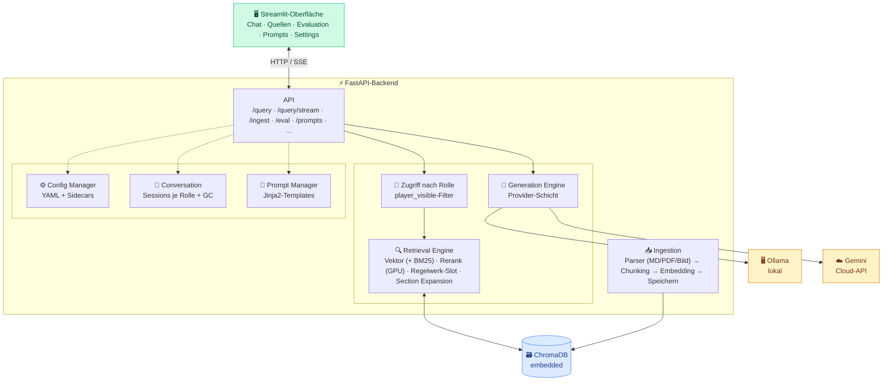
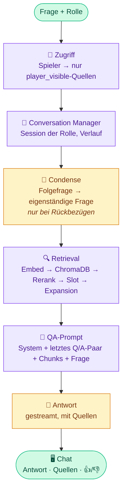

# LoreKeeper — Architektur

**RAG-basiertes Frage-Antwort-System für strukturierte Worldbuilding-Dokumente**

Stand: 2026-10-13

> Dieses Dokument beschreibt die Architektur auf Komponentenebene: wer was macht, wie die
> Teile zusammenhängen und warum. Details stehen jeweils an **einer** Stelle:
>
> | Thema | Dokument |
> |-------|----------|
> | Installation, Schnellstart, Tech Stack | [README.md](README.md) |
> | Alle Einstellungen und Umgebungsvariablen | [docs/configuration.md](docs/configuration.md) |
> | Ingestion- und Query-Pipeline als Diagramme | [docs/data-flow.md](docs/data-flow.md) |
> | Embedding, Reranking, Hybrid Search, Regelwerk-Slot — und warum | [docs/embedding-strategy.md](docs/embedding-strategy.md) |
> | Parser (Markdown/Obsidian, PDF, Bilder) | [docs/parsing.md](docs/parsing.md) |
> | Prompt-Templates und -Varianten | [docs/prompts.md](docs/prompts.md) |
> | Ollama vs. Gemini, Provider-Wechsel, Token-Zählung | [docs/provider-strategy.md](docs/provider-strategy.md) |
> | Streamlit-Oberfläche, Seiten, Session-State | [docs/ui-ux.md](docs/ui-ux.md) |
> | Golden Set und Evaluation | [docs/evaluation.md](docs/evaluation.md) |
> | Betrieb, Heimnetz, Fehlersuche, Logs | [docs/operations.md](docs/operations.md) |
> | Tests, Sicherheits- und Performance-Prüfungen | [docs/testing.md](docs/testing.md) |
> | Geplante Arbeit | [plan roadmap.md](plan%20roadmap.md) |

---

## Inhaltsverzeichnis

1. [Vision & Zielsetzung](#1-vision--zielsetzung)
2. [Systemübersicht](#2-systemübersicht)
3. [Repository-Struktur](#3-repository-struktur)
4. [Komponenten im Detail](#4-komponenten-im-detail)
   - 4.1 Ingestion-Pipeline
   - 4.2 Embedding & Vector Store
   - 4.3 Retrieval Engine
   - 4.4 Generation Engine & Provider-Abstraktion
   - 4.5 Conversation Manager
   - 4.6 Prompt Manager
   - 4.7 Config Manager
   - 4.8 Zugriff nach Rolle (Spieler / Spielleiter)
   - 4.9 API-Schicht (FastAPI)
   - 4.10 Streamlit-Oberfläche
5. [Hardware & Modelle](#5-hardware--modelle)
6. [Betrieb](#6-betrieb)
7. [Erweiterungspunkte](#7-erweiterungspunkte)
8. [Architektur-Entscheidungen](#8-architektur-entscheidungen)

---

## 1. Vision & Zielsetzung

LoreKeeper ist ein modulares Retrieval-Augmented-Generation-System (RAG), das strukturierte
Worldbuilding-Dokumente (Lore, Charaktere, Fraktionen, Orte, Regeln, Abenteuer, Simulationsberichte)
indiziert und über eine Chat-Oberfläche abfragbar macht.

### Kernziele

- Natürlichsprachliche Fragen über eine Pen-and-Paper-Welt beantworten, gestützt auf die tatsächlichen Quellen
- Quellenangabe bei jeder Antwort (Datei, Abschnitt)
- Folgefragen im Gespräch (Sliding Window für die Suche, letztes Frage/Antwort-Paar im Antwort-Prompt)
- Lokale und Cloud-LLMs (Ollama / Gemini) über eine einheitliche Provider-Schicht
- Spieler sehen nur freigegebene Quellen, Spielleiter alles
- Zentral über YAML konfigurierbar, Laufzeit-Einstellungen über die UI
- Deutsch als Primärsprache

### Nicht im Scope

- Bildinhalte analysieren (Bilder werden nur über Dateiname und Pfad indiziert, siehe Roadmap 2)
- Cloud-Deployment / Docker — LoreKeeper läuft ausschließlich lokal unter Windows
- Schreibzugriff auf die Quellen (read-only)
- Fine-Tuning von Modellen

---

## 2. Systemübersicht



### Ablauf einer Frage



Ausführliche Diagramme beider Pipelines: [docs/data-flow.md](docs/data-flow.md).

---

## 3. Repository-Struktur

```
lorekeeper/
├── config/
│   ├── settings.yaml              # Zentrale Konfiguration (versioniert)
│   ├── settings.local.yaml        # Überschreibungen der Settings-Seite (Sidecar, gitignored)
│   ├── sources.yaml               # Quellen (Sidecar, gitignored — Vorlage: sources_example.yaml)
│   ├── prompts.yaml               # Aktive Prompt-Templates
│   └── prompts/                   # Gespeicherte Prompt-Varianten (gitignored)
│
├── src/
│   ├── main.py                    # FastAPI-App, Lifespan (Modelle laden, Session-GC, Health-Schleife), Request-Log
│   ├── logging_setup.py           # Konsole + eine Logdatei pro Tag, uvicorn-Fehler in die Datei
│   ├── config/manager.py          # YAML + Env + Sidecars → Pydantic-Settings; atomic_write_text für alle Config-Dateien
│   ├── ingestion/
│   │   ├── orchestrator.py        # Parse → Chunk → Embed → Speichern (je Quelle)
│   │   ├── recategorize.py        # group/category neu setzen ohne Re-Embedding
│   │   ├── parsers/               # markdown.py · pdf.py · image.py (BaseParser)
│   │   └── chunking.py            # heading_aware | recursive | fixed_size
│   ├── retrieval/
│   │   ├── embeddings.py          # sentence-transformers (run_in_threadpool!)
│   │   ├── vectorstore.py         # ChromaDB-Zugriff
│   │   ├── bm25_index.py          # BM25 für Hybrid Search
│   │   ├── retriever.py           # Suche, Rerank, Cap, Regelwerk-Slot, Section Expansion
│   │   └── onnx_reranker.py       # Cross-Encoder auf der GPU (ONNX Runtime + DirectML)
│   ├── generation/
│   │   ├── providers/             # base.py · ollama.py · gemini.py
│   │   ├── provider_factory.py    # Config → Provider-Instanz
│   │   └── generator.py           # Prompt + LLM + Fallback
│   ├── conversation/manager.py    # Sessions je Rolle, Sliding Window, GC
│   ├── prompts/manager.py         # Jinja2-Rendering
│   └── api/
│       ├── routes.py              # bündelt die drei Router unten zu einem
│       ├── query_routes.py        # /query, /query/stream (Condense, Retrieval, Warte-Hinweis)
│       ├── sources_routes.py      # /ingest*, /sources*, /admin/wipe, /stats (Jobs, Sperre während Ingest)
│       ├── system_routes.py       # /health, /sidebar-state, /sessions, /provider*, /config, /feedback, install_llm
│       ├── background.py          # spawn_background (starke Referenz auf Job-Tasks)
│       ├── access.py              # Spieler-Filter aus player_visible
│       ├── eval_routes.py         # /eval/* (Golden Set, Preview, Eval-Jobs, Chunk-Inspector)
│       ├── prompt_routes.py       # /prompts/*
│       └── *schemas.py            # Pydantic-Request/Response-Modelle
│
├── ui/
│   ├── LoreKeeper.py              # Chat (Rollenwahl, Streaming, Quellen, 👍/👎)
│   ├── admin_gate.py              # Passwortschutz der Admin-Seiten
│   ├── roles.py                   # Spieler-/Spielleiter-Filter in der UI
│   ├── feedback.py                # Bewertungen → Golden-Set-Fragen
│   ├── backend.py                 # raise_for_status → BackendError mit dem detail des Backends (alle Seiten)
│   ├── shutdown.py                # ⏻ LoreKeeper beenden in der Sidebar (Admin) → stop.ps1
│   └── pages/                     # 1_Sources · 2_Evaluation · 3_Prompts · 4_Settings
│
├── evaluation/                    # Golden Set (274 Fragen), evaluate_retrieval.py, evaluate.py
├── tests/                         # unit · integration · ui · perf (-m perf) · live (-m live)
├── scripts/setup-lan.ps1          # Firewall-Regel für den Heimnetz-Betrieb
├── start.ps1                      # Start von Backend + UI (Entwicklung / -Server)
├── stop.ps1                       # sauberes Beenden (Strg+C an beide Fenster, nach Timeout hart)
├── chroma_data/                   # ChromaDB-Persistenz (nicht versioniert)
└── logs/                          # lorekeeper.log (+ lorekeeper.<Datum>.log je Tag), ollama.log, feedback.jsonl (nicht versioniert)
```

---

## 4. Komponenten im Detail

### 4.1 Ingestion-Pipeline

**Aufgabe:** Dokumente einlesen, parsen, in Chunks zerlegen, embedden und in ChromaDB speichern.

#### Quellen

Quellen stehen in `config/sources.yaml` (Sidecar, gitignored). Eine Quelle ist ein **Ordner** oder
eine **einzelne Datei** und gehört zu einer `group` (`lore` / `adventure` / `rules` / `simulation`) —
das sind die Filter „🗺️ Lore / 📖 Abenteuer / 📋 Regelwerk / 📊 Simulation“ im Chat. Über
`category_map` lässt sich die `group` **pro Top-Level-Ordner** überschreiben, so verteilt sich ein
Obsidian-Vault auf mehrere Gruppen. `player_visible` gibt eine Quelle für Spieler frei (4.8).
Schema und Beispiele: [docs/configuration.md](docs/configuration.md) → „Sources sidecar“.

Verwaltung per Editor, per REST (`GET/PUT /sources`, `POST /sources/{id}/reindex`,
`DELETE /sources/{id}`, `POST /sources/recategorize`, `POST /admin/wipe`) oder über die Seite
**⚙ Sources**. Source-IDs sind Freitext; die Routen nutzen den `{source_id:path}`-Converter, damit
auch IDs mit `/` funktionieren. `PUT /sources` lehnt **neue** IDs ab, die leer, `.`/`..` sind oder
mit Leerzeichen beginnen/enden.

**Recategorize** (`python -m src.ingestion.recategorize` bzw. UI-Button) überträgt geänderte
`category_map`-/`group`-Werte auf bestehende Chunks, ohne neu zu embedden.

#### Parser

Jeder Parser implementiert `BaseParser` (`can_parse()`, `parse()` → `list[ParsedDocument]`):

| Dateityp   | Parser            | Strategie |
|------------|-------------------|-----------|
| `.md`      | `MarkdownParser`  | Obsidian-Format: Frontmatter (inkl. `aliases`), Überschriften-Hierarchie, `[[Wikilinks]]` als Metadaten, `![[Bild]]` entfernen, Callouts als Text, `#Tags` extrahieren |
| `.pdf`     | `PDFParser`       | `pymupdf4llm` → Markdown, OCR (RapidOCR) für Bildbereiche, Überschriften aus dem Inhaltsverzeichnis; danach heading-aware wie Markdown |
| `.png/jpg/jpeg/webp` | `ImageMetaParser` | Dateiname + Ordnerpfad als durchsuchbarer Text (kein Bildinhalt) |

Details: [docs/parsing.md](docs/parsing.md).

#### Chunking

Standard ist `heading_aware`: jede Überschriften-Sektion wird ein Chunk; zu lange Sektionen werden
rekursiv (`\n\n` → `\n` → `. ` → ` `) mit Overlap geteilt. Tabellen sind atomar (kein Overlap,
Splits nur an Zeilengrenzen mit wiederholtem Kopf). Zu kleine Chunks werden nur **innerhalb
derselben Überschrift** mit dem Vorgänger zusammengeführt. Tokens werden mit `len(text) / 3,5`
geschätzt; `max_chunk_size: 256` ≈ 900 Zeichen hält den Embed-Text unter dem 512-Token-Limit von
`multilingual-e5-base`. Parameter: [docs/configuration.md](docs/configuration.md) → `chunking`.

#### Chunk-Metadaten

```python
{
    "source_id": "pnp-welt",                     # Quelle aus sources.yaml
    "source_file": "NPCs/Malek Nocthar.md",      # relativer Pfad
    "source_path": "C:/…/NPCs/Malek Nocthar.md",
    "document_type": "markdown",                 # markdown | pdf | image
    "heading_hierarchy": "Malek Nocthar > Kampfstil",
    "chunk_index": 3, "total_chunks": 7,
    "group": "lore",                             # Filter im Chat, Spieler-Freigabe je Quelle
    "content_category": "npc",                   # aus category_map
    "content_hash": "…",                         # SHA-256 der Quelldatei
    "obsidian_tags": "NPC, DunkleMagie",         # Listen werden als Komma-String gespeichert
    "aliases": "Malek, Der Monarch",
    "wikilinks": "Schwarzer Monolith, Schattenorden",
}
```

#### Inkrementelle Re-Ingestion

Standard (`POST /ingest`, CLI, Button **⚡ Nur Änderungen indizieren**):

1. Änderungserkennung **nur über den Content-Hash** (SHA-256) — Zeitstempel sind bei Windows-Mounts
   und externen Repos unzuverlässig. Unveränderte Dateien werden vor dem Parsen übersprungen.
2. Geänderte Dateien: neu parsen → alte Chunks löschen → neu embedden → speichern.
3. Gelöschte Dateien: verwaiste Chunks entfernen.
4. Parse-Fehler: die zuvor indizierte Version bleibt erhalten.

**Voll-Reindex** (`?full=true`, Button **🔄 Alle Dokumente neu indizieren**) ist nach Änderungen an
Chunking oder Parsern nötig — die ändern den Datei-Hash nicht. Ingestion läuft immer als
Background-Job; während ein Job läuft, antwortet `/ingest` mit 409.

---

### 4.2 Embedding & Vector Store

**Embedding-Modell** `intfloat/multilingual-e5-base`: 768 Dimensionen, 512 Tokens Kontext, gut auf
Deutsch, asymmetrisch trainiert (`"query: "` für Fragen, `"passage: "` für Dokumente — der
`EmbeddingService` setzt die Präfixe automatisch). Läuft bewusst auf der CPU; eine andere
Rechenbibliothek würde die Vektoren gegenüber dem bestehenden Index leicht verschieben.

> **Async-Regel:** `encode()` ist synchron und CPU-gebunden. Jeder Aufruf in
> `src/retrieval/embeddings.py` läuft über `run_in_threadpool`, sonst blockiert eine Anfrage den
> ganzen Event-Loop.

**Embed-Text ≠ gespeicherter Inhalt:** Embedded wird eine angereicherte Fassung (Dateiname,
Aliase, Überschriftenpfad + Inhalt), gespeichert wird der Inhalt, den später das LLM sieht.
Begründung: [docs/embedding-strategy.md](docs/embedding-strategy.md).

**ChromaDB** läuft `embedded` im FastAPI-Prozess und persistiert nach `./chroma_data`. Weil die Datenbank im
Backend-Prozess steckt, darf **kein zweiter Prozess** (z.B. die Ingestion-CLI) gleichzeitig auf
`chroma_data/` zugreifen.

---

### 4.3 Retrieval Engine

Ablauf in `Retriever.retrieve()` — alle Parameter in [docs/configuration.md](docs/configuration.md)
→ `retrieval`, die Begründungen in [docs/embedding-strategy.md](docs/embedding-strategy.md):

1. **Vektorsuche** (immer): Frage embedden, `top_k` (15) Kandidaten aus ChromaDB. Bilder sind
   ausgeschlossen. `score_threshold` (0,5) greift auf die Cosine-Scores **vor** einer Fusion.
2. **BM25** (nur Hybrid): In-Memory-Index (`rank_bm25`), lazy aus der Collection gebaut (einmal,
   auch wenn mehrere Fragen gleichzeitig kommen), nach jeder Änderung der Collection verworfen
   (Ingest, Quelle entfernen, Wipe, Recategorize). Fusion mit der Vektorsuche über Reciprocal Rank Fusion.
3. **Metadaten-Filter** (Gruppe, Quelle, Spieler-Freigabe) gehen an Vektorsuche und BM25.
4. **Regelwerk-Slot** (`rules_slot`): eine zweite, kleine Vektorsuche nur in Gruppe `rules` (5
   Kandidaten, derselbe Filter) für Fragen wie „Was bewirkt Ritterlichkeit bei Escanor?“, bei denen
   die NPC-Datei alle 15 Kandidaten belegt.
5. **Reranking** mit dem Cross-Encoder `mmarco-mMiniLMv2-L12-H384-v1` — auf der GPU über ONNX
   Runtime + DirectML (`reranking.backend: directml`, ~50 ms), sonst mit Warnung auf der CPU. Fällt
   die GPU im Betrieb aus, wechselt der Retriever mit Warnung dauerhaft auf die CPU. Das Laden des
   Modells läuft im Threadpool, nie auf dem Event-Loop.
6. **Soft-Cap je Datei** (`max_per_source`, 3): erst divers füllen, dann aus dem Überlauf
   nachfüllen, damit nie weniger als `top_k_rerank` (8) Chunks zurückkommen.
7. **Slot einlösen:** Hat es kein `rules`-Chunk in die Top-8 geschafft, ersetzt der beste
   Regelwerk-Kandidat mit Score ≥ `min_score` (−4) den schwächsten — höchstens einer, erst ab 3
   finalen Chunks.
8. **Section Expansion:** Teilen sich ≥ 2 Treffer einer Datei eine Eltern-Überschrift mit
   verschiedenen Unter-Überschriften und liegt einer davon unter den ersten `top_rank` (3), wird die
   ganze Sektion (bis `max_chunks`, 25) in Dokumentreihenfolge eingesetzt.

`top_k`, `top_k_rerank`, `max_per_source` und `hybrid_search` sind pro Anfrage überschreibbar.

---

### 4.4 Generation Engine & Provider-Abstraktion

Alle Provider implementieren `BaseLLMProvider`:

```python
class BaseLLMProvider(ABC):
    provider: str = "unknown"
    model: str                       # im __init__ setzen (kein Default)

    @abstractmethod
    async def generate(self, prompt: str, **kwargs) -> LLMResponse: ...

    @abstractmethod
    def generate_stream(self, prompt: str, system_prompt: str = "",
                        stream_result: StreamResult | None = None, **kwargs) -> AsyncGenerator[str, None]:
        """Liefert Token für Token; schreibt die Token-Zählung in stream_result.usage."""

    @abstractmethod
    async def health_check(self) -> bool: ...
```

`generate_stream` ist im Interface ein normales `def`; Implementierungen sind `async def` mit
`yield`. `StreamResult` ist ein Kontext pro Aufruf: der Provider füllt `usage`, der `Generator`
setzt `model` auf das Modell, das tatsächlich geantwortet hat (nach einem Fallback das
Fallback-Modell).

- **Ollama** über die OpenAI-kompatible API (`/v1/chat/completions`), Standardmodell `qwen3:14b`;
  für Qwen3 wird das Denken mit `reasoning_effort: "none"` abgeschaltet.
- **Gemini** über das `google-genai`-SDK. API-Key-Reihenfolge: Laufzeit-Override aus der UI
  (`POST /provider/gemini/key`, nur im Prozess, nie auf Platte) → Umgebungsvariable → `.env`.
  `GET /provider/gemini/status` verrät nie den Key selbst.
- **ProviderFactory** baut aus der Config Provider, Condense-Provider und Generator zusammen (`build_all`);
  Wechsel zur Laufzeit über `POST /provider`, Gemini-Key und Fallback-Schalter bauen über denselben
  Weg (`install_llm`) alle drei neu.
- **Fallback** (`llm.fallback_enabled`): schlägt der Hauptprovider vor dem ersten Token fehl,
  antwortet der Fallback-Provider.
- **`condense_model`**: optional ein zweites, schnelleres Ollama-Modell nur für das Umschreiben von
  Folgefragen (immer Ollama, gleiche `base_url`).

Vergleich, Kosten und Token-Zählung: [docs/provider-strategy.md](docs/provider-strategy.md).

---

### 4.5 Conversation Manager

Sessions liegen im Speicher (Dict, Session-ID als Schlüssel) und überleben keinen Neustart.

- **Sessions sind an ihre Rolle gebunden:** Kommt eine Spieler-Anfrage mit der ID einer
  Spielleiter-Session, bekommt sie eine **neue** Session — kein Spielleiter-Verlauf in Folgefragen
  eines Spielers.
- **Sliding Window** (`window_size`, 8 Paare, hart begrenzt durch `max_context_tokens`) speist nur
  den **Condense**-Schritt: Folgefragen mit Rückbezug („Welche Feinde hat er?“) werden zu einer
  eigenständigen Frage umgeschrieben, bevor gesucht wird. Eigenständige Fragen gehen unverändert in
  die Suche (`needs_condense()`); die gesuchte Frage steht als `search_query` in der Antwort.
- **Verlauf im Antwort-Prompt:** Der QA-Prompt bekommt nur das **letzte** Frage/Antwort-Paar
  (`answer_history_pairs: 1`, Antwort auf 1500 Zeichen gekürzt), vor den Quellen und als „keine
  Quelle“ markiert — genug für „fass das kürzer zusammen“, ohne dass ältere (evtl. halluzinierte)
  Antworten die Quellen verwässern.
- **Garbage Collection:** Ein `asyncio`-Task im FastAPI-Lifespan entfernt alle
  `session_gc_interval_seconds` die Sessions, die länger als `session_timeout_minutes` inaktiv sind.
  Ohne ihn wäre das Timeout wirkungslos und der Speicher würde volllaufen.

---

### 4.6 Prompt Manager

Vier Jinja2-Templates in `config/prompts.yaml`: `system` (Rolle, Sprache, Antwortformat), `qa`
(Verlauf + Chunks + Frage), `condense` (Verlauf + Folgefrage → eigenständige Frage) und
`no_context` (keine Treffer). Bearbeiten, Varianten speichern/vergleichen/aktivieren über die
Seite **✏ Prompts** oder `/prompts/*` — Änderungen greifen sofort (Hot-Reload, der globale
`PromptManager` wird ersetzt). Templates, Variablen und Gestaltungsregeln:
[docs/prompts.md](docs/prompts.md).

---

### 4.7 Config Manager

Lädt und validiert die Konfiguration mit Pydantic-Settings. Reihenfolge (höchste zuerst):

1. Umgebungsvariablen (verschachtelt mit `__`, z.B. `LLM__OLLAMA__MODEL`) — für `GEMINI_API_KEY`
   zusätzlich der Laufzeit-Override aus der UI
2. `.env`
3. `config/settings.local.yaml` — schreibt die Settings-Seite; `settings.yaml` wird nie umgeschrieben
4. `config/settings.yaml`

Welche Werte die UI ändern darf, legt eine Allow-List fest (`_EDITABLE_KEYS`); Änderungen werden
auf die laufenden Dienste angewendet, ohne Neustart. Quellen kommen aus dem Sidecar
`config/sources.yaml`; fehlt die Datei, startet LoreKeeper ohne Quellen (Warnung im Log).
Alle Schlüssel und Variablen: [docs/configuration.md](docs/configuration.md).

---

### 4.8 Zugriff nach Rolle (Spieler / Spielleiter)

Spieler nutzen LoreKeeper am Tisch (z.B. am Handy) und dürfen keine Spielleiter-Geheimnisse sehen.

- **Zentral gesteuert** über `player_visible` je Quelle in `sources.yaml` (Spalte „🎲 Spieler“
  auf der Sources-Seite).
- **Im Backend erzwungen** (`src/api/access.py`): `/query`, `/query/stream` und `/eval/preview`
  nehmen `role` entgegen. Für `player` baut das Backend selbst den Filter
  `source_id ∈ player_visible` und verknüpft mitgeschickte Filter per `$and` — sie können nur
  einengen, nie erweitern. Ohne freigegebene Quelle → 403; nicht unterstützte Filter (alles außer
  `$eq`/`$ne`/`$in`/`$and`) → 422, für beide Rollen. Default ist `game_master` (CLI,
  Eval-Tools); wird die API je außerhalb von `127.0.0.1` erreichbar, muss der Default auf
  `player` oder eine Authentifizierung her.
- **Jeder Suchweg** trägt den Filter: Vektorsuche, BM25, die Suche des Regelwerk-Slots und das
  Nachladen der Section Expansion (`get_chunks_for_file(..., where)`). Ein Spy-Test prüft das für
  jeden Store-Zugriff einer Spieler-Anfrage — ein neuer Suchweg ohne Filter fällt dort auf, auch wenn
  die Testdaten zufällig dicht wären.
- **Die UI** schickt `role` und zusätzlich ihren eigenen Filter als zweite Sicherung; Sessions sind
  rollengebunden (4.5).
- Es ist ein Spoiler-Schutz, keine Zugangskontrolle: die Rolle wählt jeder selbst. Die Admin-Seiten
  schützt ein Passwort (`LOREKEEPER_ADMIN_PASSWORD`, `ui/admin_gate.py`).

Sicherheitstests: [docs/testing.md](docs/testing.md#sicherheitsprüfungen-spieler-modus-admin-login).

---

### 4.9 API-Schicht (FastAPI)

Das Backend lauscht nur auf `127.0.0.1:8000`; der Browser spricht ausschließlich mit Streamlit.

| Methode | Endpoint | Beschreibung |
|---------|----------|--------------|
| POST   | `/query`                    | Frage stellen, Antwort + Quellen (synchron). Felder: `question`, `session_id`, `role`, `metadata_filters`, `top_k`, `top_k_rerank`, `max_per_source`, `hybrid_search` |
| POST   | `/query/stream`             | Wie `/query`, Antwort als SSE-Stream (siehe unten) |
| POST   | `/feedback`                 | 👍/👎 zu einer Antwort → Zeile in `logs/feedback.jsonl` (letzte Zeile je `message_id` gilt) |
| GET    | `/feedback`                 | Aktuelle Bewertung je Antwort, neueste zuerst |
| POST   | `/ingest`                   | Ingestion-Job starten (inkrementell; `?full=true` = alles). 409, solange ein Job läuft |
| GET    | `/ingest/status/{job_id}`   | Fortschritt eines Jobs |
| GET    | `/ingest/active`            | Laufender Job oder `null` |
| GET    | `/sources`                  | Konfigurierte Quellen |
| PUT    | `/sources`                  | Quellenliste ersetzen → `sources.yaml` |
| POST   | `/sources/scan`             | Pfad scannen (für „Quelle hinzufügen“) |
| GET    | `/sources/{id}/folders`     | Top-Level-Einträge einer Quelle |
| POST   | `/sources/{id}/reindex`     | Quelle komplett neu indizieren (Job, `full`, ohne vorheriges Löschen — bleibt durchsuchbar) |
| DELETE | `/sources/{id}`             | Quelle und ihre Chunks entfernen |
| POST   | `/sources/recategorize`     | `group`/`category` neu setzen (ohne Re-Embedding) |
| POST   | `/admin/wipe`               | Collection leeren (Body `{"confirm": "DELETE"}`) |
| —      | Sperre während eines Ingests | `DELETE /sources/{id}`, `/admin/wipe`, `/sources/recategorize`, `/eval/run` und `/eval/search-exactness` antworten mit 409 „Eine Indexierung läuft bereits“ |
| GET/POST | `/provider`               | Aktiver Provider / zur Laufzeit wechseln (`provider`: `ollama` oder `gemini`, sonst 422) |
| GET    | `/provider/gemini/status`   | Ob ein Gemini-Key da ist (ohne den Key) |
| POST   | `/provider/gemini/key`      | Gemini-Key zur Laufzeit setzen (nur im Prozess) |
| GET    | `/sidebar-state`            | Gebündelter Status für die Chat-Sidebar |
| GET    | `/health`                   | API + ChromaDB + LLM, dazu `reranker`: `gpu` · `cpu` · `cpu_fallback` (DirectML konfiguriert, läuft aber auf der CPU) · `not_loaded` · `off` |
| GET/DELETE | `/sessions/{id}`        | Session-Verlauf lesen / löschen |
| GET    | `/stats`                    | Chunk-Anzahl |
| GET/PUT | `/config`                  | UI-editierbare Settings lesen / Teil-Update (→ `settings.local.yaml`, live angewendet) |
| GET/PUT | `/eval/qa-pairs`           | Golden Set lesen / speichern |
| POST   | `/eval/preview`             | Eine Frage gegen den Retriever (ohne LLM), mit `role`; weggelassene `top_k`/`top_k_rerank`/`max_per_source` = Wert aus `settings.yaml` |
| GET    | `/eval/chunks/files`        | Indizierte Dateien einer Quelle (Chunk-Inspector) |
| GET    | `/eval/chunks`              | Alle Chunks einer Datei in Dokumentreihenfolge |
| POST   | `/eval/search-exactness`    | Vektorsuche gegen exakte Suche über alle Golden-Fragen (gleicher Filter und `top_k` wie im Chat; nur lesend; 409 während eines Ingests) |
| POST   | `/eval/run`                 | Retrieval- oder End-to-End-Eval als Job (`eval_type`: `retrieval` oder `e2e`, sonst 422; Parameter wie `/eval/preview`) |
| GET    | `/eval/status/{job_id}`     | Fortschritt eines Eval-Jobs |
| GET/DELETE | `/eval/results[/{file}]` | Ergebnisse auflisten / lesen / löschen |
| GET/PUT | `/prompts/active`          | Aktive Prompts lesen / speichern (Hot-Reload) |
| GET/PUT/DELETE | `/prompts/variants[/{name}]` | Varianten |
| POST   | `/prompts/activate/{name}`  | Variante aktivieren |
| POST   | `/prompts/preview`          | Template mit Beispieldaten rendern |

Fehlermeldungen im `detail` einer Antwort sind deutsch (die UI zeigt sie an), Logs bleiben englisch.
Ungültige Werte in Feldern mit fester Auswahl (`role`, `provider`, `eval_type`) lehnt das Schema mit
422 ab.

**SSE-Format von `/query/stream`:**

```
data: {"type": "status", "content": "..."}                      (optional, vor dem ersten Token)
data: {"type": "token", "content": "..."}                       (je Token)
data: {"type": "done", "session_id": "...", "sources": [...], "model_used": "...",
       "search_query": "...", "timings": {...}, "usage": {...}, "session_usage": {...}}
data: {"type": "error", "content": "..."}                       (bei Abbruch)
```

- `status`: deutscher Hinweis, wenn die Antwort auf andere warten muss (Ollama beantwortet eine Frage
  nach der anderen, `OLLAMA_NUM_PARALLEL=1`; Messung und Entscheidung: [provider-strategy.md](docs/provider-strategy.md)). Nur bei Ollama.
- `session_id` kommt im `done`-Event — ohne sie kann der Client keine Folgefrage zuordnen.
- `model_used` ist das Modell, das tatsächlich geantwortet hat (nach Fallback das Fallback-Modell).
- `timings`: Dauer je Stufe in ms (`condense_ms`, `retrieval_ms` mit Stufen embed/search/bm25/rerank/expand,
  `first_token_ms`, `total_ms`), Chunk-Anzahl, Prompt-Größe — auch als Log-Zeile `Query timings: …`.
- `usage` / `session_usage`: Tokens dieser Anfrage / kumuliert für die Session.
- Jede Quelle hat ein `document_type`; nur bei `image` rendert die UI ein Bild.

---

### 4.10 Streamlit-Oberfläche

Die UI spricht über HTTP/SSE mit dem Backend und importiert keine Backend-Module.

- **Chat** (`ui/LoreKeeper.py`): Rollenwahl, gestreamte Antworten, Quellen nach Datei gruppiert,
  Token-Anzeige, Zeiten unter jeder Antwort, 👍/👎.
- **⚙ Sources**: Quellen anlegen/bearbeiten, Spieler-Freigabe, Indizieren mit nicht-blockierendem
  Fortschritt, Reindex/Recategorize/Entfernen je Quelle.
- **🎯 Evaluation**: Golden Set, „Frage testen“, Retrieval- und End-to-End-Eval, Ergebnisse,
  Feedback → Golden Set, Chunk-Inspector.
- **✏ Prompts**: Templates bearbeiten, Varianten, Vergleich.
- **🛠 Settings**: Retrieval-, LLM-, Gesprächs- und Chunking-Einstellungen ohne Neustart.

Alles im Detail (Widgets, Caching, Session-State): [docs/ui-ux.md](docs/ui-ux.md).

---

## 5. Hardware & Modelle

Referenzsystem (Gaming-PC): AMD Ryzen 5 5600X (6 Kerne), 32 GB RAM, AMD Radeon RX 9070 XT (16 GB VRAM).

| Teil | Läuft auf | Modell | Kennzahl |
|------|-----------|--------|----------|
| LLM | GPU (Ollama) | `qwen3:14b`, Kontext 16k (`OLLAMA_CONTEXT_LENGTH=16384`), `OLLAMA_KEEP_ALIVE=1h` | ~11 GB VRAM, erster Token ~1 s, Antwort ~3–4 s |
| Reranker | GPU (ONNX Runtime + DirectML) | `mmarco-mMiniLMv2-L12-H384-v1` | ~50 ms für 15 Paare (CPU: ~840 ms, unter Last ~14 s) |
| Embedding | CPU | `multilingual-e5-base` | ~0,08 s pro Frage |
| Fallback | Cloud | Gemini `gemini-2.5-flash` | nur bei Bedarf — kostenpflichtig, Budgets stoppen nicht automatisch |

**AMD-Hinweise:** CUDA gibt es nur für NVIDIA. PyTorch mit ROCm unter Windows liefert auf der
RX 9070 XT derzeit stillschweigend Nullen ([embedding-strategy.md](docs/embedding-strategy.md) → Cross-Encoder) — deshalb läuft der Reranker über
DirectML und das Embedding auf der CPU. Ollama nutzt die Karte direkt.

Modell wechseln: `ollama pull <modell>`, dann `llm.ollama.model` in der Settings-Seite bzw.
`settings.yaml` oder `LLM__OLLAMA__MODEL=<modell>` setzen.

---

## 6. Betrieb

LoreKeeper läuft ausschließlich lokal unter Windows; ChromaDB steckt im Backend-Prozess.

- **Installation und Start:** [README.md](README.md) → Schnellstart. `.\start.ps1` startet Backend
  und UI für die Entwicklung, `.\start.ps1 -Server` für den Heimnetz-Betrieb (UI im LAN, Backend
  bleibt auf `127.0.0.1`, kein Auto-Reload). Bewusst **kein Autostart**.
- **Heimnetz, Passwort, Firewall, Fehlersuche, Logs:** [docs/operations.md](docs/operations.md).
- **Evaluation:** Golden Set mit 274 Fragen, `evaluate_retrieval.py` (ohne LLM, ~1 min) und
  `evaluate.py` (mit LLM) — [docs/evaluation.md](docs/evaluation.md).

---

## 7. Erweiterungspunkte

| Erweiterung | Vorgehen |
|-------------|----------|
| Neuer Parser | `BaseParser` implementieren, im Orchestrator registrieren |
| Neuer LLM-Provider | `BaseLLMProvider` implementieren (`generate_stream` als `async def` mit `yield`, `usage` in `stream_result`), `self.model` setzen, in `ProviderFactory` registrieren |
| Neue Quellengruppe | `SourceGroup` in `src/config/manager.py`, Filter in Chat-Sidebar und Sources-Seite |
| Neues Prompt-Template | Schlüssel in `prompts.yaml`, Render-Methode im `PromptManager` |
| Anderer Reranker | Modell in `reranking.model`; für die GPU braucht es einen ONNX-Export (`onnx/model.onnx`) |

Geplante Arbeit: [plan roadmap.md](plan%20roadmap.md).

---

## 8. Architektur-Entscheidungen

Aus dem Architektur-Review vom 13.10. (Agent über die ganze Codebasis, Befunde selbst nachgeprüft).
Maßstab: ein Umbau muss ein konkretes Problem lösen — Testbarkeit, Sicherheit des Spieler-Filters,
Nebenläufigkeit, Übersicht —, keine Abstraktion für Einmal-Logik.

**So bleibt es, weil es trägt:**
- **Dienste als Modul-Globale in `src.main`**, pro Anfrage über `import src.main as main_module`
  gelesen. Der Provider-Wechsel ist trotzdem atomar: `install_llm()` setzt Provider,
  Condense-Provider und Generator ohne `await` dazwischen, laufende Anfragen arbeiten mit ihrem
  Schnappschuss weiter.
- **Spieler-Filter als Konvention plus Prüfung statt Wrapper**: jeder Suchweg reicht `where` durch,
  ein Spy-Test verlangt die Einschränkung in jedem Store-/BM25-Zugriff einer Spieler-Anfrage
  ([testing.md](docs/testing.md#sicherheitsprüfungen-spieler-modus-admin-login)). Ein
  `FilteredVectorStore` wird erst sinnvoll, wenn eine neue Art Suchweg dazukommt (z.B. Wikilink-Expansion).
- **Zwei In-Memory-Job-Listen** (Ingest, Eval) ohne Aufräumen: wenige Einträge am Tag, weg beim
  Neustart; Starts sind atomar. Was fehlte, war die Sperre *zwischen* ihnen (jetzt: 409 während eines Ingests).
- **Retriever als ein Modul**: Suche, Fusion, Rerank, Deckel, Slot und Expansion hängen eng
  zusammen; nur Reranker + GPU-Rückfall wären ein eigener Baustein (optional, mit Feature-Arbeit).

**Bewusst nicht** (Kosten ohne gelöstes Problem): DI-Container über FastAPI `Depends`/`app.state`
(35 Stellen, löst nichts, was `install_llm` nicht löst); generische Job-Registry; Prompt-Varianten im
`ConfigManager`; Retriever in Pipeline-Klassen zerlegen; LLM-Warteschlange (Ollama serialisiert
selbst, der Chat zeigt den Hinweis); UI-Seiten aufteilen (AppTest testet pro Seitendatei);
typisierter API-Client in der UI (`ui/backend.py` mit `raise_for_status`/`get_json` reicht).

**Bewusste Grenze — Vertrauen in den Aufrufer**: Das Backend glaubt dem Client die Rolle (Default
`game_master`), und `/sessions`, `/feedback`, `/eval/*`, `/sources/*` haben keinen eigenen Login.
Das reicht, solange nur der Streamlit-Prozess `127.0.0.1:8000` erreicht (der Admin-Schutz sitzt in
der UI). Wird die API je selbst erreichbar (Internet-Zugriff, weiterer Client), muss vorher der
Default auf `player` oder eine Authentifizierung her.

