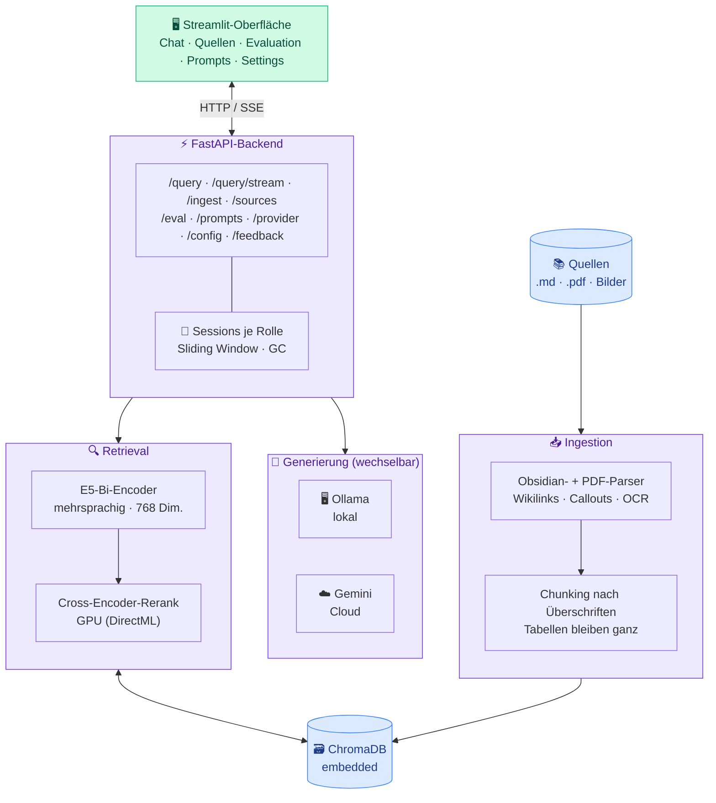

# LoreKeeper


**RAG-System für Pen-and-Paper-Welten in Obsidian.**

Stell Fragen zu deiner Kampagne — NPCs, Orte, Regeln, Abenteuer, Gegenstände, Götter — und
bekomm Antworten, die auf deinen Quellen beruhen, mit Quellenangabe. Läuft komplett lokal über
Ollama oder in der Cloud über Google Gemini; der Provider lässt sich zur Laufzeit wechseln.

<!-- TODO: echten Screenshot/GIF einfügen -->
<!--  -->

---

## Warum LoreKeeper?

Pen-and-Paper-Runden sammeln Hunderte Markdown-Dateien in einem Obsidian-Vault: NPCs, Orte,
Fraktionen, Regeln, Sitzungsnotizen. Allgemeine RAG-Tools behandeln das als flachen Text,
übersehen die Struktur, die Obsidian hinzufügt (Wikilinks, Aliase, Callouts, Tags), und mischen
munter eine Regelwerk-Klasse mit einem gleichnamigen Lore-NPC.

LoreKeeper ist für genau diesen Ablauf gebaut:

- **Obsidian-nativ** — Wikilinks, `![[Einbettungen]]`, `> [!Callouts]`, `#Tags` und Aliase aus
  dem Frontmatter werden als durchsuchbare Metadaten erfasst.
- **PDF mit OCR und Struktur** — OCR über RapidOCR, Überschriften aus dem Inhaltsverzeichnis,
  Bildextraktion.
- **Quellen nach Gruppen** — jeder Chunk erbt eine `group` (`lore` / `adventure` / `rules` /
  `simulation`). Die Filter 🗺️ Lore, 📖 Abenteuer, 📋 Regelwerk und 📊 Simulation schränken die
  Suche direkt in der Datenbank ein: Wer „Was kann der Zeitmagier?“ nur im Regelwerk sucht,
  bekommt nicht den NPC *Arkenfeld, den Zeitmagier* in den Kontext.
- **Spieler- und Spielleiter-Modus** — Spieler durchsuchen nur freigegebene Quellen (z.B. das
  Regelwerk); das Backend erzwingt das selbst. Spielleiter-Geheimnisse bleiben verborgen.
- **Mehrstufige Suche** — mehrsprachiger E5-Bi-Encoder für die Kandidaten, Cross-Encoder-Reranking
  (auf der GPU, auch AMD) für die Reihenfolge, ein weicher Deckel pro Datei für Vielfalt, ein
  Regelwerk-Platz für Fragen wie „Was bewirkt Ritterlichkeit bei Escanor?“ und das Nachladen
  ganzer Abschnitte bei Aufzählungsfragen.
- **Ehrliches Chunking** — Abschnitte entlang der Überschriften, Tabellen bleiben ganz, kleine
  Chunks werden nur mit Nachbarn derselben Überschrift zusammengelegt.
- **Identitäts-Schicht** — Dateiname und Aliase stehen vor jedem Chunk im Embedding; auch eine
  Werte-Tabelle ohne Namensnennung wird zum richtigen NPC gefunden.
- **Zwei Provider** — Ollama für Datenschutz und Kosten, Gemini als Ausweichlösung.
- **Echtes Streaming und Folgefragen** — Antworten Token für Token, Folgefragen werden für die
  Suche umgeschrieben, das letzte Frage/Antwort-Paar steht im Antwort-Prompt („fass das kürzer
  zusammen“).
- **Antworten im Telegram-Stil** — kurze Absätze, Emoji-Überschriften, Listen, Quellenangaben;
  am Handy am Spieltisch gut lesbar.

Gebaut für deutschsprachige Inhalte (Prompts und Kategorien sind deutsch); das mehrsprachige
Embedding-Modell funktioniert aber auch mit anderen Sprachen.

---

## Funktionen

| | |
|---|---|
| 🧠 **Hybride Suche** | E5-Vektorsuche + optional BM25 (Reciprocal Rank Fusion), Cross-Encoder-Reranking, Deckel pro Datei, Regelwerk-Slot, Section Expansion |
| ⚡ **Reranking auf der GPU** | ONNX Runtime + DirectML auf jeder DX12-Karte (auch AMD), CPU als Rückfall |
| 🎲 **Spieler-/Spielleiter-Modus** | Spieler sehen nur freigegebene Quellen — im Backend erzwungen, Sessions je Rolle |
| 🔀 **Zwei LLM-Provider** | Ollama (lokal) ↔ Gemini (Cloud), Wechsel zur Laufzeit |
| 📜 **Obsidian-nativ** | Wikilinks, Callouts, Einbettungen, Tags, Aliase |
| 📄 **PDF mit OCR** | RapidOCR, Überschriften aus dem Inhaltsverzeichnis, Bildextraktion |
| 🎯 **Filter nach Gruppe** | Lore / Abenteuer / Regelwerk / Simulation |
| 🌊 **SSE-Streaming** | Token für Token, Quellen im Abschluss-Event |
| 💬 **Folgefragen** | Umschreiben für die Suche, letztes Frage/Antwort-Paar im Antwort-Prompt, automatische Session-Bereinigung |
| 👍 **Antwort-Feedback** | Antworten im Chat bewerten; Bewertungen werden zu Golden-Set-Fragen |
| 📊 **Token-Anzeige** | Pro Nachricht und pro Session (rein / raus / Denken) |
| 🔁 **Inkrementelles Indizieren** | SHA-256-Hash pro Datei — nur Geändertes wird neu embedded |
| ✏ **Prompt-Verwaltung** | Prompts bearbeiten, Varianten speichern und vergleichen, sofort wirksam |
| 🛠 **Einstellungen live** | Retrieval-, LLM-, Gesprächs- und Chunking-Werte über die Settings-Seite, ohne Neustart |
| 🎯 **Evaluation** | Golden Set (278 Fragen), Retrieval- und End-to-End-Eval, Chunk-Inspector |
| ✅ **707 Tests**, 93 % Abdeckung (13.10.) | Unit, API-Integration, UI (Streamlit AppTest), Sicherheit; dazu Performance- und Live-Prüfungen |

---

## Architektur



Komponenten, Abläufe und Entscheidungen: [**ARCHITECTURE.md**](ARCHITECTURE.md).

---

## Schnellstart (lokal, Windows)

Voraussetzungen: Windows, Python 3.11+ (`winget install Python.Python.3.12`),
[Ollama für Windows](https://ollama.com/download) (startet mit Windows), Git.

1. **Repository und virtuelle Umgebung**
   ```powershell
   git clone https://github.com/FabianHentrich/lorekeeper.git
   cd lorekeeper
   python -m venv .venv
   .venv\Scripts\activate
   pip install -r requirements.txt
   # GPU-Reranker (DirectML): chromadb & Co. ziehen zusätzlich das normale onnxruntime, das
   # denselben Ordner onnxruntime/ belegt und DirectML verdeckt — entfernen, dann DirectML zurückholen:
   pip uninstall -y onnxruntime
   pip install --force-reinstall --no-deps onnxruntime-directml
   ```
   Prüfen: `python -c "import onnxruntime; print(onnxruntime.get_available_providers())"` muss
   `DmlExecutionProvider` enthalten. Die zwei Zeilen nach **jedem** `pip install -r requirements.txt`
   wiederholen. Ohne DirectML läuft der Reranker mit einer Warnung im Log auf der CPU.

2. **LLM-Modell holen**
   ```powershell
   ollama pull qwen3:14b
   ```
   Empfohlen als Benutzer-Umgebungsvariablen für Ollama: `OLLAMA_CONTEXT_LENGTH=16384` (sonst wird
   der Prompt bei großen Antworten abgeschnitten) und `OLLAMA_KEEP_ALIVE=1h` (kein Nachladen nach
   5 Minuten Pause). Hält die Ollama-App ihre Modelle in einem eigenen Ordner, zusätzlich
   `OLLAMA_MODELS` auf diesen Ordner — sonst findet ein von LoreKeeper gestartetes Ollama sie nicht.

3. **Konfigurieren**
   ```powershell
   copy .env.example .env
   ```
   `GEMINI_API_KEY` nur für Gemini; `LOREKEEPER_ADMIN_PASSWORD` schützt die Admin-Seiten (Pflicht,
   sobald andere im Heimnetz zugreifen). Quellen in der UI anlegen oder `config/sources.yaml`
   schreiben (Vorlage `config/sources_example.yaml`). Alle Einstellungen:
   [docs/configuration.md](docs/configuration.md).

4. **Modelle vorab laden** *(empfohlen — sonst lädt der erste Start ~1,6 GB herunter)*
   ```powershell
   python -c "from sentence_transformers import SentenceTransformer, CrossEncoder; SentenceTransformer('intfloat/multilingual-e5-base'); CrossEncoder('cross-encoder/mmarco-mMiniLMv2-L12-H384-v1'); print('Fertig.')"
   ```
   Der ONNX-Export des Rerankers (`onnx/model.onnx`, ~450 MB) wird beim ersten Start mit
   `backend: directml` automatisch nachgeladen. Alles liegt danach in `~/.cache/huggingface/hub/`.

5. **Backend und UI starten**
   ```powershell
   .\start.ps1            # Entwicklung: Auto-Reload, UI nur auf diesem PC
   .\start.ps1 -Server    # Heimnetz: UI im LAN erreichbar, kein Auto-Reload (docs/operations.md)
   .\stop.ps1             # sauber beenden (oder ⏻ LoreKeeper beenden in der UI-Sidebar)
   ```
   Die UI läuft dann unter **http://127.0.0.1:8501**. Ohne Skript: `uvicorn src.main:app --reload
   --port 8000` und in einem zweiten Terminal `streamlit run ui/LoreKeeper.py`.

6. **Quellen indizieren**
   In der UI **⚙ Sources** öffnen und **⚡ Nur Änderungen indizieren** klicken — der erste Lauf
   indiziert alles, spätere nur Neues und Geändertes. **🔄 Alle Dokumente neu indizieren**
   verarbeitet jede Datei (nötig nach Chunking-Änderungen).

   Die CLI macht dasselbe, aber nur bei **gestopptem** Backend (die eingebettete ChromaDB sperrt
   `chroma_data/`):
   ```powershell
   python -m src.ingestion.orchestrator
   ```

Weiter: Bedienung → [docs/ui-ux.md](docs/ui-ux.md) · Betrieb und Fehlersuche →
[docs/operations.md](docs/operations.md) · Gemini → [docs/provider-strategy.md](docs/provider-strategy.md).

---

## Screenshots

<!-- TODO: Screenshots nach docs/images/ legen und einkommentieren -->
<!--
| Chat mit Streaming | Quellenfilter |
|---|---|
|  |  |
-->

---

## Dokumentation

| Dokument | Inhalt |
|----------|--------|
| [ARCHITECTURE.md](ARCHITECTURE.md) | Einstieg: Komponenten, Abläufe, API, Rollen, Hardware |
| [docs/configuration.md](docs/configuration.md) | Alle Einstellungen, `sources.yaml`, Umgebungsvariablen, UI-Allow-List |
| [docs/data-flow.md](docs/data-flow.md) | Ingestion- und Query-Pipeline als Diagramme |
| [docs/embedding-strategy.md](docs/embedding-strategy.md) | Embedding, Reranking, Hybrid Search, Regelwerk-Slot — und **warum** |
| [docs/parsing.md](docs/parsing.md) | Markdown (Obsidian), PDF (OCR, Überschriften, Bilder), Bild-Parser |
| [docs/prompts.md](docs/prompts.md) | Prompt-Templates, Variablen, Varianten |
| [docs/provider-strategy.md](docs/provider-strategy.md) | Ollama vs. Gemini, Wechsel, Fallback, Token-Zählung |
| [docs/ui-ux.md](docs/ui-ux.md) | Alle Seiten der Oberfläche im Detail |
| [docs/evaluation.md](docs/evaluation.md) | Golden Set, Eval-Skripte, Kennzahlen, Vorgehen |
| [docs/operations.md](docs/operations.md) | Indizieren, Heimnetz-Betrieb, Fehlersuche, Logs |
| [docs/testing.md](docs/testing.md) | Testsuite, Sicherheits- und Performance-Prüfungen |
| [plan roadmap.md](plan%20roadmap.md) | Geplante und erledigte Arbeit (ersetzt ein Changelog; Details in `git log`) |

---

## Tech Stack

| Schicht | Technik |
|---------|---------|
| Backend | FastAPI + Pydantic v2 |
| UI | Streamlit |
| Embeddings | sentence-transformers (`intfloat/multilingual-e5-base`, 768 Dim., asymmetrisch), CPU |
| Reranker | `cross-encoder/mmarco-mMiniLMv2-L12-H384-v1` — ONNX Runtime + DirectML auf der GPU, sentence-transformers auf der CPU als Rückfall |
| Vektordatenbank | ChromaDB (embedded) + `rank_bm25` für Hybrid Search |
| LLM | Ollama (`qwen3:14b`) oder Google Gemini (`gemini-2.5-flash`) |
| Prompts | Jinja2 + YAML |
| OCR | RapidOCR (`rapidocr_onnxruntime`) |
| Tests | pytest, pytest-asyncio, httpx, Streamlit AppTest; ChromaDB `EphemeralClient` |
| Code-Qualität | ruff + mypy, laufen als Teil von `pytest` |

---

## Grenzen

- **Deutsch zuerst.** Prompts und Kategorien sind deutsch; für andere Sprachen müssten die
  Templates in `config/prompts.yaml` übersetzt werden.
- **Lokal, ein Haushalt.** Gedacht für einen PC im Heimnetz. Admin-Seiten sind per Passwort
  geschützt, die Spieler-/Spielleiter-Wahl ist ein Spoiler-Schutz, keine Benutzerverwaltung.
  Sessions liegen im Speicher und überleben keinen Neustart.
- **Nur Windows**, kein Docker.
- **Bilder** werden nur über Dateiname und Pfad gefunden, nicht über ihren Inhalt.
- **`.tex`-Dateien** werden nicht gelesen — nur `.md`, `.pdf` und Bilder.

---

## Lizenz

MIT © 2026 Fabian Hentrich
