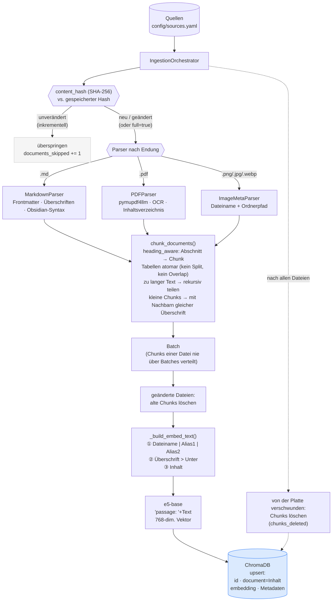
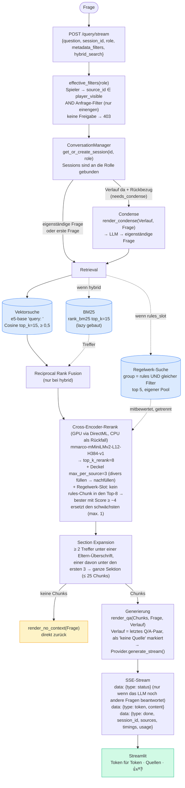
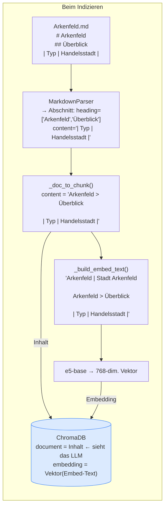
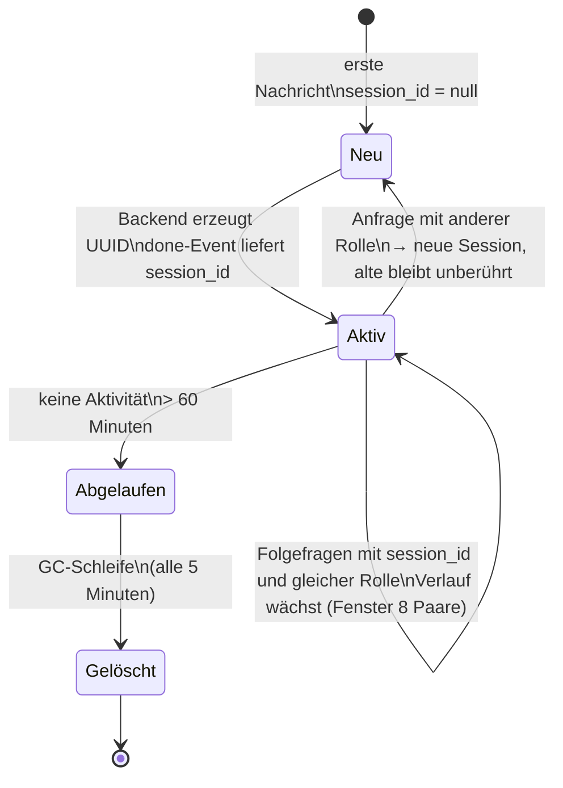
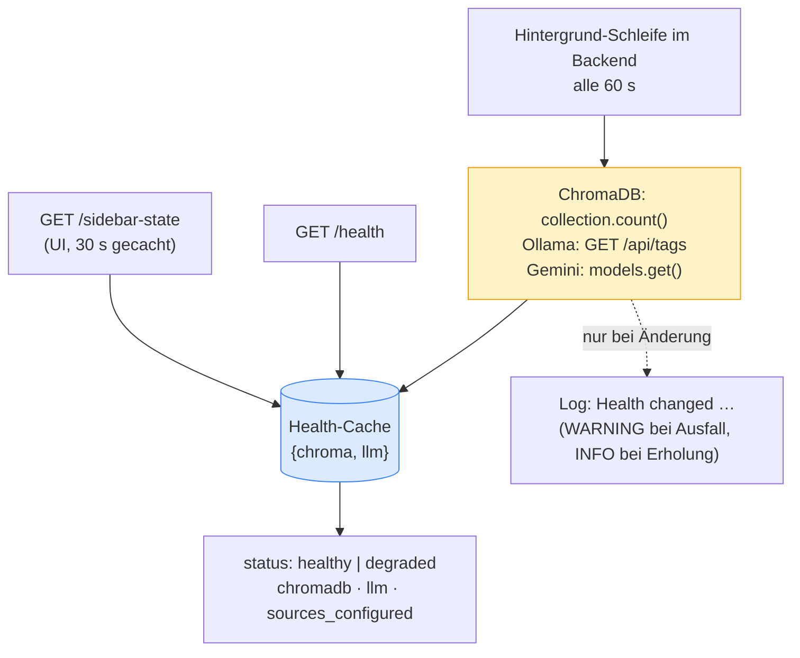

# Datenfluss

Die Abläufe von LoreKeeper als Mermaid-Diagramme: Ingestion, Beantwortung einer Frage,
Embed-Text vs. gespeicherter Inhalt, Lebenszyklus einer Session und Health-Check. Begründungen
für die einzelnen Stufen: [embedding-strategy.md](embedding-strategy.md); Parameter:
[configuration.md](configuration.md).

## Inhaltsverzeichnis
1. [Ingestion](#ingestion)
2. [Beantwortung einer Frage](#beantwortung-einer-frage)
3. [Embed-Text vs. gespeicherter Inhalt](#embed-text-vs-gespeicherter-inhalt)
4. [Lebenszyklus einer Session](#lebenszyklus-einer-session)
5. [Health-Check](#health-check)

---

## Ingestion

Der Hash-Vergleich kommt **vor** dem Parsen; unveränderte Dateien kosten nur den Hash.
`full=true` („🔄 Alle Dokumente neu indizieren“) umgeht ihn — nötig nach Änderungen an Chunking
oder Parsern, die den Hash einer Datei nicht ändern. Eine Datei, die nicht geparst werden kann,
behält ihre bisherigen Chunks. Ingestion läuft immer als Background-Job (`job_id` sofort zurück,
Fortschritt über `/ingest/status/{id}` bzw. `/ingest/active`).

**Wichtig:** ChromaDB speichert den ursprünglichen Inhalt (den später das LLM sieht), nicht den
angereicherten Embed-Text.

---

## Beantwortung einer Frage

Gespeichert wird die Frage erst nach einer vollständigen Antwort; bricht der Stream ab, bleibt der
Verlauf unverändert.

---

## Embed-Text vs. gespeicherter Inhalt

---

## Lebenszyklus einer Session

Sessions liegen nur im Speicher und überleben keinen Neustart. „🔄 Rolle wechseln“ und „Neue
Session“ in der UI starten ebenfalls eine neue Session.

---

## Health-Check

Keine Anfrage wartet auf einen Health-Check: `/health` und `/sidebar-state` lesen nur den Cache,
den die Schleife aktuell hält. Ins Log schreibt die Schleife nur Wechsel des Zustands, nicht jeden
Durchlauf.
