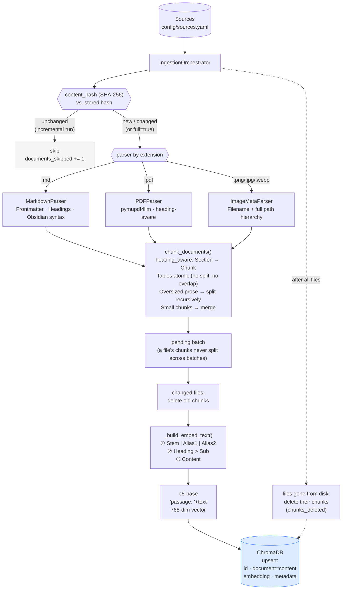
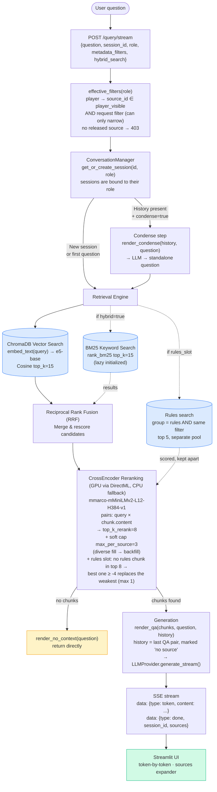
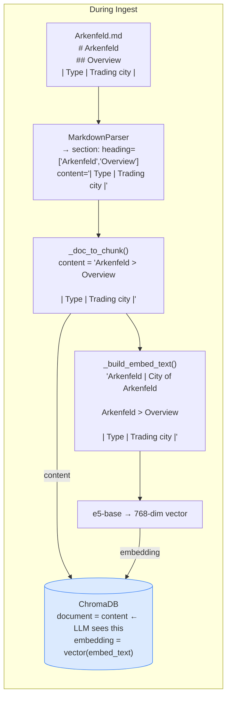
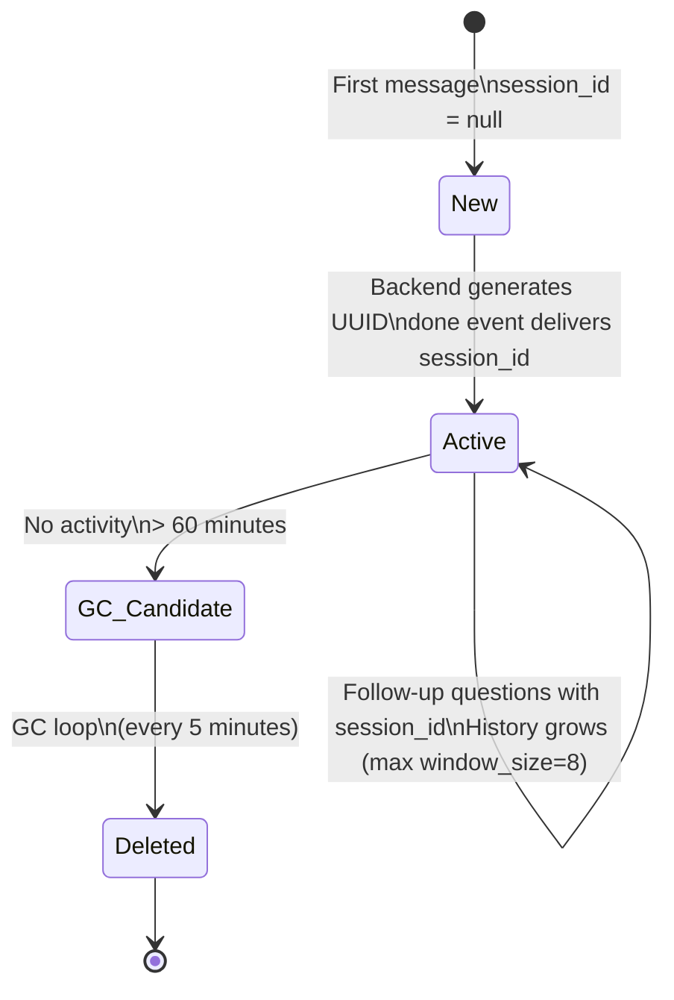
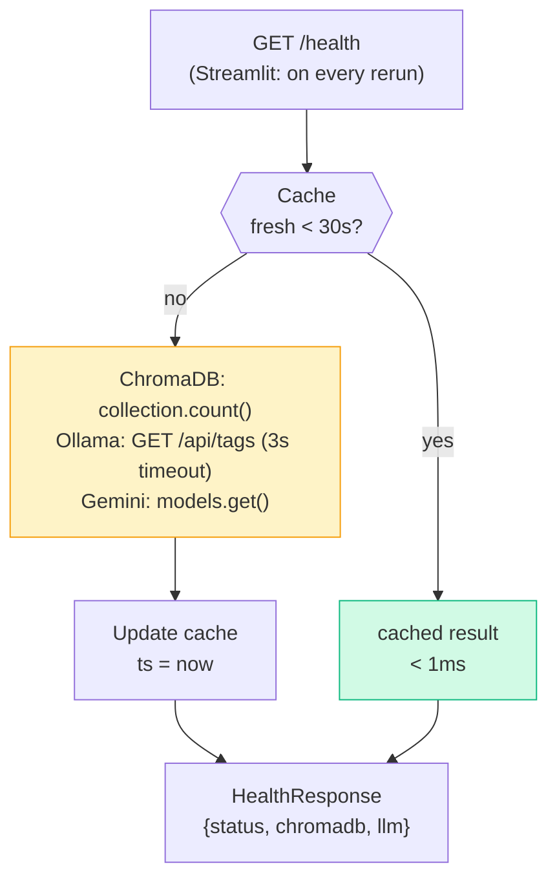

# Data Flow

This document provides visual representations of LoreKeeper's core pipelines and lifecycles using Mermaid diagrams. It covers the ingestion process, the hybrid retrieval query path, embed text construction, session management, and health checking.

## Table of Contents
1. [Ingestion Pipeline](#ingestion-pipeline)
2. [Query Pipeline](#query-pipeline)
3. [Embed Text vs. Stored Content](#embed-text-vs-stored-content)
4. [Session Lifecycle](#session-lifecycle)
5. [Health Check Caching](#health-check-caching)

---

## Ingestion Pipeline

The hash check happens **before** parsing, so unchanged files cost only a hash.
`full=true` (Sources page "🔄 Alle Dokumente neu indizieren") bypasses it — needed
after chunking or parser changes, which don't change a file's hash. A file that
fails to parse keeps its previously indexed chunks.

**Important:** ChromaDB stores the original `content` (what the LLM sees later),
not the enriched `embed_text`.

---

## Query Pipeline

---

## Embed Text vs. Stored Content

---

## Session Lifecycle

---

## Health Check Caching

