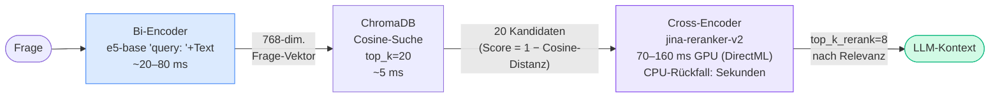
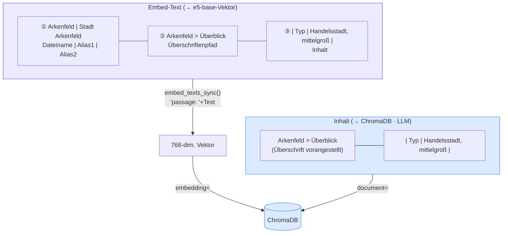

# Embedding-Strategie

Wie LoreKeeper sucht und **warum so**: Embedding-Modell, Reranking, Hybrid Search, Deckel pro
Datei, Regelwerk- und Eintrags-Slot, Section Expansion und der Aufbau der Embed-Texte. Die Parameter stehen in
[configuration.md](configuration.md) → `retrieval`, der Ablauf als Diagramm in
[data-flow.md](data-flow.md).

## Inhaltsverzeichnis
1. [Überblick](#überblick)
2. [Warum diese Entscheidungen?](#warum-diese-entscheidungen)
   - [Warum `multilingual-e5-base`?](#warum-multilingual-e5-base)
   - [Warum ein Cross-Encoder-Reranking?](#warum-ein-cross-encoder-reranking)
   - [Warum jina-reranker-v2?](#warum-jina-reranker-v2-entscheidung-1410)
   - [Warum sieht der Reranker den Notiznamen?](#warum-sieht-der-reranker-den-notiznamen-entscheidung-1710)
   - [Warum BM25-Hybrid-Suche?](#warum-bm25-hybrid-suche)
   - [Warum `top_k` 20?](#warum-top_k-20)
   - [Warum ein Deckel pro Datei?](#warum-ein-deckel-pro-datei)
   - [Warum ein Regelwerk-Slot?](#warum-ein-regelwerk-slot)
   - [Warum ein Eintrags-Slot?](#warum-ein-eintrags-slot)
   - [Warum Groß-/Kleinschreibung wiederherstellen?](#warum-gro%C3%9F-kleinschreibung-wiederherstellen)
   - [Warum Section Expansion?](#warum-section-expansion)
   - [Warum keine Wikilink-Expansion?](#warum-keine-wikilink-expansion)
   - [Warum die Identitäts-Schicht?](#warum-die-identitäts-schicht-dateiname--aliase)
   - [Warum `ef_search: 2000`?](#warum-ef_search-2000)
   - [Warum Chunking nach Überschriften?](#warum-chunking-nach-überschriften)
   - [Warum SHA-256 fürs Neu-Indizieren?](#warum-sha-256-fürs-neu-indizieren)
   - [Warum Bilder ausschließen?](#warum-bilder-aus-der-suche-ausschließen)
3. [Retrieval-Ablauf](#retrieval-ablauf)
4. [Aufbau des Embed-Texts](#aufbau-des-embed-texts)
5. [Dokumenttypen](#dokumenttypen)
6. [Was NICHT im Embedding steckt](#was-nicht-im-embedding-steckt)
7. [Neu indizieren nach Änderungen](#neu-indizieren-nach-änderungen)

---

## Überblick

LoreKeeper embeddet alle Dokumente mit `intfloat/multilingual-e5-base` (768 Dimensionen,
512 Tokens Kontext, Cosine-Ähnlichkeit), optional ergänzt um einen **BM25-Index** für die
Hybrid-Suche. Das Modell ist **asymmetrisch**: Fragen bekommen das Präfix `"query: "`, Passagen
`"passage: "` — der `EmbeddingService` setzt das automatisch, wenn der Modellname `"e5"` enthält.

Gewichte für einzelne Felder gibt es in sentence-transformers nicht. Die Wirkung entsteht über die
**Position** (was früher im Text steht, prägt den Vektor stärker) und **Wiederholung**.

---

## Warum diese Entscheidungen?

Der Embedding-Stack ist der größte Qualitätshebel eines RAG-Systems. Jede Entscheidung unten löst
ein konkretes Problem, das mit echten Vault-Daten aufgetreten ist.

### Warum `multilingual-e5-base`?

- **Der Vault ist deutsch.** Nur-Englisch-Modelle (MiniLM, `bge-*-en`) machen aus deutscher
  Morphologie Rauschen. Auf MIRACL/mMARCO liegt E5 multilingual bei nicht-englischer Suche 10–20
  Punkte vor MiniLM.
- **E5 ist asymmetrisch.** Die Präfixe `query: ` / `passage: ` trainieren das Modell, kurze Fragen
  und lange Passagen in verträglichen Räumen abzubilden. Symmetrische Modelle, auf Satzpaar-
  Ähnlichkeit trainiert, schneiden bei Frage→Dokument schlechter ab.
- **Lokal, kostenlos, überschaubar.** ~1,1 GB, läuft auf der CPU. Keine API-Kosten, keine Daten
  verlassen den Rechner, keine Rate-Limits beim Indizieren Tausender Dateien.
- **Bewusster Kompromiss:** `e5-large` wäre ~2 % genauer, aber dreimal langsamer und größer. Das
  Reranking holt den Großteil davon zu einem Bruchteil der Kosten.

### Warum ein Cross-Encoder-Reranking?

Bi-Encoder kodieren Frage und Dokument **getrennt** und vergleichen per Cosine — schnell, aber das
Modell sieht das Paar nie zusammen. So entstehen plausibel wirkende Top-Treffer, die von der
falschen Entität handeln.

Der Cross-Encoder (`jina-reranker-v2-base-multilingual`, bis 14.10. `mmarco-mMiniLMv2-L12-H384-v1`)
kodiert **beides zusammen** und bewertet die Relevanz direkt. Pro Paar ist er viel langsamer,
deshalb läuft er nur über die 20 Kandidaten der Vektorsuche und wählt die finalen 8. Kurz: Der Bi-Encoder findet 90 % der richtigen Kandidaten,
der Cross-Encoder bringt sie in die richtige Reihenfolge.

**Wo er läuft:** Mit `reranking.backend: directml` auf der GPU über ONNX Runtime + DirectML (jede
DX12-Karte, auch AMD), mit dem veröffentlichten ONNX-Export des Modells (`reranking.onnx_file`, für
jina die fp16-Datei) — unabhängig von CPU-Last. Ist DirectML nicht verfügbar, schreibt der Retriever
eine Warnung ins Log und nimmt den fp32-Export (`onnx/model.onnx`) mit ONNX Runtime auf der CPU —
fp16 lädt dort nicht; die Scores weichen um höchstens 0,004 ab. torch nutzt der Reranker nicht mehr:
jina lädt in torch nur mit `trust_remote_code` (ausgeführter Code aus dem Modell-Repo) und dem
Zusatzpaket `einops`. Fällt die GPU erst im Betrieb aus
(Treiber-Reset, VRAM voll), wechselt er ebenso mit Warnung auf die CPU — für den Rest der Laufzeit,
statt jede weitere Frage scheitern zu lassen. Der Reranker rechnet in **Batches zu 32 Paaren**: ein
Batch belegt ~40 MB VRAM pro Paar, und neben `qwen3:14b` (11 GB) füllten 100+ Paare am 14.10. die
16-GB-Karte — der Rerank wich in geteilten Speicher aus (0,3 → 3–8 s) und brach einmal mit einem
DirectML-Fehler ab, wonach er bis zum Neustart auf der CPU lief. Mit 32er-Batches: `top_k` 20 bleibt ein
Batch (~90 ms), 200 Paare ~0,8 s bei +0,5 GB (16er: 1,2 s; 50er: +1,3 GB). Die Scores weichen zwischen
Batch-Größen nur im fp16-Rundungsrauschen ab (≤ 0,002). Der Bi-Encoder bleibt bewusst auf der
CPU: ein Query-Embedding kostet ~0,08 s, und eine andere Rechenbibliothek würde die Vektoren
gegenüber dem bestehenden Index leicht verschieben.

**Warum DirectML (Entscheidung 12.10.)** — Benchmark auf Ryzen 5 5600X / RX 9070 XT, 15 Paare in
Produktionsgröße, 30 Wiederholungen; „Last“ = 12 Busy-Loop-Prozesse (≈ laufende Simulation):

| Variante | idle | unter Last | Ranking wie torch? |
|---|---|---|---|
| torch CPU | 840 ms | 14,2 s | — |
| ONNX fp32 CPU | 840 ms | 2,9 s | ✅ identisch |
| ONNX int8 CPU (`quint8_avx2`) | 710 ms | 2,8 s | ❌ Top-8 weicht ab → verworfen |
| **DirectML fp32 (GPU)** | **50 ms** | **68 ms** | ✅ identisch (max. Abweichung 6·10⁻⁶) |
| DirectML fp16 | — | — | lädt nicht |

Golden Set mit GPU-Reranker in ~1 min statt ~12 min, gleiche Treffer. (Die Tabelle gilt für
mMiniLMv2; jina fp16 lädt auf DirectML.) Verworfen bzw. später neu zu
prüfen: **PyTorch + ROCm unter Windows** (die RX 9070 XT lieferte still Nullen — hätte den Index
zerstört), **Windows ML** als Nachfolger von DirectML (Radeon-Pfad aus Python nicht belegt). DirectML
ist bei Microsoft im Wartungsmodus und braucht das Paket `onnxruntime-directml` statt `onnxruntime`
(Installation: README); ein `pip install -r requirements.txt` kann das CPU-Paket zurückholen — dann
greift der CPU-Rückfall mit Warnung im Log, falsch wird nichts. Im Betrieb (13.10.) braucht die
ganze Suche warm 120–170 ms (mit mMiniLMv2, ohne Eintrags-Slot; mit jina und Slot 14.10.: p50 ~270 ms,
p95 ~360 ms); die erste Frage mit einer neuen Eingabelänge ist auf DirectML einmalig
langsamer (~0,4 s), direkt nach dem Laden des LLM in den Grafikspeicher einmal ~2 s gesehen.

### Warum jina-reranker-v2? (Entscheidung 14.10.)

Die verbliebenen Abschnitt-Misses (Roadmap 3.10) waren überwiegend Reranker-Fälle: der richtige
Chunk unter den Kandidaten, aber ein Nachbarabschnitt vorn (p003 Würfelsystem, p099 Verbände auf
Vektor-Rang 1). Golden Set, alle Kandidaten in einem Prozess auf demselben Index, ONNX auf
DirectML, Regelwerk-Slot je Kandidat gesweept (−2 bis −8):

| Reranker | Datei | Abschnitt | MRR | Platz 1 | Rerank p50 | Bemerkung |
|---|---|---|---|---|---|---|
| mMiniLMv2-L12 (bis 14.10.) | 272/274 | 139/149 | 0,438 | 110 | — | |
| **jina-reranker-v2 fp16** | **272** | **142** | **0,468** | **121** | **107 ms** | + p003, p010, p099, p108, x003 · − p009, z001 |
| bge-reranker-v2-m3 fp16 | 271 | 143 | 0,452 | 113 | 249 ms | verliert Datei m048; 2,3 GB |
| msmarco-MiniLM-L12-en-de | 271 | 143 | 0,414 | 101 | 101 ms | 13 Fragen ≥ 3 Plätze schlechter |
| gte-multilingual-reranker | — | — | — | — | — | läuft mit transformers 5.x nicht |

jina gewinnt bei der Reihenfolge (MRR, Platz-1-Treffer) deutlich und verliert keine Datei. Der
Regelwerk-Slot bleibt bei −4: von −2 bis −8 gleiche Treffer; wie oft reine Lore-Fragen damit
Regelwerk-Chunks bekommen, ist für jina nicht gemessen. Grafikspeicher neben `qwen3:14b` (16 GB
Karte, gemessen 14.10.): qwen3 allein 12,6 GB, mit mMiniLMv2 14,6 GB, mit jina 14,4 GB — das LLM
bleibt ganz im VRAM (11,0/11,0 GB), Generierung unverändert 53,6 Token/s. Rerankt der Reranker
ununterbrochen parallel (nur bei gleichzeitigen Fragen), sinkt sie bei beiden auf ~14 Token/s.
Lizenz CC-BY-NC — für den privaten Einsatz in Ordnung. Nach dem Einbau im Golden Set wieder
272/274 und 142/149.

### Warum sieht der Reranker den Notiznamen? (Entscheidung 17.10.)

Der Cross-Encoder bewertete `[Frage, Chunk-Inhalt]`. Der Inhalt trägt den Überschriftenpfad, aber
nicht die Identitäts-Schicht (Dateiname | Aliase), die nur im Embed-Text steht. Ein Kopfabschnitt
ohne Überschrift wie „Deckname: Solmar · Faktion: Bund der Sonne“ (Escanor) nennt seine Person nie
und verlor im Rerank gegen jeden Text, der „Escanor“ enthält — m048 fand die Datei, aber nie diesen
Chunk, die Antwort war falsch. Seitdem bekommen **Markdown-Chunks die Identitätszeile vor den
Inhalt** (`_rerank_text` in `retriever.py`, dieselbe Funktion `identity_line` wie der Embed-Text).
Das ändert nur das Rerank-Paar, nicht den Index — kein Re-Index nötig.

Gemessen am 17.10. (Golden Set, alle Varianten in einem Prozess auf demselben Index, Grundlinie
vorher und nachher identisch):

| Rerank-Paar | Datei | Abschnitt | Platz-1-Abschnitt | Bemerkung |
|---|---|---|---|---|
| Inhalt (bis 17.10.) | 272/274 | 143/149 | 118 | |
| Identität + Inhalt, alle Typen | 272 | 142 | 119 | verliert k006 |
| ganzer Embed-Text (inkl. „Einträge: …“) | 272 | 142 | 118 | verliert k006 |
| **Identität nur für Markdown, PDF wie bisher** | **272** | **143** | **120** | nichts verloren, m048-Chunk auf Platz 1 |

„pnp_regelbuch“ vor jedem Regelbuch-Chunk ist Rauschen — daher bleiben PDF-Paare unverändert. Die
Variante ändert die Top 8 bei 179 von 274 Fragen, deshalb zusätzlich gegen die Antworten geprüft:
Holdout 9/10 Listen, 51/53 Einträge (vorher 50/53); End-to-End **253/274** gegen 250 im Lauf vom
15.10. (beide mit den Stichwörtern vom 17.10. ausgewertet) — 8 gewonnen (u. a. m048 „Deckname:
Solmar“), 5 verloren, alle gesichtet: p016/p094/z006 richtig mit anderer Formulierung, a002 mit
denselben Quellen wie vorher (LLM-Rauschen), x002 dieselben Dateien in anderer Reihenfolge, das
Modell erfindet eine Quelle. Der Regelwerk-Slot (`min_score` −4) bleibt: Regelbuch-Chunks in den
Antworten 1373 → 1421, Fragen mit Regelbuch 210 → 215 — Markdown verdrängt das PDF nicht.

### Warum BM25-Hybrid-Suche?

Vektorsuche verallgemeinert gut, verliert aber Präzision bei exakten Begriffen — Eigennamen,
Zahlen, Regelvokabular („Langschwert“, „Bonusaktion“, „Marke“) rutschen in Nachbar-Chunks, selbst
wenn das Wort wörtlich vorkommt. BM25 belohnt exakte Wortübereinstimmung und trifft diese Fälle.

LoreKeeper führt beide **parallel** aus, nicht als Vorfilter:

1. Die Vektorsuche holt die Top-K aus ChromaDB und wendet `score_threshold` auf die Cosine-Scores
   an — solange sie noch vergleichbar sind.
2. BM25 fragt einen In-Memory-Index (`rank_bm25`), lazy aus derselben Collection gebaut und nach
   jeder Änderung der Collection verworfen (Ingestion, Quelle entfernen, Wipe, Recategorize — sonst
   fände die Hybrid-Suche gelöschte Inhalte bzw. filterte auf alten Metadaten). Der Aufbau läuft unter
   einer Sperre und wird auf einmal veröffentlicht: gleichzeitige erste Fragen hatten zwei Korpora
   vermischt (Treffer auf falsche Dokumente, Roadmap 11.0). Metadaten-Filter werden nachträglich mit ChromaDB-kompatiblen
   Operatoren angewandt (`$eq`, `$ne`, `$in`, `$and`).
3. Beide Listen werden per **Reciprocal Rank Fusion** zusammengeführt:
   `score = Gewicht / (k + Rang + 1)`, `bm25_weight` (0,3) steuert die Balance, `k=60` dämpft den
   Vorteil der obersten Ränge.
4. Der fusionierte Pool geht wie gehabt zum Reranker.

RRF-Scores liegen auf einer anderen Skala (max. ≈ 1/61); deshalb greift die Schwelle **vor** der
Fusion, nie auf dem fusionierten Score. Für BM25 gibt es keine vergleichbare absolute Schwelle,
`bm25_top_k` begrenzt das Rauschen.

Hybrid ist pro Anfrage schaltbar (`hybrid_search`); die Evaluation-Seite hat eine Auswahl
(Config / nur Vektor / Hybrid) und einen A/B-Lauf über das Golden Set.

**Standard: aus.** Golden-Set-Sweep 13.10. (Index nach dem Simulations-Update, 4733 Chunks, alle
Varianten in einem Prozess): Hybrid war bei jedem `top_k` schlechter als reine Vektorsuche — bei
15 Datei 274 statt 276/278 und Abschnitt 134 statt 136/153 (verliert p009, p088, i002, z010), bei
20 und 25 je drei Abschnitte weniger; dazu ~80–100 ms mehr pro Frage. Die BM25-Treffer drängen
richtige Kandidaten aus dem Pool, bevor der Reranker sie sieht. Die Fälle, für die BM25 gedacht
war (Waffentabelle mit „Langschwert“), löst Hybrid ebenfalls nicht.

**Mit jina erneut gemessen (14.10.)**, Golden Set über den laufenden Backend-Prozess, `top_k` 20: Hybrid
Datei 271 statt 272/274, Abschnitt 141 statt 143/149 (gewinnt z009, verliert p108, k006, x004), Retrieval
p50 356 statt 270 ms. Bleibt aus. Für die Aufzählungsfragen, deren Antworten im End-to-End-Lauf
unvollständig sind (Basis-Skills, Basis-Zauber, Benchmark), hilft es nicht: Dort trifft schon die
Vektorsuche den richtigen Abschnitt — es kommen nur 8 Chunks davon beim LLM an (Roadmap 3.15).

### Warum `top_k` 20?

`top_k` ist die Zahl der Vektor-Kandidaten, aus denen der Reranker die `top_k_rerank` (8) wählt. Bei
den Abschnitt-Misses aus Roadmap 3.10 lag der richtige Chunk oft knapp außerhalb: „Vorteil und
Nachteil“ (k002) auf Vektor-Rang 18 — der Reranker hätte ihn klar vorn gesehen (−0,5 gegen −5,8).
Sweep 13.10. (reine Vektorsuche, gleicher Index, ein Prozess):

| `top_k` | Datei | Abschnitt | gewonnen / verloren | Latenz p50 |
|---|---|---|---|---|
| 15 | 276/278 | 136/153 | — | 255 ms |
| **20** | 275 | 138 | + k002, x008 / Datei z010 | 271 ms |
| 25 | 275 | 139 | + k002, x008, z010 / Datei z014 | 320 ms |
| 30 | 275 | 136 | + k002, x008, z010 / − p009, p061, p083, Datei z014 | 354 ms |

20 holt beide klaren Regelwerk-Gewinne (Vorteil/Nachteil, Heimkehrpfennig) ohne Abschnitt-Verlust;
25 tauscht nur eine Simulationsfrage gegen eine andere und kostet +50 ms; ab 30 gewinnt das
Rauschen — mehr Kandidaten heißt auch mehr plausible falsche für den Reranker. Die Latenzen sind
unter Last gemessen (ein Spiel lief parallel), die Abstände gelten trotzdem.

Was mehr Kandidaten **nicht** lösen: Treffer, die tief liegen (Waffentabelle für „Langschwert“ auf
Rang 37, „Armbrust“ auf Rang 50 hinter „Armdrücker“) und Fälle, in denen der Reranker den richtigen
Chunk schon sieht, aber anders gewichtet (Würfelsystem, Erlernen von Zaubern, Verbände) — offen in
Roadmap 3.10.

**Mit jina erneut gemessen (14.10.)**, Golden Set über den laufenden Backend-Prozess: `top_k` 20 →
Datei 272, Abschnitt 142/149, MRR 0,468, Platz 1 bei 121 Fragen; 25 → 271/142, verliert Datei m062;
30 → 270/141, verliert zusätzlich k006 und z001; 40 → 271/141. Keine Frage gewinnt — 20 bleibt. Anlass
war die Waffentabelle: Für „Wie viel Schaden macht ein Dolch-Angriff mit Stärke 4 bei einer Wurfzahl
von 12?“ liegt sie auf Vektor-Rang 21–25, ab `top_k` 25 setzte jina sie auf Platz 6.

**Verworfen: Tabellenzeilen als eigene Chunks (14.10.).** Experiment mit zwei frisch gebauten
Indizes (gleiche Quellen, jina): B teilt die 28 *Eintragstabellen* des Regelbuchs (Waffen, Rüstungen,
Tränke, Artefakte, Schadenstypen, Statuseffekte, Tierformen; Fähigkeitskarten und Zahlentabellen
bleiben ganz) in 146 Zeilen-Chunks mit wiederholtem Tabellenkopf. Golden Set: Abschnitte 142 → 141
(verliert die Waffenfragen p052 und p086, gewinnt x004). Elf Tabellenfragen: Einzeleinträge gleich oft
gefunden (je 4 von 8, aber „Wie viel Schaden macht ein Dolch?“ geht verloren), Listenfragen brechen
ein („Welche Nahkampfwaffen gibt es?“ 9/9 → 2/9, Heiltränke 4/4 → 3/4). Einzelne Zeilen sind zu klein:
sie konkurrieren untereinander und verlieren gegen längere Chunks.

### Warum ein Deckel pro Datei?

Cross-Encoder-Scores bewerten nur Frage und Passage — das Modell weiß nicht, dass es schon etwas
Ähnliches gewählt hat. Bei „Was ist Arkenfeld?“ kommen 8 Chunks aus `Arkenfeld.md`, alle hoch
bewertet, und das LLM bekommt tiefen, aber **engen** Kontext: viel Arkenfeld, nichts aus
Fraktionen, Kampagne oder NPCs.

Deshalb gilt nach dem Reranking ein Deckel **`max_per_source`** (3), in **zwei Durchgängen**:

1. **Divers füllen** — die nach Score sortierte Liste ablaufen und Chunks annehmen, bis eine Datei
   den Deckel erreicht; blockierte Chunks wandern in einen Überlauf (weiter in Score-Reihenfolge).
2. **Nachfüllen** — kommen so weniger als `top_k_rerank` zusammen (dünner Pool, eine Datei
   dominiert), werden die freien Plätze aus dem Überlauf gefüllt.

Der Deckel ist also eine **Vorliebe** für Vielfalt, kein Platzvernichter: Solange Kandidaten da
sind, kommen nie weniger als `top_k_rerank` Chunks zurück. Danach wird nach Score neu sortiert,
damit das LLM das Relevanteste zuerst sieht. Er zählt je (Quelle, Datei) — zwei gleichnamige
Dateien in verschiedenen Quellen (z.B. zwei `llm_report.md`) haben je einen eigenen Deckel.

Bewusst **keine** Deduplizierung nach Überschrift: Ein langer Abschnitt ergibt legitim mehrere
Chunks. Verdrängt wird auf Dateiebene, also wirkt der Deckel dort.

- `3` (Standard) — gut für einen Vault mit vielen kleinen, verlinkten Notizen.
- `5+` — wenn einzelne Dateien groß und maßgeblich sind (z.B. ein Regelwerk-PDF).
- `0` — kein Deckel, reine Reranker-Reihenfolge.

### Warum ein Regelwerk-Slot?

Fragen, die eine Vault-Entität **und** einen Regelbegriff nennen — „Was bewirkt Ritterlichkeit bei
Escanor?“, „Thalion trägt eine Phönixfeder – was kann sie?“ — treffen die Datei der Entität so
stark, dass sie alle 15 Vektor-Kandidaten belegt. Die Regeldefinition im PDF erreicht den Reranker
nie; kein Deckel und keine Umsortierung hilft dann.

`retrieval.rules_slot` ergänzt eine zweite, kleine Vektorsuche nur in Gruppe `rules`
(5 Kandidaten, mit demselben Filter wie die Anfrage — der Spieler-Modus bleibt dicht). Diese
Kandidaten bewertet der Cross-Encoder mit, sie bleiben aber **außerhalb des Haupt-Pools**. Nur
wenn kein `rules`-Chunk in die finalen Top-`top_k_rerank` gekommen ist, ersetzt der beste davon
den schwächsten Chunk — wenn sein Score ≥ `min_score` (−4) ist, nie mehr als einer und erst ab 3
finalen Chunks (bei `top_k_rerank` 1–2 würde ein schwacher Regel-Chunk den Großteil des Kontexts
verdrängen).

Die Extra-Kandidaten in den Haupt-Pool zu mischen wurde gemessen und verworfen: etwas mehr
Abschnitt-Treffer (138 statt 136 von 153), aber Regelwerk-Chunks in 121 von 138 reinen
Lore-Fragen statt 64. Golden Set mit Slot: Abschnitte 132 → 136/153, Fragen mit Entität + Regel
(x001–x008) 1 → 5/8.

### Warum Groß-/Kleinschreibung wiederherstellen?

Embedding-Modell und Reranker unterscheiden Groß- und Kleinschreibung, die Quellen schreiben deutsche
Substantive groß — im Chat wird oft klein getippt. Alle 👎 vom 13./14.10. waren klein geschrieben:
„was ist überschaden?“ fand nur „Überheilung“ (4.11), „Was ist Überschaden?“ setzt 4.10 auf Platz 1.
Das Golden Set komplett kleingeschrieben verliert 8 von 149 Abschnitten (143 → 135) und einen
Datei-Treffer — ein systematischer Verlust, kein Einzelfall.

`src/retrieval/truecase.py` baut aus allen Chunks ein Wörterbuch „klein → Schreibweise der Quellen“:
Ein Wort kommt hinein, wenn es mindestens zweimal vorkommt und zu ≥ 80 % großgeschrieben ist; alle
großgeschriebenen Formen zählen („Kampf“ 450× und „KAMPF“ 235× aus Talentnamen gegen „kampf“ 42×),
gewählt wird die normale Schreibweise. Vor der Suche werden nur **ganz kleingeschriebene** Wörter der
Frage ersetzt, und die Frage beginnt mit einem Großbuchstaben; was der Nutzer groß oder gemischt
schrieb, bleibt. Gebaut beim ersten Suchaufruf, verworfen nach jedem Ingest (wie der BM25-Index).
**Nur intern**: Die korrigierte Frage geht nie an den Client — das Wörterbuch enthält auch
Spielleiter-Chunks, eine geänderte Schreibweise verriete einem Spieler, dass ein Wort dort vorkommt.

Gemessen 14.10. (frisch gebauter Index, jina): Golden Set wie geschrieben 143 → 143 (unverändert),
kleingeschrieben 135 → **142**/149 (übrig: „würfeln“ — in den Quellen 3× klein, 2× groß — und
„Decknamen“, das dort nicht vorkommt); Holdout kleingeschrieben 6/8 → 7/8 Abschnitte (= wie
geschrieben). Erste Fassung ohne die Großschreibung am Fragenanfang und mit nur der häufigsten
Großform: 140/149. Tippfehler („üebrschaden“) behebt das nicht.

### Warum ein Eintrags-Slot?

Eine Tabelle ist **ein** Vektor für alle ihre Zeilen. „Wie viel Schaden macht ein Dolch?“ findet die
Waffentabelle noch, jedes weitere Wort kippt es: „… Dolch-Angriff mit Stärke 4 …“, „… Angriff mit
einem Dolch?“, „Welche Besonderheit hat der Hammer?“ — die Tabelle liegt auf Vektor-Rang 21–25 oder
tiefer, Kampf- und Krit-Abschnitte gewinnen. Mehr Kandidaten (`top_k` 25–40) und Zeilen als eigene
Chunks wurden gemessen und verworfen (siehe [Warum `top_k` 20?](#warum-top_k-20)).

`retrieval.entry_slot` sucht deshalb nicht per Vektor, sondern nach dem Namen: Wörter der Frage und
Folgen aus 2–3 Wörtern (erster Buchstabe groß, Bindestrich-Wörter auch in Teilen) werden als fette
Tabellenzelle `|**Name**|` im gespeicherten Text gesucht (ChromaDB `where_document`, mit dem Filter der
Anfrage). Treffer zählen nur, wenn der Name die **erste Zelle einer Zeile** ist — „Dolch“ trifft nicht
„Dolch der Schatten“ und nicht eine Beute-Tabelle mit Dolch in der zweiten Spalte. **Nur PDF-Tabellen**
(Zelle ohne Leerzeichen `|**Name**|`, so schreibt der PDF-Parser): Obsidian-Tabellen (`| **Typ** |`,
`| Charakter |`) mitzunehmen wurde am 14.10. gemessen und verworfen — sie sind meist Steckbrief-Tabellen
mit allgemeinen Bezeichnungen. Golden Set (frisch gebauter Index): nur fette Zellen 143 → 142/149
(verliert x004), Regelfragen mit Vault-Chunks 86 → 92/120, 56 Fragen mit anderem Kontext; fett + schlicht
ebenso 142, 91/120, 66 Fragen; die elf Tabellenfragen blieben bei 8/11. Bis zu
`max_chunks` Tabellen kommen in den Rerank-Pool, mit ihrer echten Cosine-Ähnlichkeit als Score — **ohne**
`score_threshold`: Sie werden gerade gesucht, weil ihr Vektor schwach ist; die einzige Schranke ist der
Reranker.

**Kein reservierter Platz** (anders als der Regelwerk-Slot): Der Slot feuert bei 32 von 274
Golden-Set-Fragen, in 27 schafft es die Tabelle von selbst unter die 8. Von den übrigen 5 sind 4
Fehlgriffe, die jina zu Recht verwirft — „Fähigkeit“ und „Aktionspunkte“ sind auch Zeilennamen in
legendären Artefakt-Tabellen —, und bei „Wie viel kostet ein Langschwert?“ steht der Preis nicht in
der Waffentabelle. Ein reservierter Platz würde genau diese Fehlgriffe erzwingen.

Gemessen 14.10. (frisch gebauter Index, gleicher Inhalt wie der laufende, jina): Golden Set
Abschnitte 142 → **143**/149 (+x004 „Phönixfeder bei Thalion“), nichts verloren, Datei 272/274
unverändert. Elf Tabellenfragen vollständig gefunden 5 → **8**/11; Listenfragen („Welche
Nahkampfwaffen gibt es?“ 9/9) unverändert. `max_chunks` 1, 2 und 3 maßen gleich. Kosten: ~75 ms pro
Frage (p50, max ~200 ms). Die Kosten wachsen mit **Namen × Chunks** — jeder Name ist eine
`$contains`-Klausel, und jede durchsucht die Collection (synthetisch gemessen: bei 5.000 Chunks ~5 ms
pro Klausel, eine normale Frage bei 20.000 Chunks ~1 s). Deshalb höchstens **60 Namen** pro Frage, vom
Anfang der Frage (Golden Set braucht höchstens 48, p95 32): Ohne Grenze ließen ~1.000 Klauseln (eine
Frage mit ~4.000 Zeichen) die Abfrage scheitern und ~3.000 den Backend-Prozess abstürzen (Code-Review
14.10., Roadmap 13.0); dazu nimmt die API höchstens 4.000 Zeichen pro Frage an. Wächst der Index stark,
die Zeit neu messen. Offen: die Rechenfrage „Dolch, STÄ 4, Wurfzahl 12“ und „Unterschied Dolch und
Kurzschwert“ — der Slot holt die Tabelle, jina bewertet Krit-Regeln bzw. die Schurken-Sektion höher;
„Langbogen“ — die PDF-Zelle heißt `**l**<br>**Langbogen**` (Parser-Artefakt). Groß-/Kleinschreibung
innerhalb des Namens zählt: „ap-trank“ findet „AP-Trank“ nicht.

### Warum Section Expansion?

Aufzählungsfragen („Welche Fähigkeiten hat der Waldläufer?“) treffen oft nur zwei, drei
Unterabschnitte einer Sektion; die Antwort wird dann lückenhaft. Teilen sich ≥ 2 Treffer einer
Datei eine Eltern-Überschrift mit **verschiedenen** Unter-Überschriften, lädt der Retriever die
ganze Sektion in Dokumentreihenfolge und setzt sie an der Stelle des besten Treffers ein.

**Einleitungs-Chunk zählt mit (17.10., Roadmap 3.15):** Der Chunk mit der Eltern-Überschrift selbst
(„5.2 Basis-Skills“, der Text vor der ersten Unter-Überschrift) zählt als Treffer seiner Sektion —
aber nur, wenn auch eine Unter-Überschrift getroffen wurde; ein Einleitungs-Chunk allein lädt nichts.
Vorher zählte nur, was eine Ebene **unter** der Eltern-Überschrift lag: Bei p036 („Welche Basis-Skills
…?“) stand die Einleitung auf Rang 1, der beste gezählte Treffer auf Rang 5 (> `top_rank`), es blieb
bei 8 Chunks; bei p014 waren Einleitung + eine Unter-Überschrift nur *eine* verschiedene Überschrift.
Die Sektion wird an der Stelle des bestplatzierten Treffers eingesetzt, also oft an der der
Einleitung. Golden Set (gleicher Index, nach dem Parser-Fix für Beschriftungen): Datei 272/274
unverändert, Abschnitt 143 → **144**/149 (+z006, nichts verloren); expandierte Fragen 115 → 144,
Chunks Ø / p90 / max 11,7 / 21 / 27 → 12,6 / 22 / 28 (Budget 30 hält). Je drei Läufe: p036 und p014
0 → 3/3; Holdout unverändert 9/10, 51/53. End-to-End mit Parser-Fix und dieser Regel zusammen
(17.10.): **260/274** gegen 253 — 12 gewonnen (alle vier Zielfragen p036, p037, p114, p014, dazu p091,
m056 u. a.), 5 verloren, alle inhaltlich richtig mit anderer Formulierung („nicht vorbereitet“ statt
„unvorbereitet“, „Kleine Golems“). Die Antwortzeit dieses Laufs ist nicht vergleichbar — das LLM
generierte während des Laufs 3–4× langsamer, auch bei Fragen mit unverändert 8 Chunks (Rechner unter
Last); was die längeren Kontexte kosten, ist noch nicht gemessen.

Zwei Grenzen schützen den Kontext: Sektionen über `max_chunks` (25) bleiben unverändert, und
expandiert wird nur, wenn ein Treffer der Sektion unter den ersten `top_rank` (3) liegt — sonst
ziehen zwei zufällige, schwache Treffer eine fremde Sektion herein. Golden Set mit `top_rank: 3`:
Ø Chunks 13,9 → 12,6, Abschnitt-Treffer unverändert.

Drittens begrenzt `max_total_chunks` (30) das ganze Ergebnis über alle Sektionen (Roadmap 5.6):
Expandiert wird in der Reihenfolge des besten Treffers, solange die Summe passt; eine Sektion, die
nicht mehr passt, behält ihre ursprünglichen Treffer. Golden-Set-Sweep 13.10. (alle Varianten in
einem Prozess, zwei Läufe ohne Budget identisch):

| Budget | Datei / Abschnitt | Ø / p95 / max Chunks | Fragen > 20 Chunks | geänderte Fragen |
|---|---|---|---|---|
| 0 (aus) | 276/278 · 137/153 | 12,4 / 27 / 49 | 49 | — |
| 40 | gleich | 12,3 / 27 / 37 | 49 | 1 |
| **30** | gleich | 12,2 / 27 / 30 | 48 | 3 |
| 25 | gleich | 10,6 / 23 / 25 | 24 | 25 |
| 20 | gleich | 9,3 / 17 / 20 | 0 | 49 |
| 16 | gleich | 8,8 / 14 / 16 | 0 | 63 |
| 12 | gleich | 8,3 / 11 / 12 | 0 | 77 |

Die Treffer-Metriken sind blind für das Budget: Die gererankten Treffer bleiben immer drin, also
fast immer auch der erwartete Abschnitt. Was das Budget kostet, ist Vollständigkeit — entschieden
wurde deshalb nach den geänderten Fragen. **30** trifft genau die drei Fälle mit gestapelten
Sektionen und streicht jeweils die fremde: „Ass-Regel“ (37 → 17) und „Zauberspeicher“ (49 → 29)
verlieren die 22 Chunks von „7.3 Legendäre Artefakte > Monolith“, „Blauer Monolith“ (32 → 27) fünf
Chunks „Prismenhalter“. Eine einzelne Sektion (≤ `max_chunks` 25) plus Treffer passt weiter.
**Verworfen:** 25 und kleiner schneiden genau die Aufzählungsfragen, für die es die Expansion gibt —
bei 20 gehen Waldläufer, Krieger, Mönch, Alchemist und die Magieschulen von 23–28 auf 8 Chunks.

### Warum keine Wikilink-Expansion?

Idee (Roadmap 3.5): Die Notizen, auf die die besten Treffer per `[[Link]]` verweisen, kommen mit ihren
besten Chunks in den Rerank-Pool (wie der Eintrags-Slot, Filter der Anfrage, der Reranker entscheidet).
Gemessen am 14.10. auf einer Index-Kopie (jina, eine Prozess-Sitzung), Links der ersten N Treffer,
je Frage K Chunks aus den verlinkten Notizen:

| Variante | Golden Set Datei | Abschnitt | Holdout (Datei / Abschnitt) |
|---|---|---|---|
| ohne | 272/274 | 143/149 | 10/10 · 7/8 |
| N 3, K 3 | 270 (−a009, −m062) | 143 | 10/10 · 7/8 |
| N 5, K 3 | 271 (−a009) | 143 | 10/10 · 7/8 |
| N 3, K 5 | 270 (−a009, −m062) | 143 | 10/10 · 7/8 |
| N 8, K 5 | 271 (−a009) | 143 | 10/10 · 7/8 |

**Nicht umgesetzt:** kein Gewinn, nur Verluste — die zusätzlichen Chunks verdrängen im Rerank richtige
Treffer. Alle sechs verbleibenden Fehlschläge (p009, z001, z003, z006, z009, z012) liegen im Regelbuch
oder in Simulationsberichten, die keine Wikilinks haben; ein Suchweg über Links kann sie gar nicht
erreichen. Dazu sind die Links grob: `wikilinks` ist eine Liste je **Notiz**, nicht je Abschnitt
(Malek Nocthar: 26 Ziele an jedem Chunk). Neu prüfen erst bei Fragen, die nachweislich über einen Link
gehen (NPC → Gegenstand) und heute scheitern — dann mit Links je Abschnitt (Parser + Re-Index).

### Warum die Identitäts-Schicht (Dateiname | Aliase)?

Der wichtigste Trick für Inhalte, die sich um Entitäten drehen.

Ein Chunk wie `| Typ | Handelsstadt, mittelgroß |` enthält keinen Eigennamen — es ist eine
Tabellenzeile. Ihr Embedding hat null Bezug zu „Was ist Arkenfeld?“; der Chunk würde nie gefunden.

Lösung: **Dateiname und Aliase aus dem Frontmatter werden dem Embed-Text vorangestellt** (nicht
dem in ChromaDB gespeicherten Inhalt). Der Vektor trägt jetzt „Arkenfeld | Stadt Arkenfeld“ und
passt zu Fragen nach der Entität; das LLM sieht weiter nur den sauberen Inhalt. Seit 17.10. steht
dieselbe Zeile bei Markdown auch im Rerank-Paar ([Begründung](#warum-sieht-der-reranker-den-notiznamen-entscheidung-1710)).

Das funktioniert, weil Obsidian-Vaults die Identität einer Entität per Konvention im Dateinamen
tragen. Bei beliebigen Markdown-Sammlungen ginge das nicht.

### Warum `ef_search: 2000`?

ChromaDB sucht über einen HNSW-Graphen — approximativ. Mit der Voreinstellung `ef_search: 100`
fehlte bei 38 von 278 Golden-Fragen mindestens ein Chunk, den eine exakte Suche unter den Top 15
hat, und nach einem Neustart bekamen 6–8 Fragen andere Kandidaten (bitgleiche Query-Embeddings).
Eval-Läufe in getrennten Prozessen schwankten dadurch um ±2 Abschnitte. Gemessen am 13.10. auf
einer Kopie des Index (4745 Chunks; Top 15 mit dem Bild-Filter wie im Betrieb):

| `ef_search` | anders als exakte Suche | anders zwischen Prozessen | pro Abfrage |
|---|---|---|---|
| 100 | 38–39 Fragen | bis 8 | 9,6 ms |
| 200 | 12–13 | bis 8 | 9,9 ms |
| 500 | 4–6 | bis 2 | 10,9 ms |
| **1000** | **0** | **0** | 11,8 ms |

Golden Set (je zwei Läufe in getrennten Prozessen): mit 100 Dateien 275/274 von 278, Abschnitte
136/135 von 153, 11 Fragen mit anderer Trefferliste; mit **1000 beide Läufe identisch**, 276/278 und
137/153 (p105 gewinnt Datei und Abschnitt, nichts verloren), Ø 183 statt 178 ms pro Frage. Der Wert
ist an die Größe gebunden: wächst der Index deutlich (Bilder, weitere Quellen), mit **Evaluation →
🎯 Suchgenauigkeit prüfen** gegen eine exakte Suche neu prüfen
([evaluation.md](evaluation.md#suchgenauigkeit-prüfen)). Ein geänderter Wert wirkt erst nach einem
Neustart des Backends — ChromaDB übernimmt ihn beim Laden des Index, nicht in einen schon geladenen. Eine exakte Suche in NumPy statt HNSW wäre ein
zweiter Suchweg (Filter, Spieler-Modus, Synchronität mit der Collection) — bei 0 Abweichung unnötig.

**1000 → 2000 (13.10., nach zwei Re-Index-Läufen):** Die Läufe haben jeden Vektor an Ort und Stelle
ersetzt; HNSW baut seinen Graphen dabei nicht neu, die Suche wird schlechter. Bei 4419 Chunks fand
1000 nicht mehr alles: 5 von 274 Golden-Fragen wichen bei `top_k` 20 ab (3 bei 15). Mit 2000 und
4000 war die Suche wieder exakt (274/274 bei 15 und 20), 2000 kostet 21,5 statt 19,5 ms pro
Abfrage. Nach weiteren Indizierungen deshalb wieder **🎯 Suchgenauigkeit prüfen** — ein Wipe mit
Neu-Indizierung baut den Graphen frisch auf, falls ein höherer Wert nicht mehr reicht.

**Stolperfalle beim Anlegen**: Gibt man ChromaDB 1.5 `metadata={"hnsw:space": "cosine"}` *und*
`configuration` zusammen, entsteht still eine **l2**-Collection. LoreKeeper setzt deshalb Raum und
`ef_search` nur über `configuration`; ein späteres `get_or_create_collection` ignoriert die
Konfiguration einer bestehenden Collection, `ef_search` wird dann per `modify` nachgezogen.

### Warum Chunking nach Überschriften?

Obsidian-Dokumente sind **über Überschriften strukturiert**: ein Charakterbogen hat `## Werte`,
`## Hintergrund`, `## Beziehungen`. Zeichenbasiertes Chunking schneidet mitten in Absätze und
Tabellen und zerstört das. Chunking nach Überschriften:

1. Teilt zuerst an `#`/`##`/`###`.
2. Hält Tabellen **atomar** — nie zwischen Zeilen geteilt (eine halbe Zeile ist Müll). Tabellen
   bleiben bis `max_chunk_size × 1,5` in einem Chunk; nur sehr große werden an Zeilengrenzen mit
   wiederholtem Kopf geteilt.
3. Legt zu kleine Abschnitte **nur innerhalb derselben Überschrift** zusammen — eine winzige
   Tabelle unter `### Bruchgraben` schluckt nicht den nächsten Abschnitt, sonst würde
   `heading_hierarchy` über den Inhalt lügen.
4. Behält den Überschriftenpfad (`Arkenfeld > Geografie`) im Chunk, damit das LLM sieht, woher
   der Inhalt stammt.
5. Erzeugt **keine Chunks ohne Inhalt** (14.10., nach einem leeren Chunk im Chat zu Arkenfeld): Ein
   Abschnitt, der auf Tabelle + `---` endete, ergab einen Chunk aus Überschriftenpfad und `---`;
   Werteblöcke endeten auf Block-ID + `<!-- sim:end -->`, Notizen auf eine Tag-Zeile. Solche Chunks
   bestehen im Embedding fast nur aus dem Überschriftenpfad, ranken deshalb für den Namen der Notiz und
   belegen Plätze, die im Chat leer aussehen. Der Parser entfernt diese Zeilen (siehe
   [parsing.md](parsing.md)); im Chunker geht ein Stück unter `min_chunk_size` an das **nächste**
   Stück der Sektion — meist die Beschriftung einer Tabelle (`- L2` aus einem eingeklappten Callout,
   `**Optionen:**`), die vorher allein stand und ihrer Tabelle fehlte —, und ein Stück ohne Buchstaben
   oder Ziffern fällt weg. **Gemessen** (voller Re-Index, Golden Set im selben Index-Stand): 4414 →
   3933 Chunks, 251 → 0 ohne Inhalt; Treffer unverändert Datei 272/274, Abschnitt 143/149 (dieselben
   Misses); doppelt belegte Plätze (gleiche Datei + Überschrift) in den Ergebnissen 738 → 556 —
   z. B. m001 „Wo liegt Arkenfeld“ bekommt statt des zweiten „Bruchgraben“ „Atmosphäre & Ton“.

Ergebnis: jeder Chunk ist eine inhaltliche Einheit, und seine Überschrift stimmt immer — darauf
bauen Deckel, Section Expansion und die Abschnittsprüfung der Evaluation.

### Warum SHA-256 fürs Neu-Indizieren?

- **Naheliegende Alternative: Änderungszeit.** Versagt bei Windows-Netzlaufwerken, Git-Checkouts,
  OneDrive/Dropbox (ändern die Zeit ohne Inhalt) und Massenoperationen.
- **SHA-256 über die Dateibytes** ist deterministisch und billig — 1 MB Markdown in ~1 ms. Der Hash
  steht in den Chunk-Metadaten; beim Neu-Indizieren wird verglichen und Unverändertes komplett
  übersprungen. Bei 1000 Dateien mit 5 Änderungen wird aus Minuten eine Sekunde.

### Warum Bilder aus der Suche ausschließen?

Bild-„Chunks“ sind Platzhalter wie `"Bild: Malek Nocthar 1 (Pfad: NPCs)"`. Sie ranken schlecht und
**verdrängen** schlimmer noch inhaltsreiche Chunks. Ein harter Filter `document_type != image` im
Retriever hält sie aus dem LLM-Kontext. Fragen nach Bildern funktionieren trotzdem über die
zugehörige `.md`-Datei (siehe [Dokumenttypen](#dokumenttypen)). Gezeigt werden Bilder seit 14.10.
ohne Suche: ein gefundener Abschnitt bringt die Bilder mit, die seine Notiz an dieser Stelle einbettet
(`images`, [parsing.md](parsing.md)). Bildbeschreibungen per Vision-Modell wurden dafür verworfen
(Roadmap 2).

---

## Retrieval-Ablauf



Vollständiger Ablauf mit BM25, Regelwerk- und Eintrags-Slot und Section Expansion:
[data-flow.md](data-flow.md#beantwortung-einer-frage).

| | Bi-Encoder (e5-base) | Cross-Encoder (jina-reranker-v2) |
|---|---|---|
| **Funktionsweise** | Frage und Dokument getrennt → Cosine | Frage + Dokument zusammen → direkte Bewertung |
| **Vorteil** | Vektoren vorberechnet → sehr schnell | Versteht die Beziehung zwischen Frage und Text |
| **Nachteil** | Kein Zusammenspiel | Zu langsam für den ganzen Index |
| **Rolle** | Kandidaten finden (Top 20) | Kandidaten ordnen (Top 8) |

---

## Aufbau des Embed-Texts

Für jeden Chunk wird ein **Embed-Text** gebaut; ChromaDB speichert den ursprünglichen
**Inhalt** (den später das LLM sieht):



- **Schicht 1 — Identität:** `Dateiname | Alias 1 | Alias 2`. Der Dateiname
  (`Arkenfeld.md → "Arkenfeld"`) ist der wichtigste Suchbegriff, Aliase kommen aus dem Frontmatter.
  Ohne diese Schicht fände „Was ist Arkenfeld?“ den Chunk `| Typ | Handelsstadt |` nicht.
- **Schicht 2 — Kontext:** `Überschrift > Unterüberschrift` — welcher Abschnitt (vom Chunker in den
  Inhalt geschrieben).
- **Schicht 3 — Inhalt:** der eigentliche Text, Tabellen, Listen.
- **Nur bei Tabellen — Zeilennamen:** zwischen Identität und Inhalt eine Zeile `Einträge: Dolch,
  Kurzschwert, Langschwert, …` mit der ersten Zelle jeder Tabellenzeile (ohne Kopf- und
  Trennzeile; Fortsetzungszeilen mit leerer erster Zelle zählen nicht). Tabellen werden erst ab
  etwa 1,5 × `max_chunk_size` an Zeilengrenzen geteilt — eine Waffentabelle ist ein Chunk, ihr
  Vektor der Durchschnitt aller Zeilen — eine Frage nach **einer** Zeile
  („Wie viel Schaden macht ein Langschwert?“) traf ihn nur schwach. Der gespeicherte Inhalt bleibt
  unverändert.

  Messung 13.10. (Roadmap 3.10, je Variante eine frisch aufgebaute Collection, nur die Vektoren der
  1821 Tabellen-Chunks neu): Abschnitte 137 → **139/149** (+ Langschwert p086, + Armbrust p087),
  nichts verloren; Vektor-Rang des richtigen Chunks Langschwert 22 → 14, Armbrust 47 → 2.
  **Verworfen:** die Tabelle als Fließtext („Armbrust — schwer · GEW + 5 · …“, ohne `|` und `**`) —
  gewann nur p086, verlor x005, Armbrust blieb auf Rang 44. Abgeschnitten wird bei Tabellen fast nie:
  nur 6 Simulations-Tabellen sind länger als die 512 Token des Modells.

---

## Dokumenttypen

| Typ | Aufbau des Embed-Texts | In der Suche |
|-----|------------------------|:---:|
| Markdown | `Dateiname \| Aliase` · `Überschrift > Unter` · `Inhalt` | ✅ |
| PDF | `Dateiname` · `Überschrift > Unter` · `Inhalt` | ✅ |
| Bild | — | ❌ |

**Fragen nach Bildern** wie „Zeig mir ein Bild von Malek Nocthar“ liefern die zugehörige
`.md`-Datei (`NPCs/Malek Nocthar.md`); deren eingebettete Bilder zeigt der Chat unter „🖼️ Bilder“.
Bild-Quellen rendert die UI per `st.image()`, wenn `document_type == "image"` gesetzt ist. Das Golden Set bildet das ab: Bildfragen erwarten die
`.md`-Datei.

---

## Was NICHT im Embedding steckt

| Feld | Warum nicht | Stattdessen |
|------|-------------|-------------|
| `obsidian_tags` | Kategoriesignal zu schwach | ChromaDB-Metadaten |
| `wikilinks` | Verweis-Graph, kein Suchsignal | ChromaDB-Metadaten (Roadmap 3.5: Wikilink-Expansion) |
| `group` / `content_category` | Über Filter steuerbar | ChromaDB-Metadaten → Filter im Chat |
| `source_path` | Absoluter Pfad ohne Bedeutung | Links in der UI (`file://`) |

---

## Neu indizieren nach Änderungen

Der `content_hash` hängt am **Dateiinhalt**, nicht am erzeugten Embed-Text. Änderungen an Chunking
oder Embed-Text erfordern deshalb eine **vollständige** Neu-Indizierung — der inkrementelle Lauf
würde jede Datei überspringen:

- Sources-Seite → **🔄 Alle Dokumente neu indizieren**, oder
- `POST /ingest?full=true`

Ein anderes **Embedding-Modell** (andere Vektordimension) braucht zusätzlich eine leere
Collection: Sources-Seite → Danger Zone (`POST /admin/wipe`), oder bei gestopptem Backend:

```powershell
Remove-Item -Recurse -Force .\chroma_data
python -m src.ingestion.orchestrator
```

Mehr in [operations.md](operations.md).
