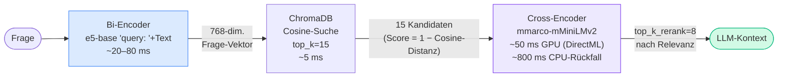
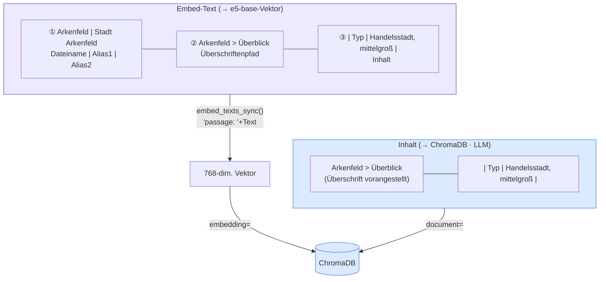

# Embedding-Strategie

Wie LoreKeeper sucht und **warum so**: Embedding-Modell, Reranking, Hybrid Search, Deckel pro
Datei, Regelwerk-Slot, Section Expansion und der Aufbau der Embed-Texte. Die Parameter stehen in
[configuration.md](configuration.md) → `retrieval`, der Ablauf als Diagramm in
[data-flow.md](data-flow.md).

## Inhaltsverzeichnis
1. [Überblick](#überblick)
2. [Warum diese Entscheidungen?](#warum-diese-entscheidungen)
   - [Warum `multilingual-e5-base`?](#warum-multilingual-e5-base)
   - [Warum ein Cross-Encoder-Reranking?](#warum-ein-cross-encoder-reranking)
   - [Warum BM25-Hybrid-Suche?](#warum-bm25-hybrid-suche)
   - [Warum ein Deckel pro Datei?](#warum-ein-deckel-pro-datei)
   - [Warum ein Regelwerk-Slot?](#warum-ein-regelwerk-slot)
   - [Warum Section Expansion?](#warum-section-expansion)
   - [Warum die Identitäts-Schicht?](#warum-die-identitäts-schicht-dateiname--aliase)
   - [Warum Chunking nach Überschriften?](#warum-chunking-nach-überschriften)
   - [Warum SHA-256 fürs Neu-Indizieren?](#warum-sha-256-fürs-neu-indizieren)
   - [Warum Bilder ausschließen?](#warum-bilder-aus-der-suche-ausschließen)
3. [Retrieval-Ablauf](#retrieval-ablauf)
4. [Aufbau des Embed-Texts](#aufbau-des-embed-texts)
5. [Dokumenttypen](#dokumenttypen)
6. [Was NICHT im Embedding steckt](#was-nicht-im-embedding-steckt)
7. [Neu indizieren nach Änderungen](#neu-indizieren-nach-änderungen)

---

## Überblick

LoreKeeper embeddet alle Dokumente mit `intfloat/multilingual-e5-base` (768 Dimensionen,
512 Tokens Kontext, Cosine-Ähnlichkeit), optional ergänzt um einen **BM25-Index** für die
Hybrid-Suche. Das Modell ist **asymmetrisch**: Fragen bekommen das Präfix `"query: "`, Passagen
`"passage: "` — der `EmbeddingService` setzt das automatisch, wenn der Modellname `"e5"` enthält.

Gewichte für einzelne Felder gibt es in sentence-transformers nicht. Die Wirkung entsteht über die
**Position** (was früher im Text steht, prägt den Vektor stärker) und **Wiederholung**.

---

## Warum diese Entscheidungen?

Der Embedding-Stack ist der größte Qualitätshebel eines RAG-Systems. Jede Entscheidung unten löst
ein konkretes Problem, das mit echten Vault-Daten aufgetreten ist.

### Warum `multilingual-e5-base`?

- **Der Vault ist deutsch.** Nur-Englisch-Modelle (MiniLM, `bge-*-en`) machen aus deutscher
  Morphologie Rauschen. Auf MIRACL/mMARCO liegt E5 multilingual bei nicht-englischer Suche 10–20
  Punkte vor MiniLM.
- **E5 ist asymmetrisch.** Die Präfixe `query: ` / `passage: ` trainieren das Modell, kurze Fragen
  und lange Passagen in verträglichen Räumen abzubilden. Symmetrische Modelle, auf Satzpaar-
  Ähnlichkeit trainiert, schneiden bei Frage→Dokument schlechter ab.
- **Lokal, kostenlos, überschaubar.** ~1,1 GB, läuft auf der CPU. Keine API-Kosten, keine Daten
  verlassen den Rechner, keine Rate-Limits beim Indizieren Tausender Dateien.
- **Bewusster Kompromiss:** `e5-large` wäre ~2 % genauer, aber dreimal langsamer und größer. Das
  Reranking holt den Großteil davon zu einem Bruchteil der Kosten.

### Warum ein Cross-Encoder-Reranking?

Bi-Encoder kodieren Frage und Dokument **getrennt** und vergleichen per Cosine — schnell, aber das
Modell sieht das Paar nie zusammen. So entstehen plausibel wirkende Top-Treffer, die von der
falschen Entität handeln.

Der Cross-Encoder (`mmarco-mMiniLMv2-L12-H384-v1`) kodiert **beides zusammen** und bewertet die
Relevanz direkt. Pro Paar ist er ~20× langsamer, deshalb läuft er nur über die 15 Kandidaten der
Vektorsuche und wählt die finalen 8. Kurz: Der Bi-Encoder findet 90 % der richtigen Kandidaten,
der Cross-Encoder bringt sie in die richtige Reihenfolge.

**Wo er läuft:** Mit `reranking.backend: directml` auf der GPU über ONNX Runtime + DirectML (jede
DX12-Karte, auch AMD), mit dem veröffentlichten ONNX-Export des Modells — identische Scores, ~50 ms
für 15 Paare statt ~840 ms auf der CPU und unabhängig von CPU-Last (~70 ms statt ~14 s, während
eine Simulation alle Kerne belegt). Ist DirectML nicht verfügbar, schreibt der Retriever eine
Warnung ins Log und nimmt das torch-Modell auf der CPU; fällt die GPU erst im Betrieb aus
(Treiber-Reset, VRAM voll), wechselt er ebenso mit Warnung auf die CPU — für den Rest der Laufzeit,
statt jede weitere Frage scheitern zu lassen. Der Bi-Encoder bleibt bewusst auf der
CPU: ein Query-Embedding kostet ~0,08 s, und eine andere Rechenbibliothek würde die Vektoren
gegenüber dem bestehenden Index leicht verschieben.

**Warum DirectML (Entscheidung 12.10.)** — Benchmark auf Ryzen 5 5600X / RX 9070 XT, 15 Paare in
Produktionsgröße, 30 Wiederholungen; „Last“ = 12 Busy-Loop-Prozesse (≈ laufende Simulation):

| Variante | idle | unter Last | Ranking wie torch? |
|---|---|---|---|
| torch CPU | 840 ms | 14,2 s | — |
| ONNX fp32 CPU | 840 ms | 2,9 s | ✅ identisch |
| ONNX int8 CPU (`quint8_avx2`) | 710 ms | 2,8 s | ❌ Top-8 weicht ab → verworfen |
| **DirectML fp32 (GPU)** | **50 ms** | **68 ms** | ✅ identisch (max. Abweichung 6·10⁻⁶) |
| DirectML fp16 | — | — | lädt nicht |

Golden Set mit GPU-Reranker in ~1 min statt ~12 min, gleiche Treffer. Verworfen bzw. später neu zu
prüfen: **PyTorch + ROCm unter Windows** (die RX 9070 XT lieferte still Nullen — hätte den Index
zerstört), **Windows ML** als Nachfolger von DirectML (Radeon-Pfad aus Python nicht belegt). DirectML
ist bei Microsoft im Wartungsmodus und braucht das Paket `onnxruntime-directml` statt `onnxruntime`
(Installation: README); ein `pip install -r requirements.txt` kann das CPU-Paket zurückholen — dann
greift der CPU-Rückfall mit Warnung im Log, falsch wird nichts. Im Betrieb (13.10.) braucht die
ganze Suche warm 120–170 ms; die erste Frage mit einer neuen Eingabelänge ist auf DirectML einmalig
langsamer (~0,4 s), direkt nach dem Laden des LLM in den Grafikspeicher einmal ~2 s gesehen.

### Warum BM25-Hybrid-Suche?

Vektorsuche verallgemeinert gut, verliert aber Präzision bei exakten Begriffen — Eigennamen,
Zahlen, Regelvokabular („Langschwert“, „Bonusaktion“, „Marke“) rutschen in Nachbar-Chunks, selbst
wenn das Wort wörtlich vorkommt. BM25 belohnt exakte Wortübereinstimmung und trifft diese Fälle.

LoreKeeper führt beide **parallel** aus, nicht als Vorfilter:

1. Die Vektorsuche holt die Top-K aus ChromaDB und wendet `score_threshold` auf die Cosine-Scores
   an — solange sie noch vergleichbar sind.
2. BM25 fragt einen In-Memory-Index (`rank_bm25`), lazy aus derselben Collection gebaut und nach
   jeder Änderung der Collection verworfen (Ingestion, Quelle entfernen, Wipe, Recategorize — sonst
   fände die Hybrid-Suche gelöschte Inhalte bzw. filterte auf alten Metadaten). Der Aufbau läuft unter
   einer Sperre und wird auf einmal veröffentlicht: gleichzeitige erste Fragen hatten zwei Korpora
   vermischt (Treffer auf falsche Dokumente, Roadmap 11.0). Metadaten-Filter werden nachträglich mit ChromaDB-kompatiblen
   Operatoren angewandt (`$eq`, `$ne`, `$in`, `$and`).
3. Beide Listen werden per **Reciprocal Rank Fusion** zusammengeführt:
   `score = Gewicht / (k + Rang + 1)`, `bm25_weight` (0,3) steuert die Balance, `k=60` dämpft den
   Vorteil der obersten Ränge.
4. Der fusionierte Pool geht wie gehabt zum Reranker.

RRF-Scores liegen auf einer anderen Skala (max. ≈ 1/61); deshalb greift die Schwelle **vor** der
Fusion, nie auf dem fusionierten Score. Für BM25 gibt es keine vergleichbare absolute Schwelle,
`bm25_top_k` begrenzt das Rauschen.

Hybrid ist pro Anfrage schaltbar (`hybrid_search`); die Evaluation-Seite hat eine Auswahl
(Config / nur Vektor / Hybrid) und einen A/B-Lauf über das Golden Set.

### Warum ein Deckel pro Datei?

Cross-Encoder-Scores bewerten nur Frage und Passage — das Modell weiß nicht, dass es schon etwas
Ähnliches gewählt hat. Bei „Was ist Arkenfeld?“ kommen 8 Chunks aus `Arkenfeld.md`, alle hoch
bewertet, und das LLM bekommt tiefen, aber **engen** Kontext: viel Arkenfeld, nichts aus
Fraktionen, Kampagne oder NPCs.

Deshalb gilt nach dem Reranking ein Deckel **`max_per_source`** (3), in **zwei Durchgängen**:

1. **Divers füllen** — die nach Score sortierte Liste ablaufen und Chunks annehmen, bis eine Datei
   den Deckel erreicht; blockierte Chunks wandern in einen Überlauf (weiter in Score-Reihenfolge).
2. **Nachfüllen** — kommen so weniger als `top_k_rerank` zusammen (dünner Pool, eine Datei
   dominiert), werden die freien Plätze aus dem Überlauf gefüllt.

Der Deckel ist also eine **Vorliebe** für Vielfalt, kein Platzvernichter: Solange Kandidaten da
sind, kommen nie weniger als `top_k_rerank` Chunks zurück. Danach wird nach Score neu sortiert,
damit das LLM das Relevanteste zuerst sieht. Er zählt je (Quelle, Datei) — zwei gleichnamige
Dateien in verschiedenen Quellen (z.B. zwei `llm_report.md`) haben je einen eigenen Deckel.

Bewusst **keine** Deduplizierung nach Überschrift: Ein langer Abschnitt ergibt legitim mehrere
Chunks. Verdrängt wird auf Dateiebene, also wirkt der Deckel dort.

- `3` (Standard) — gut für einen Vault mit vielen kleinen, verlinkten Notizen.
- `5+` — wenn einzelne Dateien groß und maßgeblich sind (z.B. ein Regelwerk-PDF).
- `0` — kein Deckel, reine Reranker-Reihenfolge.

### Warum ein Regelwerk-Slot?

Fragen, die eine Vault-Entität **und** einen Regelbegriff nennen — „Was bewirkt Ritterlichkeit bei
Escanor?“, „Thalion trägt eine Phönixfeder – was kann sie?“ — treffen die Datei der Entität so
stark, dass sie alle 15 Vektor-Kandidaten belegt. Die Regeldefinition im PDF erreicht den Reranker
nie; kein Deckel und keine Umsortierung hilft dann.

`retrieval.rules_slot` ergänzt eine zweite, kleine Vektorsuche nur in Gruppe `rules`
(5 Kandidaten, mit demselben Filter wie die Anfrage — der Spieler-Modus bleibt dicht). Diese
Kandidaten bewertet der Cross-Encoder mit, sie bleiben aber **außerhalb des Haupt-Pools**. Nur
wenn kein `rules`-Chunk in die finalen Top-`top_k_rerank` gekommen ist, ersetzt der beste davon
den schwächsten Chunk — wenn sein Score ≥ `min_score` (−4) ist, nie mehr als einer und erst ab 3
finalen Chunks (bei `top_k_rerank` 1–2 würde ein schwacher Regel-Chunk den Großteil des Kontexts
verdrängen).

Die Extra-Kandidaten in den Haupt-Pool zu mischen wurde gemessen und verworfen: etwas mehr
Abschnitt-Treffer (138 statt 136 von 153), aber Regelwerk-Chunks in 121 von 138 reinen
Lore-Fragen statt 64. Golden Set mit Slot: Abschnitte 132 → 136/153, Fragen mit Entität + Regel
(x001–x008) 1 → 5/8.

### Warum Section Expansion?

Aufzählungsfragen („Welche Fähigkeiten hat der Waldläufer?“) treffen oft nur zwei, drei
Unterabschnitte einer Sektion; die Antwort wird dann lückenhaft. Teilen sich ≥ 2 Treffer einer
Datei eine Eltern-Überschrift mit **verschiedenen** Unter-Überschriften, lädt der Retriever die
ganze Sektion in Dokumentreihenfolge und setzt sie an der Stelle des besten Treffers ein.

Zwei Grenzen schützen den Kontext: Sektionen über `max_chunks` (25) bleiben unverändert, und
expandiert wird nur, wenn ein Treffer der Sektion unter den ersten `top_rank` (3) liegt — sonst
ziehen zwei zufällige, schwache Treffer eine fremde Sektion herein. Golden Set mit `top_rank: 3`:
Ø Chunks 13,9 → 12,6, Abschnitt-Treffer unverändert. Offen: ein Gesamtbudget über mehrere
expandierte Sektionen (bis zu 49 Chunks sind noch möglich, Roadmap 5.3).

### Warum die Identitäts-Schicht (Dateiname | Aliase)?

Der wichtigste Trick für Inhalte, die sich um Entitäten drehen.

Ein Chunk wie `| Typ | Handelsstadt, mittelgroß |` enthält keinen Eigennamen — es ist eine
Tabellenzeile. Ihr Embedding hat null Bezug zu „Was ist Arkenfeld?“; der Chunk würde nie gefunden.

Lösung: **Dateiname und Aliase aus dem Frontmatter werden dem Embed-Text vorangestellt** (nicht
dem in ChromaDB gespeicherten Inhalt). Der Vektor trägt jetzt „Arkenfeld | Stadt Arkenfeld“ und
passt zu Fragen nach der Entität; das LLM sieht weiter nur den sauberen Inhalt.

Das funktioniert, weil Obsidian-Vaults die Identität einer Entität per Konvention im Dateinamen
tragen. Bei beliebigen Markdown-Sammlungen ginge das nicht.

### Warum `ef_search: 1000`?

ChromaDB sucht über einen HNSW-Graphen — approximativ. Mit der Voreinstellung `ef_search: 100`
fehlte bei 38 von 278 Golden-Fragen mindestens ein Chunk, den eine exakte Suche unter den Top 15
hat, und nach einem Neustart bekamen 6–8 Fragen andere Kandidaten (bitgleiche Query-Embeddings).
Eval-Läufe in getrennten Prozessen schwankten dadurch um ±2 Abschnitte. Gemessen am 13.10. auf
einer Kopie des Index (4745 Chunks; Top 15 mit dem Bild-Filter wie im Betrieb):

| `ef_search` | anders als exakte Suche | anders zwischen Prozessen | pro Abfrage |
|---|---|---|---|
| 100 | 38–39 Fragen | bis 8 | 9,6 ms |
| 200 | 12–13 | bis 8 | 9,9 ms |
| 500 | 4–6 | bis 2 | 10,9 ms |
| **1000** | **0** | **0** | 11,8 ms |

Golden Set (je zwei Läufe in getrennten Prozessen): mit 100 Dateien 275/274 von 278, Abschnitte
136/135 von 153, 11 Fragen mit anderer Trefferliste; mit **1000 beide Läufe identisch**, 276/278 und
137/153 (p105 gewinnt Datei und Abschnitt, nichts verloren), Ø 183 statt 178 ms pro Frage. Der Wert
ist an die Größe gebunden: wächst der Index deutlich (Bilder, weitere Quellen), mit **Evaluation →
🎯 Suchgenauigkeit prüfen** gegen eine exakte Suche neu prüfen
([evaluation.md](evaluation.md#suchgenauigkeit-prüfen)). Ein geänderter Wert wirkt erst nach einem
Neustart des Backends — ChromaDB übernimmt ihn beim Laden des Index, nicht in einen schon geladenen. Eine exakte Suche in NumPy statt HNSW wäre ein
zweiter Suchweg (Filter, Spieler-Modus, Synchronität mit der Collection) — bei 0 Abweichung unnötig.

**Stolperfalle beim Anlegen**: Gibt man ChromaDB 1.5 `metadata={"hnsw:space": "cosine"}` *und*
`configuration` zusammen, entsteht still eine **l2**-Collection. LoreKeeper setzt deshalb Raum und
`ef_search` nur über `configuration`; ein späteres `get_or_create_collection` ignoriert die
Konfiguration einer bestehenden Collection, `ef_search` wird dann per `modify` nachgezogen.

### Warum Chunking nach Überschriften?

Obsidian-Dokumente sind **über Überschriften strukturiert**: ein Charakterbogen hat `## Werte`,
`## Hintergrund`, `## Beziehungen`. Zeichenbasiertes Chunking schneidet mitten in Absätze und
Tabellen und zerstört das. Chunking nach Überschriften:

1. Teilt zuerst an `#`/`##`/`###`.
2. Hält Tabellen **atomar** — nie zwischen Zeilen geteilt (eine halbe Zeile ist Müll). Tabellen
   bleiben bis `max_chunk_size × 3` in einem Chunk; nur sehr große werden an Zeilengrenzen mit
   wiederholtem Kopf geteilt.
3. Legt zu kleine Abschnitte **nur innerhalb derselben Überschrift** zusammen — eine winzige
   Tabelle unter `### Bruchgraben` schluckt nicht den nächsten Abschnitt, sonst würde
   `heading_hierarchy` über den Inhalt lügen.
4. Behält den Überschriftenpfad (`Arkenfeld > Geografie`) im Chunk, damit das LLM sieht, woher
   der Inhalt stammt.

Ergebnis: jeder Chunk ist eine inhaltliche Einheit, und seine Überschrift stimmt immer — darauf
bauen Deckel, Section Expansion und die Abschnittsprüfung der Evaluation.

### Warum SHA-256 fürs Neu-Indizieren?

- **Naheliegende Alternative: Änderungszeit.** Versagt bei Windows-Netzlaufwerken, Git-Checkouts,
  OneDrive/Dropbox (ändern die Zeit ohne Inhalt) und Massenoperationen.
- **SHA-256 über die Dateibytes** ist deterministisch und billig — 1 MB Markdown in ~1 ms. Der Hash
  steht in den Chunk-Metadaten; beim Neu-Indizieren wird verglichen und Unverändertes komplett
  übersprungen. Bei 1000 Dateien mit 5 Änderungen wird aus Minuten eine Sekunde.

### Warum Bilder aus der Suche ausschließen?

Bild-„Chunks“ sind Platzhalter wie `"Bild: Malek Nocthar 1 (Pfad: NPCs)"`. Sie ranken schlecht und
**verdrängen** schlimmer noch inhaltsreiche Chunks. Ein harter Filter `document_type != image` im
Retriever hält sie aus dem LLM-Kontext. Fragen nach Bildern funktionieren trotzdem über die
zugehörige `.md`-Datei (siehe [Dokumenttypen](#dokumenttypen)). Echte Bildbeschreibungen sind
Roadmap 2.

---

## Retrieval-Ablauf



Vollständiger Ablauf mit BM25, Regelwerk-Slot und Section Expansion:
[data-flow.md](data-flow.md#beantwortung-einer-frage).

| | Bi-Encoder (e5-base) | Cross-Encoder (mMiniLMv2) |
|---|---|---|
| **Funktionsweise** | Frage und Dokument getrennt → Cosine | Frage + Dokument zusammen → direkte Bewertung |
| **Vorteil** | Vektoren vorberechnet → sehr schnell | Versteht die Beziehung zwischen Frage und Text |
| **Nachteil** | Kein Zusammenspiel | Zu langsam für den ganzen Index |
| **Rolle** | Kandidaten finden (Top 15) | Kandidaten ordnen (Top 8) |

---

## Aufbau des Embed-Texts

Für jeden Chunk wird ein **Embed-Text** gebaut; ChromaDB speichert den ursprünglichen
**Inhalt** (den später das LLM sieht):



- **Schicht 1 — Identität:** `Dateiname | Alias 1 | Alias 2`. Der Dateiname
  (`Arkenfeld.md → "Arkenfeld"`) ist der wichtigste Suchbegriff, Aliase kommen aus dem Frontmatter.
  Ohne diese Schicht fände „Was ist Arkenfeld?“ den Chunk `| Typ | Handelsstadt |` nicht.
- **Schicht 2 — Kontext:** `Überschrift > Unterüberschrift` — welcher Abschnitt (vom Chunker in den
  Inhalt geschrieben).
- **Schicht 3 — Inhalt:** der eigentliche Text, Tabellen, Listen.

---

## Dokumenttypen

| Typ | Aufbau des Embed-Texts | In der Suche |
|-----|------------------------|:---:|
| Markdown | `Dateiname \| Aliase` · `Überschrift > Unter` · `Inhalt` | ✅ |
| PDF | `Dateiname` · `Überschrift > Unter` · `Inhalt` | ✅ |
| Bild | — | ❌ |

**Fragen nach Bildern** wie „Zeig mir ein Bild von Malek Nocthar“ liefern die zugehörige
`.md`-Datei (`NPCs/Malek Nocthar.md`). Bild-Quellen rendert die UI per `st.image()`, wenn
`document_type == "image"` gesetzt ist. Das Golden Set bildet das ab: Bildfragen erwarten die
`.md`-Datei.

---

## Was NICHT im Embedding steckt

| Feld | Warum nicht | Stattdessen |
|------|-------------|-------------|
| `obsidian_tags` | Kategoriesignal zu schwach | ChromaDB-Metadaten |
| `wikilinks` | Verweis-Graph, kein Suchsignal | ChromaDB-Metadaten (Roadmap 3.5: Wikilink-Expansion) |
| `group` / `content_category` | Über Filter steuerbar | ChromaDB-Metadaten → Filter im Chat |
| `source_path` | Absoluter Pfad ohne Bedeutung | Links in der UI (`file://`) |

---

## Neu indizieren nach Änderungen

Der `content_hash` hängt am **Dateiinhalt**, nicht am erzeugten Embed-Text. Änderungen an Chunking
oder Embed-Text erfordern deshalb eine **vollständige** Neu-Indizierung — der inkrementelle Lauf
würde jede Datei überspringen:

- Sources-Seite → **🔄 Alle Dokumente neu indizieren**, oder
- `POST /ingest?full=true`

Ein anderes **Embedding-Modell** (andere Vektordimension) braucht zusätzlich eine leere
Collection: Sources-Seite → Danger Zone (`POST /admin/wipe`), oder bei gestopptem Backend:

```powershell
Remove-Item -Recurse -Force .\chroma_data
python -m src.ingestion.orchestrator
```

Mehr in [operations.md](operations.md).
