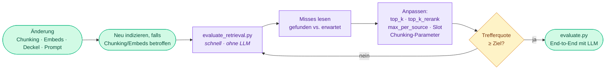

# Evaluation

Wie LoreKeeper Suchqualität messbar macht: das Golden Set, das schnelle Retrieval-Skript, der
End-to-End-Lauf mit LLM, Kennzahlen und das empfohlene Vorgehen. Die Bedienung der
Evaluation-Seite steht in [ui-ux.md](ui-ux.md#evaluation-seite-uipages2_evaluationpy).

## Inhaltsverzeichnis
1. [Überblick](#überblick)
2. [Kurz und knapp](#kurz-und-knapp)
3. [Das Golden Set (`evaluation/qa_pairs.yaml`)](#das-golden-set-evaluationqa_pairsyaml)
4. [`evaluate_retrieval.py` — schneller Durchlauf](#evaluate_retrievalpy--schneller-durchlauf)
5. [`evaluate.py` — End-to-End](#evaluatepy--end-to-end)
6. [Kennzahlen und Ziele](#kennzahlen-und-ziele)
7. [Vorgehen](#vorgehen)
8. [Neue Fragen hinzufügen](#neue-fragen-hinzufügen)

---

## Überblick

Das Golden Set und zwei Skripte messen die Suchqualität ohne Rätselraten. Immer einsetzen, wenn
sich etwas an der Suche ändert — Chunking, Embedding, Reranking, Deckel, Slot, Prompts —, damit
Verschlechterungen auffallen, bevor sie am Spieltisch stören.

---

## Kurz und knapp

```powershell
# Schnell: nur Retrieval, kein LLM (~1 min für 278 Fragen mit GPU-Reranker)
python -m evaluation.evaluate_retrieval

# Parameter für einen Lauf überschreiben
python -m evaluation.evaluate_retrieval --top-k 25 --top-k-rerank 10

# End-to-End mit LLM (langsam, Backend muss laufen)
python -m evaluation.evaluate --qa-pairs evaluation/qa_pairs.yaml --output evaluation/results/
```

`evaluate_retrieval.py` öffnet die eingebettete ChromaDB selbst — nur bei **gestopptem** Backend
starten; bei laufendem Backend die Evaluation-Seite nutzen (gleicher Code über `/eval/run`).
Berichte landen als JSON mit Zeitstempel in `evaluation/results/`.

---

## Das Golden Set (`evaluation/qa_pairs.yaml`)

278 handverlesene Fragen:

| Block | Anzahl | Was er prüft |
|---|---|---|
| `markdown` (m001–m067) | 67 | Entitäten-Fragen → Datei (NPC, Ort, Organisation, Gegenstand, Gegner) plus Detailfragen zu einzelnen Tabellen/Unterabschnitten (m026–m067) — Arkenfeld-Viertel, Thal'Emyra, Malek, Gegner-Schwächen, Dämmerorden, Schattenorden, Sequenz-Schlüssel. Manche haben `source_type: pdf`, weil ihr Gegenstand ins Regelwerk gewandert ist (m005) |
| `pdf` (p001–p120) | 120 | Regelwerk-PDF, alle 7 Kapitel. p001–p041: eine Frage je Kapitel/Klasse. p042–p120: einzelne Regeln — Kampfunfähigkeit/Überschaden/Heroische Runde vs. Überheilung, kritischer Treffer, Schadens- und Statuseffekte, Ressourcen und Stufentabelle, Ausrüstung/Tränke/Handel, Skill- und Zauberkarten, alle 7 Eigenheiten-Gruppen, Artefakte |
| `image` (i001–i010) | 10 | Bildfragen zeigen auf die **zugehörige `.md`-Datei** (Bilder sind aus der Suche ausgeschlossen, siehe [embedding-strategy.md](embedding-strategy.md)) |
| `adventure` (a001–a031) | 31 | Abenteuer- und Kampagnenstruktur, aktübergreifend (a001–a015), plus Szenen und Mechaniken in einzelnen Abenteuern (a016–a031) |
| `s001–s006` **Strukturtests** | 6 | Unterabschnitte, Vielfalt über Quellen, Tabellen am Stück, Identitäts-Schicht, Wikilink-Querverweise |
| `k001–k020` **Stichworttests** | 20 | Exakte Begriffe, bei denen BM25 der Vektorsuche überlegen sein sollte — seltene Eigennamen (Rhaz'Muell, Artheon Knisterhand Faraday), eindeutige Komposita (Ephraskal-Handschuh, Venthir-Siegelnetz-Blaupause), Farbvarianten (Blauer/Roter/Grüner Monolith). Für den A/B-Lauf Vektor vs. Hybrid |
| `x001–x008` **quellenübergreifend** (`source_type: mixed`) | 8 | Eine Vault-Datei nennt eine Eigenheit/einen Zauber/ein Artefakt, dessen Regel nur im PDF steht (Maleks Schattenfreund, Escanors Ritterlichkeit). Einige vermerken Widersprüche zwischen Vault und Regelwerk in `notes`. Gemessen nach Abschnitt; der Regelwerk-Slot hob sie von 1/8 auf 5/8 |
| `z001–z016` **Simulation** | 16 | Berichte der PnP-Simulation (Gruppe `simulation`). Prüfen Quelle (`expected_source_ids`) und benannten Abschnitt; Antwort-Stichwörter nur Methodenbegriffe, damit neue Simulationsläufe sie nicht brechen |
| `f###` **aus Feedback** | — | Über Evaluation → „Feedback“ aus bewerteten Chat-Antworten übernommen: 👍 behält die Quellen der Antwort, 👎 lässt sie leer zum Nachtragen |

Die Strukturtests fangen Fehler, die Entitäten-Fragen übersehen:

| ID | Fängt |
|---|---|
| `s001` | Zusammenlegen kleiner Chunks über Überschriftsgrenzen (der Fehler, der den Gotteslicht-Viertel-Chunk versteckte) |
| `s002` | Erreichbarkeit tiefer `###`-Abschnitte |
| `s003` | Vielfalt über Quellen — wirkt `max_per_source`, oder frisst eine Datei alle Plätze? |
| `s004` | Tabellen am Stück + Identitäts-Schicht — reine Werte-Tabellen ohne Namensnennung |
| `s005` | Wikilink als Kontext — Entitäten nur per `[[…]]` in einer anderen Datei erwähnt |
| `s006` | Information nur in einer Tabellenzelle, gefunden über die Identitäts-Schicht |

### Schema

```yaml
- id: m001
  question: "Wo liegt Arkenfeld und was ist das für ein Ort?"
  source_type: markdown          # markdown | pdf | image | mixed | simulation
  category: location             # nur Label — nicht in ChromaDB
  expected_sources:
    - "Orte/Arkenfeld.md"        # Pfad relativ zur Quelle
  expected_source_ids: []        # optional: die Datei muss aus einer dieser Quellen kommen
  expected_answer_contains:
    - "Arkenfeld"                # Teilstrings, die die LLM-Antwort enthalten soll
  expected_section: "4.10"       # optional: nummerierte Überschrift oder Überschriften-Name
  notes: "optional"
```

`category` ist nur ein Label des Golden Sets und hat nichts mit `content_category` in ChromaDB zu
tun.

### Ein „Treffer“ ist bewusst großzügig

Eine Frage zählt als Treffer, wenn **irgendeine** ihrer `expected_sources` unter den gefundenen
Chunks ist. Unterordner werden ignoriert (`Orte/Arkenfeld.md` passt auch zu
`Orte\Arkenfeld.md` oder `Arkenfeld.md`). Das hält die Kennzahl stabil gegen Pfadtrenner und lässt
Fragen mit mehreren Quellen auch dann treffen, wenn nur eine kommt — der `details`-Block im
JSON-Bericht zeigt genau, was gefunden wurde. Mit `expected_source_ids` muss die Datei zusätzlich
aus einer bestimmten Quelle stammen (nötig bei gleichnamigen Dateien wie den beiden
`llm_report.md`).

Beim Regelwerk ist ein Datei-Treffer fast immer wahr — jeder Chunk kommt aus
`pnp_regelbuch.pdf`, auch der falsche Abschnitt. Dafür gibt es `expected_section`: eine
nummerierte Überschrift (`"4.10"`), mit der mindestens eine gefundene Überschrift beginnen muss.
Unterabschnitte zählen (`"5.4"` passt zu `5.4.1 Krieger`), Geschwister nicht (`"4.1"` ≠ `4.10`).
Unnummerierte Überschriften passen über den Namen (`"Gesamtwertung"` passt zu „Gesamtwertung (R3
vs Median aus 6 Profilen)“). Der Bericht enthält `section_hit_rate`, `section_total` und
`section_misses` (mit den gefundenen Überschriften); die Evaluation-Seite markiert „richtige Datei,
falscher Abschnitt“ mit ⚠️. Für den End-to-End-Lauf `expected_answer_contains` so wählen, dass die
Wörter nur im richtigen Abschnitt stehen (z.B. `Todeszähler` für Überschaden, nicht `Überheilung`).

---

## `evaluate_retrieval.py` — schneller Durchlauf

Spricht direkt mit dem Retriever (Embedding → ChromaDB → Reranker → Deckel → Slot → Expansion),
ohne LLM. Für jede Iteration beim Tunen der Suche.

```powershell
python -m evaluation.evaluate_retrieval
python -m evaluation.evaluate_retrieval --top-k 25 --top-k-rerank 10
python -m evaluation.evaluate_retrieval --qa-pairs evaluation/qa_pairs.yaml --output evaluation/results/
```

| Flag | Default | Wirkung |
|---|---|---|
| `--top-k` | aus `settings.yaml` | Kandidaten der Vektorsuche |
| `--top-k-rerank` | aus `settings.yaml` | Chunks nach dem Reranking |
| `--hybrid` / `--no-hybrid` | aus `settings.yaml` | Hybrid-Suche für diesen Lauf erzwingen bzw. abschalten; ohne beide gilt die Config |
| `--qa-pairs` | `evaluation/qa_pairs.yaml` | Fragenkatalog |
| `--output` | `evaluation/results/` | Zielordner des JSON-Berichts |

`max_per_source` ist (noch) kein Flag — zum Durchprobieren `RETRIEVAL__RERANKING__MAX_PER_SOURCE=N`
setzen (bis 13.10. war im Skript fest 3 hinterlegt, die Variable wirkte nicht). Pro Anfrage lässt es
sich über API und UI überschreiben; ohne Angabe gilt überall der Wert aus `settings.yaml`, und der
Bericht (`config`) nennt die tatsächlich benutzten Werte.

A/B-Vergleich: zweimal laufen lassen und die Berichte vergleichen (z.B. `--no-hybrid` vs.
`--hybrid`). Die Evaluation-Seite hat dafür den Knopf **⚖ A/B starten (Vektor vs. Hybrid)** mit
Differenz der Trefferquote und den Fragen, die Hybrid gewinnt oder verliert.

> **Varianten im selben Prozess vergleichen.** ChromaDBs HNSW-Suche ist approximativ: nach einem
> Neustart bekommen ~9 von 278 Fragen leicht andere Vektor-Kandidaten (bei bitgleichen
> Query-Embeddings), zwei getrennte Läufe weichen deshalb um etwa ±2 Abschnitt-Treffer ab. Für
> Parameter-Vergleiche in einem Skript je Variante einen `Retriever` bauen und
> `run_evaluation_with_retriever` aufrufen (Roadmap 5.5).

Die Konsolenausgabe zeigt die Aufteilung nach `source_type` und einen Block `Misses` mit erwarteten
und gefundenen Dateien für jeden Fehlschlag — genau lesen, er erklärt, *warum* eine Frage scheitert.
Bei der Ursachensuche helfen die Tabs **„Frage testen“** (welche Chunks eine Frage liefert) und
**„Chunks“** (alle gespeicherten Chunks einer Datei — z.B. um zu sehen, warum eine Tabellenzeile
ohne Überschrift nie passt).

---

## `evaluate.py` — End-to-End

Ruft den laufenden `/query`-Endpoint auf, misst also die **ganze** Pipeline inklusive LLM.
Langsamer (eine Generierung pro Frage); das Backend muss laufen (`.\start.ps1`).

```powershell
python -m evaluation.evaluate --qa-pairs evaluation/qa_pairs.yaml --output evaluation/results/
```

Zusätzlich gemessen wird `answer_contains`: wie oft die Antwort die Teilstrings aus
`expected_answer_contains` enthält. Als Abnahme, nachdem die Suche stabil ist.

Beide Skripte und die Evaluation-Seite teilen sich die Treffer-Regel (`source_hit`), das Laden des
Golden Sets und das Speichern der Berichte (`evaluation/evaluate_retrieval.py`). Berichte heißen
`retrieval_<zeit>.json` bzw. `e2e_<zeit>.json`; die Evaluation-Seite behält je Typ die letzten 3.
Der End-to-End-Lauf kann `expected_source_ids` nicht prüfen — `/query` liefert keine Quellen-IDs.

---

## Kennzahlen und Ziele

| Kennzahl | Skript | Was sie misst | Ziel | Stand 13.10. |
|---|---|---|---|---|
| **Trefferquote (Datei)** | `evaluate_retrieval.py` | Erwartete Datei unter den gefundenen Chunks | > 0,85 | 0,986 |
| **Abschnitt-Trefferquote** | `evaluate_retrieval.py` | Erwarteter Abschnitt unter den Überschriften | darf nicht sinken | 136/153 |
| **Answer Contains** | `evaluate.py` | Stichwörter in der LLM-Antwort | > 0,75 | — |
| **Latenz** | `evaluate.py` | Antwortzeit gesamt | < 10 s | ~3–4 s |

Die Ziel-Trefferquote liegt bewusst unter 1,0 — die Strukturtests prüfen Randfälle, sie alle zu
treffen ist ein Ziel, keine Grundlinie. Unter 0,85 → etwas ist kaputt. Dass die
Abschnitt-Trefferquote nicht sinkt, prüft auch `pytest -m perf` ([testing.md](testing.md#performance-prüfungen)).

---

## Vorgehen



**Neu indizieren nur nach Änderungen an Chunking, Embedding oder der Identitäts-Schicht.**
Reranking, Deckel, Slot, `top_k` und Prompts brauchen keine Neu-Indizierung — der Durchlauf bleibt
bei etwa einer Minute.

---

## Neue Fragen hinzufügen

Eintrag in `evaluation/qa_pairs.yaml` ergänzen (oder über die Evaluation-Seite: Tab „Golden Set“,
„Frage testen“ → „Zum Golden Set hinzufügen“, „Feedback“) und `evaluate_retrieval.py` erneut laufen
lassen. Dabei:

1. **`expected_sources` vollständig, aber knapp.** Lässt sich eine Frage aus drei Dateien
   beantworten, alle drei nennen — die Regel ist „irgendeine passt“, der Bericht zeigt, welche kam.
2. **Bildfragen zeigen auf die `.md`-Datei**, nicht auf das Bild.
3. **`notes:` ausfüllen** — *was* die Frage prüfen soll. Wenn sie später bricht, weißt du, ob es um
   Tabellen oder die Identitäts-Schicht ging.
4. **Keine `expected_answer_contains` bei breiten Fragen** — leer lassen (`[]`), wenn die Antwort zu
   offen für feste Teilstrings ist; `evaluate.py` prüft dann nur die Suche.
5. **Bei Regelwerk-Fragen `expected_section` setzen**, sonst ist der Treffer nichtssagend.
6. **Nach dem Hinzufügen laufen lassen.** Eine neue Frage, die schon jetzt verfehlt, ist ein
   Verbesserungswunsch, kein Regressionstest — in `notes` vermerken.
7. **Feedback-Fragen prüfen:** Aus 👎 übernommene Fragen haben leere `expected_sources` — die
   richtige Quelle eintragen. Umgeschriebene Folgefragen werden automatisch in ihrer eigenständigen
   Form übernommen (die Chat-Frage steht in `notes`); hat die Heuristik eine Folgefrage nicht
   erkannt („Und wer ist sein Vater?“ ohne Umschreiben), von Hand eigenständig formulieren.
