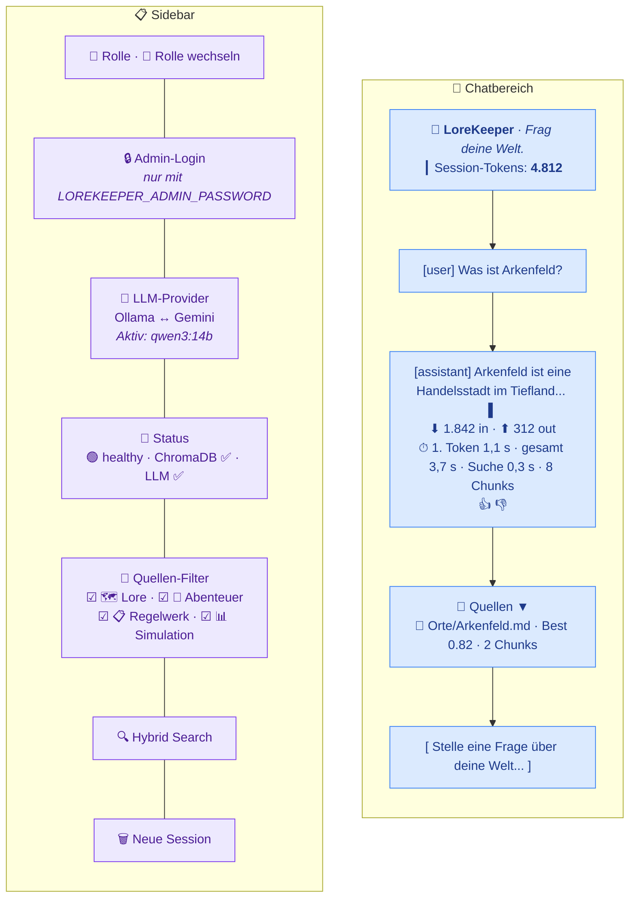
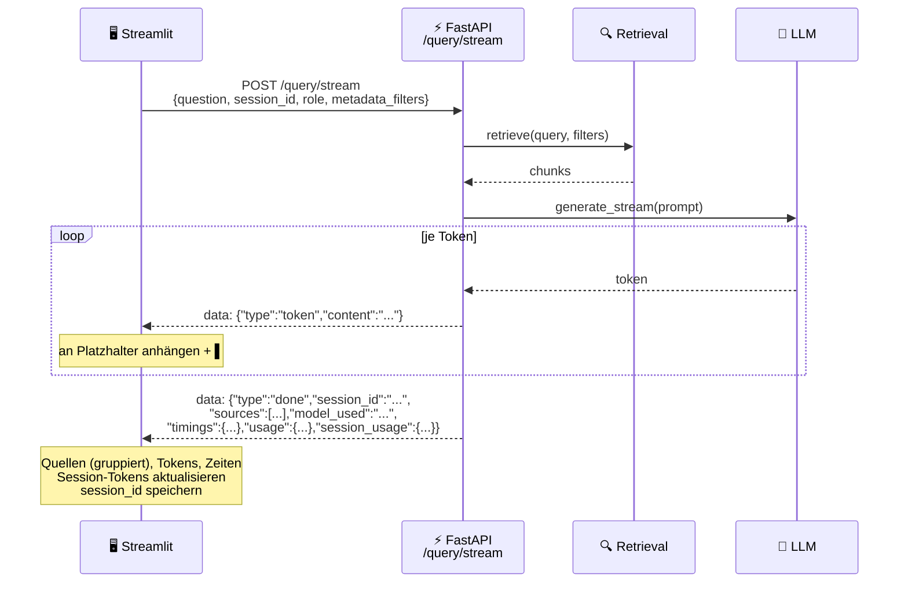

# Oberfläche (UI / UX)

Die Oberfläche von LoreKeeper ist komplett in Streamlit geschrieben. Dieses Dokument beschreibt
die Seiten, ihre Bedienung, wie sie mit dem FastAPI-Backend sprechen und welchen Session-State sie
nutzen. Die UI spricht nur über HTTP/SSE mit dem Backend und importiert keine Backend-Module.

## Inhaltsverzeichnis
1. [Chat](#chat)
   - [Rollenwahl: Spieler / Spielleiter](#rollenwahl-spieler--spielleiter)
2. [Sidebar](#sidebar)
3. [Kopfzeile](#kopfzeile)
4. [Chatbereich](#chatbereich)
5. [Sources-Seite (`ui/pages/1_Sources.py`)](#sources-seite-uipages1_sourcespy)
6. [Evaluation-Seite (`ui/pages/2_Evaluation.py`)](#evaluation-seite-uipages2_evaluationpy)
7. [Prompts-Seite (`ui/pages/3_Prompts.py`)](#prompts-seite-uipages3_promptspy)
8. [Settings-Seite (`ui/pages/4_Settings.py`)](#settings-seite-uipages4_settingspy)
9. [Antwortzeiten](#antwortzeiten)
10. [Session-State](#session-state)

---

## Chat



### Rollenwahl: Spieler / Spielleiter

Bevor der Chat öffnet, fragt `ui/LoreKeeper.py` **„Wer fragt?“** mit zwei Knöpfen (Logik in
`ui/roles.py`):

| Rolle | Durchsucht | Sidebar |
|---|---|---|
| **🎲 Spieler** | Nur Quellen mit **🎲 Spieler** auf der Sources-Seite (`player_visible`; z.B. Regelwerk + Charakterbogen) — keine Lore, keine Abenteuer, kein Spielleiter-Material | Rolle, „🔄 Rolle wechseln“, Status, Hybrid; **keine** Quellen-/Kategoriefilter |
| **📜 Spielleiter** | Alles, mit den üblichen Filtern | Volle Sidebar |

- Jede Frage trägt `role` (`player` / `game_master`). Für Spieler baut das **Backend** die
  Einschränkung selbst aus `player_visible` (`src/api/access.py`) und verknüpft mitgeschickte
  Filter per `$and` — sie können nur einengen. Keine freigegebene Quelle → `403`.
- Als zweite Sicherung schickt die UI zusätzlich
  `metadata_filters = {"source_id": {"$in": [<Spieler-Quellen>]}}` (aus `/sidebar-state` →
  `player_source_ids`); Gruppen-/Kategoriefilter der Sidebar werden für Spieler ignoriert. Der
  Browser spricht nie direkt mit dem Backend (`127.0.0.1`).
- Backend-Sessions sind an die Rolle gebunden: eine Spieler-Anfrage mit Spielleiter-`session_id`
  bekommt eine neue Session — kein Spielleiter-Verlauf in einer Folgefrage, auch außerhalb der UI.
- **„🔄 Rolle wechseln“** führt zurück zur Auswahl und startet eine **neue Session** (Chat,
  Backend-Session, Token-Zähler).
- Ist keine Quelle für Spieler freigegeben, ist die Eingabe gesperrt, mit Hinweis auf die
  Sources-Seite.
- **Keine Zugangskontrolle:** Jeder kann „Spielleiter“ wählen — der Modus schützt vor
  versehentlichen Spoilern, er sperrt niemanden aus. Admin-Seiten und Provider-Steuerung hängen
  unabhängig von der Rolle am `LOREKEEPER_ADMIN_PASSWORD`.

---

## Sidebar

### Backend-URL und Zugriffsschutz (`ui/admin_gate.py`)

Die Backend-URL ist nicht in der UI änderbar, sie kommt aus `LOREKEEPER_API_URL` (Standard
`http://127.0.0.1:8000`; nicht `localhost` — unter Windows ~2 s pro Anfrage).

Mit `LOREKEEPER_ADMIN_PASSWORD` (Heimnetz-Server, siehe [operations.md](operations.md)):
- zeigen die Admin-Seiten (Sources, Evaluation, Prompts, Settings) nur ein Login-Formular und
  rufen das Backend erst nach dem Passwort auf;
- bleibt der Chat offen, aber Provider-Auswahl und Gemini-Key-Eingabe werden durch das aktive
  Modell und einen Ausklapper **🔒 Admin-Login** ersetzt;
- gilt ein erfolgreicher Login für die Browser-Session und schaltet alle Seiten frei;
- wird Raten serverweit gebremst: jedes falsche Passwort wartet 1 s, 5 Fehlversuche in 5 Minuten
  sperren den Login (beide Formulare, alle Sessions) für 5 Minuten. Angemeldete Sessions arbeiten
  weiter; ein UI-Neustart hebt die Sperre auf.

Ohne Passwort ist alles offen (lokaler Einzelbetrieb).

### LLM-Provider

Auswahlfeld zum Wechsel zwischen Ollama und Gemini zur Laufzeit (mit Passwort nur für Admins).
Schlägt der Wechsel fehl, springt die Auswahl zurück und es erscheint eine Fehlermeldung.

**Gemini-Key:** Direkt darunter. `GET /provider/gemini/status` sagt nur, ob ein Key da ist
(`{has_key, source: env|runtime|none}`), nie den Key selbst.

| Zustand im Backend | Anzeige |
|---|---|
| Key aus Umgebung / `.env` | `🔑 Gemini-Key: ✅ (Umgebungsvariable)` + Ausklapper **Override** |
| Key in dieser Laufzeit über die UI gesetzt | `🔑 Gemini-Key: ✅ (UI-Eingabe)` + **Override** |
| Kein Key | Gelbe Warnung + Passwortfeld + **Key speichern** |

Die Eingabe geht an `POST /provider/gemini/key`; das Backend hält den Key nur im Speicher (nie auf
Platte, nach Neustart weg). Ist Gemini aktiv, wird der Provider sofort neu gebaut.

### Status

Aus `/sidebar-state` (in der UI 30 s gecacht; das Backend prüft im Hintergrund alle 60 s):
🟢 healthy (ChromaDB + LLM erreichbar) · 🟡 degraded (eine Komponente nicht erreichbar) ·
🔴 API nicht erreichbar.

### Hybrid Search

Eine Checkbox „🔍 Hybrid Search (BM25 + Vektor)“ unter **Suche**. Setzt `hybrid_search` in der
nächsten Anfrage und überschreibt `retrieval.hybrid.enabled` **nur für diese Session** — nützlich
bei exakten Namen oder Regel-IDs. Die Standardwerte der Suche stehen auf der Settings-Seite,
A/B-Läufe auf der Evaluation-Seite; die Sidebar bleibt bewusst schlank.

### Quellen-Filter (Lore / Abenteuer / Regelwerk / Simulation)

Vier Checkboxen schränken die Suche über das Metadatum `group` ein, das jeder Chunk beim Indizieren
von seiner Quelle erbt ([configuration.md](configuration.md#quellen--configsourcesyaml)):

| Checkbox | `group` |
|---|---|
| 🗺️ **Lore** | `lore` |
| 📖 **Abenteuer** | `adventure` |
| 📋 **Regelwerk** | `rules` |
| 📊 **Simulation** | `simulation` (Balance-Berichte — für reine Regelfragen abwählen) |

Das löst ein echtes Mehrdeutigkeitsproblem: „Was kann der Zeitmagier?“ passt auf die
Regelwerk-Klasse **und** auf den NPC *Arkenfeld, den Zeitmagier*. Ohne 🗺️ Lore sucht LoreKeeper nur
im Regelwerk.

| Auswahl | Filter ans Backend |
|---|---|
| Alle vier | `None` (kein Filter) |
| Teilmenge | `{"group": {"$in": [...]}}` + Hinweis „🔍 Suche eingeschränkt auf: …“ |
| Keine | Eingabe blockiert mit Fehlermeldung (kein API-Aufruf) |

Der Retriever verknüpft das mit dem festen Filter `document_type != "image"` per `$and`.

### Links und Neue Session

Hinweise auf **⚙ Sources** (Chunk-Zahl, Indizieren, Quellen) und **🛠 Settings**. **🗑️ Neue
Session** leert `messages` und `session_id` — die nächste Frage startet ohne Verlauf.

---

## Kopfzeile

| Links | Rechts |
|---|---|
| `📜 LoreKeeper` + `Frag deine Welt.` | **Session-Tokens** — Summe aus rein + raus + Denken der aktuellen Session, Tooltip mit Aufschlüsselung; „🗑️ Neue Session“ setzt zurück |

---

## Chatbereich

### Nachrichten

- Frühere Nachrichten kommen aus `st.session_state.messages`.
- Unter jeder Antwort:
  - Tokens `⬇ N in · ⬆ N out · 🧠 N think` (Denken nur, wenn > 0),
  - Zeiten `⏱ 1. Token … · gesamt … · Suche … · N Chunks` (aus `timings`),
  - bei umgeschriebener Folgefrage „🔎 Gesucht nach: …“,
  - 👍/👎 (`st.feedback("thumbs")`) für Spieler und Spielleiter. Ein Klick schickt
    `POST /feedback` mit Frage, Antwort, Quelldateien, Modell, Rolle, Session und Zeiten;
    Zurücknehmen als `rating: null`. Fehlermeldungen und ausgeblendete ältere Nachrichten haben
    keine Daumen. Anzeigen kostet keinen Backend-Aufruf — nur der Klick.
- Quellen im Ausklapper **📎 Quellen**, nach Datei gruppiert (siehe unten).

### Streaming

Token für Token per Server-Sent Events, mit blinkendem `▌` bis zum `done`-Event; dann werden
Quellen, Tokens und Zeiten gerendert und die `session_id` für Folgefragen gespeichert.



| Feld im `done`-Event | Bedeutung |
|---|---|
| `usage` | Tokens **dieser** Anfrage (`tokens_in`, `tokens_out`, `tokens_thinking`) |
| `session_usage` | Session-Summe danach — für die Kopfzeile |
| `timings` | Zeiten je Stufe — für die Zeile ⏱ |

Das LLM-Timeout der Anfrage kommt aus dem gecachten `/sidebar-state` — eine Chat-Nachricht kostet
genau eine Backend-Anfrage.

### Quellen (nach Datei gruppiert)

```
📄 Orte/Arkenfeld.md — Best Score: 0.82 · 2 Chunks
    ↳ Arkenfeld > Überblick (Score: 0.82)
       Arkenfeld ist eine mittelgroße Handelsstadt...
    ↳ Arkenfeld > Geschichte (Score: 0.71)
       Gegründet während der Salzkriege...
```

| Typ | Darstellung |
|---|---|
| Markdown / PDF (ein Chunk) | `📄 [Dateiname](file:///...) — Best Score` + Vorschau |
| Markdown / PDF (mehrere) | Dieselbe Zeile mit `· N Chunks`; jeder Chunk eingerückt als `↳ Überschrift (Score)` + Vorschau |
| Bild | `st.image(source_path)` mit Dateiname (vor den gruppierten Dokumenten) |

Links öffnen die Originaldatei lokal (z.B. in Obsidian); fehlt `source_path`, erscheint eine Warnung.

`tokens_thinking` füllt Gemini 2.5 (`thoughts_token_count`), wenn es denkt. Bei Ollama mit Qwen3
ist das Denken abgeschaltet — der Wert ist normalerweise 0 und wird nicht angezeigt.

---

## Sources-Seite (`ui/pages/1_Sources.py`)

Quellen aus `config/sources.yaml` verwalten, ohne YAML zu öffnen. Seitenauswahl oben in der Sidebar.

### 1. Indizierte Chunks + Indizieren

| Knopf | Backend | Hinweis |
|---|---|---|
| — (Kennzahl) | `GET /stats` | Gesamtzahl der Chunks; nach jedem Indizieren/Löschen aktualisiert |
| ⚡ **Nur Änderungen indizieren** | `POST /ingest` | Inkrementell, unveränderte Dateien werden übersprungen — der Normalfall |
| 🔄 **Alle Dokumente neu indizieren** | `POST /ingest?full=true` | Jede Datei; nötig nach Chunking-Änderungen |

Alle Indizier-Vorgänge zeigen **nicht-blockierenden Fortschritt**: die Job-ID steht in
`st.session_state["_ingest_job"]`, das Fragment `_ingest_progress()`
(`st.fragment(run_every=1.5)`) fragt `GET /ingest/status/{job_id}` ab und zeigt den Stand in einem
`st.status`. Der Rest der Seite bleibt bedienbar, Klicks und Seitenwechsel verlieren den Job nicht;
Indizier- und Reindex-Knöpfe sind solange gesperrt. Am Ende erscheint einmal das Ergebnis — „X
Dokumente indiziert · Y unverändert übersprungen · N s“, erzeugte/aktualisierte/gelöschte Chunks,
Fehler als Warnungen. Ist das Backend ~45 s am Stück nicht erreichbar, endet die Anzeige mit
„Backend nicht erreichbar“ (der Job läuft im Backend weiter). Bei `409` (Job aus einer anderen
Browser-Session) hängt sich die Seite über `GET /ingest/active` an.

### 2. Konfigurierte Quellen

Bearbeitbare Tabelle (`GET /sources`, Speichern über `PUT /sources`) mit *id, path, type, group,
default_category, category_map, 🎲 Spieler* (`player_visible`, wirkt sofort).

- `id` und `path` nur lesbar; `type` wird abgeleitet (`file` / `folder` / `missing`).
- `category_map` als Kurztext: `Ordner→kategorie` (erbt die Gruppe) oder
  `Ordner→kategorie:gruppe`. Beispiel: `NPCs→npc, Geschichte→story:adventure`.
- **💾 Änderungen speichern**; nicht angezeigte Felder (`exclude_patterns`) bleiben erhalten.
  Speichern leert den Streamlit-Cache, damit eine entzogene Spieler-Freigabe sofort wirkt.
- **🔄 Neu laden** übernimmt Änderungen von außen.

### 3. Aktionen pro Quelle

Je Quelle ein Ausklapper (`📁 {id} — {path}`):

| Knopf | Backend | Hinweis |
|---|---|---|
| 🔄 **Reindex** | `POST /sources/{id}/reindex` | Löscht und indiziert eine Quelle neu, mit Fortschritt; nötig bei geändertem Inhalt oder Pfad |
| 🏷 **Recategorize (alle)** | `POST /sources/recategorize` | Schreibt nur `group` / `content_category` / `source_id` neu (Sekunden, kein Embedding) — für **alle** Quellen |
| 🗑 **Source entfernen** | `DELETE /sources/{id}` | Entfernt Quelle **und** ihre Chunks; mit Bestätigungs-Checkbox |

**Ordner-Zuordnung:** `GET /sources/{id}/folders` (60 s gecacht) liefert die Ordner; eine zweite
Tabelle (*name, type, category, group*) ist mit der aktuellen `category_map` vorbelegt.
**💾 Zuordnung speichern** baut daraus die neue `category_map` und speichert per `PUT /sources`;
danach Recategorize.

### 4. Neue Quelle hinzufügen

| Schritt | UI | Backend |
|---|---|---|
| 1. Pfad eingeben und scannen | Textfeld + 🔍 Scannen | `POST /sources/scan` |
| 2. Einstellungen | ID (vorgeschlagen aus dem Namen), Gruppe, Default-Kategorie | — |
| 3. Ordner zuordnen (nur Ordner) | Tabelle mit den gescannten Ordnern | — |
| 4. Hinzufügen | ➕ | `PUT /sources` |

Das Scan-Ergebnis bleibt im Session-State über die Schritte erhalten. Die vorgeschlagene ID ist der
Name in Kleinbuchstaben, alles außer Buchstaben, Ziffern, `_` und `-` wird zu `-`. Freie IDs sind
erlaubt (nicht leer, eindeutig; das Backend lehnt `.`, `..` und Leerzeichen am Rand ab). Erfolgs-
meldungen überleben das Neuladen über `st.session_state["_flash"]`; Fehler zeigen den `detail`-Text
des Backends.

### 5. ⚠ Danger Zone

`POST /admin/wipe` (Body `{"confirm": "DELETE"}`) nach Eingabe von `DELETE` — leert die Collection.

**Welche Aktion wann:** Tippfehler in `category_map` → Tabelle/Zuordnung speichern →
Recategorize. Pfad oder Inhalt geändert → speichern → Reindex. Quelle überflüssig → Source
entfernen. Neue Quelle → Schritte 1–4, dann Reindex. Datenbank kaputt (selten) → Danger Zone, dann
„Alle Dokumente neu indizieren“.

**Quellen-Identität:** Jeder Chunk trägt `source_id`; so kollidieren gleichnamige Dateien in
verschiedenen Quellen nicht. Eine umbenannte `id` gilt als neue Quelle — vorher die alte entfernen.

---

## Evaluation-Seite (`ui/pages/2_Evaluation.py`)

Golden Set pflegen, Suche testen, Evaluationen laufen lassen, Ergebnisse vergleichen. Sieben Tabs.
Hintergrund und Kennzahlen: [evaluation.md](evaluation.md).

| Tab | Inhalt |
|---|---|
| **1 Golden Set** | Bearbeitbare Tabelle aller Fragen aus `evaluation/qa_pairs.yaml` (ID, Frage, Typ, Kategorie, erwartete Quellen, Antwort-Stichwörter, Notizen); **💾 Golden Set speichern** über `PUT /eval/qa-pairs`, Zeilen ohne ID oder Frage werden übersprungen |
| **2 Frage testen** | Eine Frage gegen den Retriever (`POST /eval/preview`, ohne LLM) mit einstellbaren Parametern; Tabelle der Chunks (Score, Quelle, Überschrift, Vorschau) + Latenz. Das Ergebnis bleibt im Session-State stehen, sodass sich die Frage danach ins Golden Set übernehmen lässt (erwartete Quellen vorbelegt, eine schon vergebene ID wird abgelehnt) |
| **3 Retrieval Eval** | Ganzes Golden Set ohne LLM als Hintergrund-Job (`POST /eval/run`, `GET /eval/status/{id}`); Trefferquote, Abschnitt-Trefferquote, Aufschlüsselung nach Typ, Details je Frage (⚠️ = richtige Datei, falscher Abschnitt); **⚖ A/B starten (Vektor vs. Hybrid)** |
| **4 End-to-End** | Golden Set mit LLM: Trefferquote, Answer-Contains-Quote, mittlere Latenz, Antworten je Frage. Langsam |
| **5 Ergebnisse** | Gespeicherte Läufe (max. 3 je Typ) mit Kennzahlen und Config, löschen; zwei Läufe vergleichen (Differenz + Fragen, deren Treffer sich geändert hat) |
| **6 Feedback** | Aktuelle 👍/👎 je Chat-Antwort (`GET /feedback`, letzte Bewertung je `message_id`, zurückgenommene ausgelassen). Standard nur 👎, 👍 per Schalter. Ausgewählte Zeilen werden zu Golden-Set-Fragen `f###` (`ui/feedback.py`): 👍 behält die Quellen der Antwort, 👎 bleibt leer mit Notiz zum Nachtragen; umgeschriebene Folgefragen gehen in ihrer eigenständigen Form ein; Fragen, die schon im Golden Set stehen, werden übersprungen. Ändert sich die angezeigte Liste (👍-Schalter, neue Bewertungen), werden die Häkchen zurückgesetzt, damit keins auf eine andere Antwort rutscht |
| **7 Chunks** | Chunk-Inspector: Quelle wählen (`GET /sources`, 60 s gecacht), dann Datei (`GET /eval/chunks/files`), dann alle Chunks der Datei in Dokumentreihenfolge (`GET /eval/chunks`). Anzahl und min/Ø/max-Länge (unter 100 Zeichen markiert), Tabelle (Index, Überschriftenpfad, Länge, Textanfang), voller Text + Metadaten eines gewählten Chunks. Dateien und Chunks werden erst nach der Auswahl geladen; ein ChromaDB-Fehler erscheint als Fehlermeldung, nicht als leere Liste |

**Gemeinsame Bausteine:** `_render_tuning_sliders(prefix)` — drei gekoppelte Regler (Kandidaten,
Finale Chunks, Max pro Quelle; `top_k_rerank ≤ top_k`, `max_per_source ≤ top_k_rerank`) für „Frage
testen“ und „Retrieval Eval“, dazu die Auswahl Config / nur Vektor / Hybrid.
`_poll_eval_job(job_id)` fragt `GET /eval/status/{id}` jede Sekunde in einem `st.status` ab und gibt nach ~45 s ohne erreichbares Backend mit Hinweis auf; die Evaluation läuft im Backend ggf. weiter und erscheint dann unter „Ergebnisse“.

---

## Prompts-Seite (`ui/pages/3_Prompts.py`)

Prompt-Templates bearbeiten, Varianten verwalten und vergleichen — ohne YAML. Details zu den
Templates: [prompts.md](prompts.md).

| Tab | Inhalt |
|---|---|
| **Aktive Prompts** | Vier Textfelder (System, QA, Condense, No-Context) mit Variablen-Hilfe und **Vorschau** (`POST /prompts/preview`); **💾 Aktive Prompts speichern** schreibt `config/prompts.yaml` und lädt den `PromptManager` neu |
| **Varianten** | Aktive Prompts als benannte Variante speichern; je Variante Textfelder, Beschreibung, **💾 Speichern**, **Aktivieren** (überschreibt `prompts.yaml` + Neuladen), **🗑 Löschen**. Aktive Variante mit ✅ — aktiv heißt: die vier Templates stimmen mit `prompts.yaml` überein |
| **Vergleichen** | Zwei Varianten (oder „(Aktiv)“) nebeneinander; Templates mit ⚠ unterschiedlich / ✅ gleich |

Alle Abrufe sind 10 s gecacht und werden nach Änderungen geleert.

---

## Settings-Seite (`ui/pages/4_Settings.py`)

Zentrale Stelle für die zur Laufzeit änderbaren Werte. Liest über `GET /config`, schreibt nur
Geändertes über `PUT /config` nach `config/settings.local.yaml` **und** in die laufenden Dienste —
kein Neustart. Welche Schlüssel änderbar sind: [configuration.md](configuration.md#bearbeiten-über-die-ui).

| Tab | Bereich | Wirkung |
|---|---|---|
| 🔎 **Retrieval** | Kandidaten (`top_k`, 1–50), Score-Schwelle (0–0,9; unter 0,3 nur Rauschen), Reranking an/aus, Finale Chunks, Max. Chunks pro Quelle (0 = unbegrenzt), Hybrid-Default, BM25-Anteil, BM25-Kandidaten | nächste Frage |
| 🧠 **LLM** | Je Provider Temperatur, Top-p, Max Tokens, Timeout; Fallback an/aus. Das Modell wird nur angezeigt (Wechsel über `settings.yaml`) | nächste Frage |
| 💬 **Conversation** | `window_size`, Condense an/aus, Session-Timeout | nächste Frage / nächster GC-Lauf |
| 📥 **Ingestion** | Chunking-Strategie und -Größen | **erst nach Neu-Indizieren** (Warnbanner) |
| Nur lesen | `embeddings.*`, `vectorstore.*` | Änderung über `.env`/`settings.yaml` + Neustart |

Intern werden die verschachtelten Pydantic-Objekte **an Ort und Stelle** geändert — Dienste mit
Referenzen darauf (Retriever, ConversationManager, Provider) sehen die neuen Werte beim nächsten
Aufruf, eine laufende Anfrage bricht nicht ab. Alle Tabs speichern über dasselbe `_save(...)`: nur
die Differenz wird geschickt (ohne Änderung erscheint **Keine Änderungen** und es gibt keinen
Aufruf), danach lädt die Seite neu und zeigt **„Gespeichert.“** über `_flash` (ein `st.success`
direkt vor dem Neuladen wäre sofort wieder weg). Lehnt das Backend einen Wert ab (422, z.B.
Overlap ≥ Chunk-Größe), steht die Begründung in der Fehlermeldung. LLM-Änderungen leeren alle
Caches, weil der Chat das LLM-Timeout aus dem gecachten `/sidebar-state` liest.

---

## Antwortzeiten

| Aktion | Typisch |
|--------|---------|
| Rerun der Sidebar | < 0,1 s (gecachte Aufrufe) |
| Frage mit Ollama qwen3:14b (warm) | erster Token ~1 s, gesamt ~3–4 s |
| Erste Frage nach > 1 h Pause | +~16 s (Ollama lädt das Modell neu, `OLLAMA_KEEP_ALIVE`) |
| Frage mit Gemini 2.5 Flash | 3–8 s gesamt |
| Retrieval | Embedding ~0,08 s + Suche ~0,02 s + Reranking ~50 ms auf der GPU (CPU-Rückfall ~0,8 s); im laufenden Chat noch nicht nachgemessen |
| Backend-Start | ~18 s bis `/health` |

Embedding-Modell und Reranker werden beim Start geladen — die erste Frage ist nicht langsamer als
die folgenden. Die Zahl der Backend-Aufrufe pro Seite prüft `tests/ui/test_backend_calls.py`.

---

## Session-State

| Schlüssel | Typ | Bedeutung |
|-----------|-----|-----------|
| `messages` | `list[dict]` | Chatverlauf inkl. `sources`, `usage`, `timings` je Nachricht |
| `session_id` | `str \| None` | UUID der Backend-Session für Folgefragen |
| `session_usage` | `dict` | Session-Summe `{tokens_in, tokens_out, tokens_thinking}` für die Kopfzeile |
| `_role` | `"player" \| "game_master"` | Gewählte Rolle; fehlt → Rollenauswahl. Entfernen (Rolle wechseln) setzt Chat und Session zurück |
| `_is_admin` | `bool` | Nach erfolgreichem Admin-Login; schaltet Admin-Seiten und Provider-Steuerung frei |
| `_selected_provider` | `str` | Gewählter Provider (Widget-State) |
| `_provider_switch_ok` / `_provider_switch_error` | `bool` / `str` | Kurzzeit-Flags nach einem Provider-Wechsel |
| `_ingest_job` | `dict \| None` | Sources-Seite: verfolgter Indizier-Job `{id, label, failures}` |
| `_flash` | `str` | Sources-Seite: Erfolgsmeldung, die ein Neuladen überlebt |
| `_scan_result` / `_scanned_path` | `dict \| None` / `str` | Sources-Seite: Ergebnis von `POST /sources/scan` und der gescannte Pfad |
