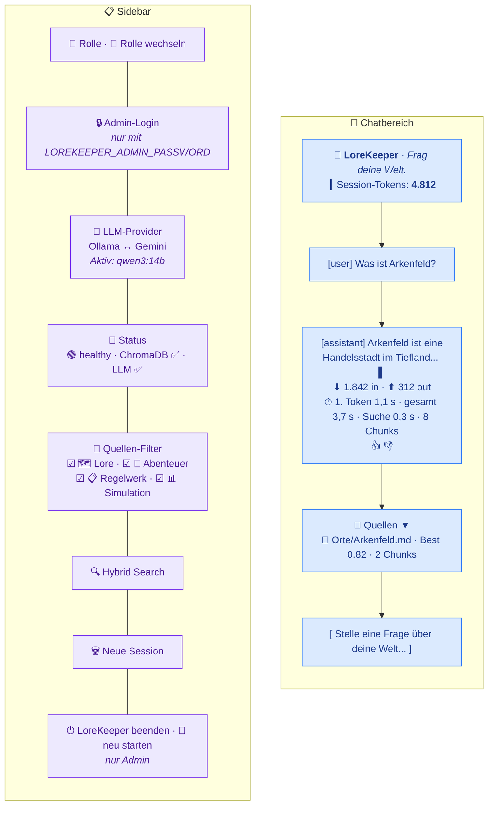
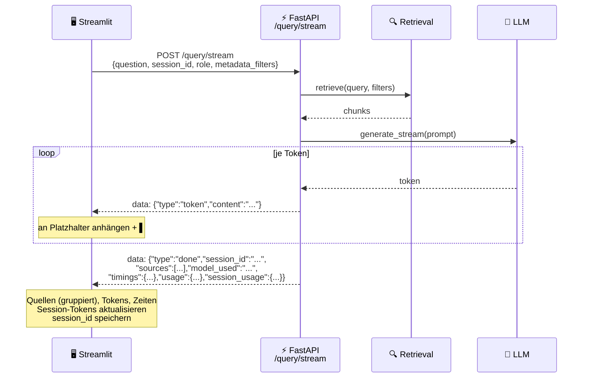

# Oberfläche (UI / UX)

Die Oberfläche von LoreKeeper ist komplett in Streamlit geschrieben. Dieses Dokument beschreibt
die Seiten, ihre Bedienung, wie sie mit dem FastAPI-Backend sprechen und welchen Session-State sie
nutzen. Die UI spricht nur über HTTP/SSE mit dem Backend und importiert keine Backend-Module.

## Inhaltsverzeichnis
1. [Chat](#chat)
   - [Rollenwahl: Spieler / Spielleiter](#rollenwahl-spieler--spielleiter)
2. [Sidebar](#sidebar)
3. [Kopfzeile](#kopfzeile)
4. [Chatbereich](#chatbereich)
5. [Sources-Seite (`ui/pages/1_Sources.py`)](#sources-seite-uipages1_sourcespy)
6. [Evaluation-Seite (`ui/pages/2_Evaluation.py`)](#evaluation-seite-uipages2_evaluationpy)
7. [Prompts-Seite (`ui/pages/3_Prompts.py`)](#prompts-seite-uipages3_promptspy)
8. [Settings-Seite (`ui/pages/4_Settings.py`)](#settings-seite-uipages4_settingspy)
9. [Antwortzeiten](#antwortzeiten)
10. [Session-State](#session-state)

---

## Chat



**Eingabefeld**: höchstens 4.000 Zeichen — dieselbe Grenze wie die API (`MAX_QUESTION_CHARS` in
`src/api/schemas.py`); das Feld hört auf anzunehmen, statt dass das Backend mit 422 antwortet.

### Rollenwahl: Spieler / Spielleiter

Bevor der Chat öffnet, fragt `ui/LoreKeeper.py` **„Wer fragt?“** mit zwei Knöpfen (Logik in
`ui/roles.py`):

| Rolle | Durchsucht | Sidebar |
|---|---|---|
| **🎲 Spieler** | Nur Quellen mit **🎲 Spieler** auf der Sources-Seite (`player_visible`; z.B. Regelwerk + Charakterbogen) — keine Lore, keine Abenteuer, kein Spielleiter-Material | Rolle, „🔄 Rolle wechseln“, Status, Hybrid; **keine** Quellen-/Kategoriefilter |
| **📜 Spielleiter** | Alles, mit den üblichen Filtern | Volle Sidebar |

- Jede Frage trägt `role` (`player` / `game_master`). Für Spieler baut das **Backend** die
  Einschränkung selbst aus `player_visible` (`src/api/access.py`) und verknüpft mitgeschickte
  Filter per `$and` — sie können nur einengen. Keine freigegebene Quelle → `403`.
- Als zweite Sicherung schickt die UI zusätzlich
  `metadata_filters = {"source_id": {"$in": [<Spieler-Quellen>]}}` (aus `/sidebar-state` →
  `player_source_ids`); Gruppen-/Kategoriefilter der Sidebar werden für Spieler ignoriert. Der
  Browser spricht nie direkt mit dem Backend (`127.0.0.1`).
- Backend-Sessions sind an die Rolle gebunden: eine Spieler-Anfrage mit Spielleiter-`session_id`
  bekommt eine neue Session — kein Spielleiter-Verlauf in einer Folgefrage, auch außerhalb der UI.
- **„🔄 Rolle wechseln“** führt zurück zur Auswahl und startet eine **neue Session** (Chat,
  Backend-Session, Token-Zähler).
- Ist keine Quelle für Spieler freigegeben, ist die Eingabe gesperrt, mit Hinweis auf die
  Sources-Seite.
- **Keine Zugangskontrolle:** Jeder kann „Spielleiter“ wählen — der Modus schützt vor
  versehentlichen Spoilern, er sperrt niemanden aus. Admin-Seiten und Provider-Steuerung hängen
  unabhängig von der Rolle am `LOREKEEPER_ADMIN_PASSWORD`.

---

## Sidebar

### Backend-URL und Zugriffsschutz (`ui/admin_gate.py`)

Die Backend-URL ist nicht in der UI änderbar, sie kommt aus `LOREKEEPER_API_URL` (Standard
`http://127.0.0.1:8000`; nicht `localhost` — unter Windows ~2 s pro Anfrage).

Mit `LOREKEEPER_ADMIN_PASSWORD` (Heimnetz-Server, siehe [operations.md](operations.md)):
- zeigen die Admin-Seiten (Sources, Evaluation, Prompts, Settings) nur ein Login-Formular und
  rufen das Backend erst nach dem Passwort auf;
- bleibt der Chat offen, aber Provider-Auswahl und Gemini-Key-Eingabe werden durch das aktive
  Modell und einen Ausklapper **🔒 Admin-Login** ersetzt;
- gilt ein erfolgreicher Login für die Browser-Session und schaltet alle Seiten frei;
- wird Raten serverweit gebremst: jedes falsche Passwort wartet 1 s, 5 Fehlversuche in 5 Minuten
  sperren den Login (beide Formulare, alle Sessions) für 5 Minuten. Angemeldete Sessions arbeiten
  weiter; ein UI-Neustart hebt die Sperre auf. Jeder Fehlversuch und die Sperre stehen als WARNING
  im Konsolenfenster der UI (die UI hat keine Logdatei).

Ohne Passwort ist alles offen (lokaler Einzelbetrieb).

### LLM-Provider

Auswahlfeld zum Wechsel zwischen Ollama und Gemini zur Laufzeit (mit Passwort nur für Admins).
Schlägt der Wechsel fehl, springt die Auswahl zurück und es erscheint eine Fehlermeldung.

**Gemini-Key:** Direkt darunter. `gemini_status` aus `/sidebar-state` sagt nur, ob ein Key da ist
(`{has_key, source: env|runtime|none}`), nie den Key selbst (dasselbe liefert einzeln
`GET /provider/gemini/status`).

| Zustand im Backend | Anzeige |
|---|---|
| Key aus Umgebung / `.env` | `🔑 Gemini-Key: ✅ (Umgebungsvariable)` + Ausklapper **Gemini-Key ändern** |
| Key in dieser Laufzeit über die UI gesetzt | `🔑 Gemini-Key: ✅ (UI-Eingabe)` + **Gemini-Key ändern** + **UI-Key entfernen** |
| Kein Key | Gelbe Warnung + offener Ausklapper **Gemini-Key eingeben** |

Im Ausklapper: Passwortfeld + **Key setzen** → `POST /provider/gemini/key`. Leere Eingabe wird
abgelehnt („Kein Key eingegeben.“) statt still den Key zu löschen; dafür gibt es **UI-Key
entfernen** (`{"api_key": null}`), nur solange der Key aus der UI stammt — ein Key aus `.env` bleibt
bis zur Änderung dort. Die Bestätigung erscheint nach dem Neuladen der Seite. Das Backend hält den
Key nur im Speicher (nie auf Platte, nach Neustart weg). Er wirkt sofort — für Gemini als aktiven
Provider wie als Fallback.

### Status

Aus `/sidebar-state` (in der UI 30 s gecacht; das Backend prüft im Hintergrund alle 60 s):
🟢 healthy (ChromaDB + LLM erreichbar) · 🟡 degraded (eine Komponente nicht erreichbar) ·
🔴 API nicht erreichbar. Darunter **Reranker**: „GPU ✅“, „CPU“, „noch nicht geladen“ oder „aus“ — und
eine Warnung, wenn DirectML eingestellt ist, der Reranker aber auf der CPU läuft (Antworten langsamer,
Ursache im Log; [operations.md](operations.md#reranker-läuft-auf-der-cpu-directml-warnung)). Ebenso eine
Warnung, wenn das lokale LLM über 1 GB im **geteilten GPU-Speicher** liegt (`llm_shared_gb` aus `/health`,
Roadmap 7b) — dann laufen Antworten mehrfach langsamer, obwohl `ollama ps` „100% GPU“ zeigt; die Warnung
verweist auf **🔄 LoreKeeper neu starten** (lädt das Modell neu, nachdem der VRAM frei ist).

### Hybrid Search

Eine Checkbox „🔍 Hybrid Search (BM25 + Vektor)“ unter **Suche**. Sie startet beim Default
`retrieval.hybrid.enabled` (`hybrid_default` aus `/sidebar-state`) und schickt ihren Wert **immer** als
`hybrid_search` mit — so überschreibt sie den Default **nur für diese Session** in beide Richtungen.
Bis 18.10. startete sie immer aus und schickte nur „an“: Mit Hybrid als Default ließ sie sich nicht
abschalten (Roadmap 13.6). Nützlich bei exakten Namen oder Regel-IDs. Die Standardwerte der Suche
stehen auf der Settings-Seite, A/B-Läufe auf der Evaluation-Seite; die Sidebar bleibt bewusst schlank.

### Quellen-Filter (Lore / Abenteuer / Regelwerk / Simulation)

Vier Checkboxen schränken die Suche über das Metadatum `group` ein, das jeder Chunk beim Indizieren
von seiner Quelle erbt ([configuration.md](configuration.md#quellen--configsourcesyaml)):

| Checkbox | `group` |
|---|---|
| 🗺️ **Lore** | `lore` |
| 📖 **Abenteuer** | `adventure` |
| 📋 **Regelwerk** | `rules` |
| 📊 **Simulation** | `simulation` (Balance-Berichte — für reine Regelfragen abwählen) |

Das löst ein echtes Mehrdeutigkeitsproblem: „Was kann der Zeitmagier?“ passt auf die
Regelwerk-Klasse **und** auf den NPC *Arkenfeld, den Zeitmagier*. Ohne 🗺️ Lore sucht LoreKeeper nur
im Regelwerk.

| Auswahl | Filter ans Backend |
|---|---|
| Alle vier | `None` (kein Filter) |
| Teilmenge | `{"group": {"$in": [...]}}` + Hinweis „🔍 Suche eingeschränkt auf: …“ |
| Keine | Eingabe blockiert mit Fehlermeldung (kein API-Aufruf) |

Der Retriever verknüpft das mit dem festen Filter `document_type != "image"` per `$and`.

Filter, Kategorie-Auswahl und Hybrid-Checkbox **überleben einen Seitenwechsel**: Streamlit verwirft den
Zustand der Widgets, sobald man eine andere Seite öffnet — vorher stand der Filter danach still wieder
auf „alles“. Die Werte liegen zusätzlich in `_keep_*`-Schlüsseln und geben den Startwert vor (13.6).

### Links und Neue Session

Hinweise auf **⚙ Sources** (Chunk-Zahl, Indizieren, Quellen) und **🛠 Settings**. **🗑️ Neue
Session** leert `messages` und `session_id` — die nächste Frage startet ohne Verlauf.

### LoreKeeper beenden und neu starten (`ui/shutdown.py`)

**⏻ LoreKeeper beenden** und darunter **🔄 LoreKeeper neu starten** (18.10., Roadmap 16) stehen unten in
der Sidebar jeder Seite (Chat und alle Admin-Seiten), nur für Admins (mit Passwort erst nach dem Login,
ohne Passwort für alle wie die Admin-Seiten). Der erste Klick fragt nach („alle Nutzer verlieren die
Verbindung“ bzw. „für ~30 s“), **Beenden** startet `stop.ps1`, **Neu starten** `stop.ps1 -Restart` —
beide losgelöst ohne Fenster (Ablauf: [operations.md](operations.md#server-im-heimnetz-lan)); der
Neustart behält den Modus (Server/Entwicklung) und räumt den VRAM, die Seite verbindet sich danach von
selbst wieder. **Abbrechen** nimmt die Frage zurück. Läuft eine Indizierung (`GET /ingest/active`), wird nicht beendet und die
Seite sagt warum; ist das Backend nicht erreichbar, wird trotzdem beendet. Die UI startet das Skript
selbst statt einen Backend-Endpunkt aufzurufen: UI und Backend laufen immer auf demselben PC, so
bleibt das Beenden hinter dem Admin-Login, ohne eine neue API-Route zu öffnen. Beim Seitenaufbau
keine Backend-Anfrage — die Ingest-Prüfung läuft erst beim Bestätigen.

---

## Kopfzeile

| Links | Rechts |
|---|---|
| `📜 LoreKeeper` + `Frag deine Welt.` | **Session-Tokens** — Summe aus rein + raus + Denken der aktuellen Session, Tooltip mit Aufschlüsselung; „🗑️ Neue Session“ setzt zurück |

---

## Chatbereich

### Nachrichten

- Frühere Nachrichten kommen aus `st.session_state.messages`.
- Unter jeder Antwort:
  - Tokens `⬇ N in · ⬆ N out · 🧠 N think` (Denken nur, wenn > 0),
  - Zeiten `⏱ 1. Token … · gesamt … · Suche … · N Chunks` (aus `timings`),
  - bei umgeschriebener Folgefrage „🔎 Gesucht nach: …“,
  - 👍/👎 (`st.feedback("thumbs")`) für Spieler und Spielleiter. Ein Klick schickt
    `POST /feedback` mit Frage, Antwort, Quelldateien, Modell, Rolle, Session und Zeiten;
    Zurücknehmen als `rating: null`. Nach einer Bewertung erscheint ein Feld für einen
    **Kommentar** (optional, höchstens 1.000 Zeichen, Enter oder „Kommentar speichern“ speichert — Roadmap 3.4, 14.10.). Das Feld steht in
    einem `st.form`, weil ein freies `st.text_input` schon beim Verlassen des Felds speichert — so
    kamen am 15.10. halbe Kommentare an, sobald man zwischendurch woanders hinklickte; jede
    Zeile trägt Bewertung und Kommentar zusammen, sodass eine spätere Änderung des einen das andere
    nicht verliert, Zurücknehmen löscht den Kommentar mit. Bewertung und Kommentar stehen zusätzlich in
    der Nachricht (`fb`, `fb_comment`) und füllen die Widgets nach einem Seitenwechsel wieder — vorher
    wirkte die Antwort danach unbewertet, und ein erneutes 👎 überschrieb den Kommentar mit einem leeren
    (13.6). Fehlermeldungen und ausgeblendete ältere Nachrichten haben keine Daumen. Anzeigen kostet
    keinen Backend-Aufruf — nur Klick und Enter.
- **🖼️ Bilder (n)** (zugeklappt, vor den Quellen): die Bilder, die die gefundenen Abschnitte in
  ihrer Notiz einbetten (`images` je Quelle, Roadmap 2) — jedes Bild einmal, in Quellen-Reihenfolge,
  höchstens 6, nur existierende Dateien, 300 px breit mit Dateiname. Nur Notizen, deren Name
  (Dateiname ohne `.md`) oder einer ihrer `aliases` aus dem Frontmatter (ganzes Wort, Groß-/Kleinschreibung
  egal) in Frage oder Antwort vorkommt — sonst zeigte eine schwach passende Quelle ein fremdes Porträt
  (15.10.: „wer ist lady lilith?“ bekam Liora Veylans Bild, Quelle Nr. 6, in der Antwort nicht erwähnt).
  Die Aliase decken Vor- und Spitznamen ab („Lyssara“, „Lilith“, „Malek“; seit 18.10., Roadmap 9 — 7 der
  11 Notizen mit Bildern haben welche); fehlt ein Name dort, fehlt auch das Bild. `st.image` liest die Datei auf
  dem Streamlit-Server, daher klappt es auch von einem anderen Gerät im Heimnetz. Im Spieler-Modus
  kommen nur Bilder freigegebener Quellen an (Auflösung je Quelle, siehe [parsing.md](parsing.md)).
- Quellen im Ausklapper **📎 Quellen**, nach Datei gruppiert (siehe unten).

### Streaming

Token für Token per Server-Sent Events, mit blinkendem `▌` bis zum `done`-Event; dann werden
Quellen, Tokens und Zeiten gerendert und die `session_id` für Folgefragen gespeichert.

Beantwortet das LLM gerade andere Fragen (Spielabend, mehrere fragen gleichzeitig), steht bis zum
ersten Token ein Hinweis da: „⏳ Das LLM beantwortet gerade eine andere Frage — deine kommt
danach.“ (`status`-Event). Ollama arbeitet eine Frage nach der anderen ab; bei vier gleichzeitigen
Fragen wartet die letzte bis zu ~17 s auf ihr erstes Token ([provider-strategy.md](provider-strategy.md)).

**Fehler und „🔁 Erneut senden“** (Roadmap 14.1, 17.10.): Ein `error`-Event, ein Fehler-Status des
Backends oder ein Verbindungsfehler („Läuft der Server?“) bleibt als Nachricht „⚠️ …“ im Verlauf —
vorher verschwand der Verbindungsfehler beim nächsten Rerun. Unter der **letzten** Nachricht steht
dann „🔁 Erneut senden“: Frage und Fehlermeldung verschwinden aus dem Verlauf und die Frage geht noch
einmal raus, ohne sie neu zu tippen (gedacht für Timeout, ladendes Ollama, Backend-Neustart). Ältere
Fehler im Verlauf haben keinen Knopf, ebenso während schon eine neue Frage unterwegs ist. Kostet
keine zusätzliche Backend-Anfrage — erst der Klick schickt die Frage.

Zwei Fälle ohne Fehler-Event behandelt der Chat seit 18.10. ebenso (Roadmap 13.6): Endet der Stream
**ohne `done`** (Backend mitten in der Antwort neu gestartet), ist das „⚠️ Antwort abgebrochen …“ mit
„🔁 Erneut senden“ — vorher blieb der abgeschnittene Text als bewertbare Antwort stehen. Wird eine
Antwort **unterbrochen** (Seitenwechsel oder Klick während des Streamings beendet das Skript), steht die
Frage ohne Antwort da; als letzte Nachricht bekommt sie „⚠️ Keine Antwort — die Anfrage wurde
unterbrochen.“ und „🔁 Erneut senden“.



| Feld im `done`-Event | Bedeutung |
|---|---|
| `usage` | Tokens **dieser** Anfrage (`tokens_in`, `tokens_out`, `tokens_thinking`) |
| `session_usage` | Session-Summe danach — für die Kopfzeile |
| `timings` | Zeiten je Stufe — für die Zeile ⏱ |

Das LLM-Timeout der Anfrage kommt aus dem gecachten `/sidebar-state` — eine Chat-Nachricht kostet
genau eine Backend-Anfrage.

### Quellen (nach Datei gruppiert)

```
📄 Orte/Arkenfeld.md — Best Score: 0.82 · 2 Chunks
    ▸ ↳ Arkenfeld > Überblick · Score 0.82      (aufklappbar: ganzer Chunk-Text)
    ▸ ↳ Arkenfeld > Geschichte · Score 0.71
```

Jeder Chunk ist ein eigener Ausklapper mit dem **ganzen Text, den das LLM bekommen hat** (seit 14.10.,
Roadmap 3.16) — so lässt sich eine Antwort direkt an der Quelle nachprüfen. Die Überschriftenzeile am
Anfang des Chunks entfällt (sie steht schon im Titel), `<br>` aus PDF-Tabellen wird zum Zeilenumbruch.
Ältere Nachrichten ohne Volltext zeigen die 100-Zeichen-Vorschau. Kein eigener Viewer: angezeigt werden
nur die Chunks dieser Antwort, im Spieler-Modus also nur freigegebene.

| Typ | Darstellung |
|---|---|
| Markdown / PDF (ein Chunk) | `📄 [Dateiname](file:///...) — Best Score`, darunter der Chunk als Ausklapper `↳ Überschrift · Score` |
| Markdown / PDF (mehrere) | Dieselbe Zeile mit `· N Chunks`; je Chunk ein Ausklapper `↳ Überschrift · Score` mit dem ganzen Text |
| Bild | `st.image(source_path)` mit Dateiname (vor den gruppierten Dokumenten) |

Links öffnen die Originaldatei lokal (z.B. in Obsidian); fehlt `source_path`, erscheint eine Warnung.

`tokens_thinking` füllt Gemini 2.5 (`thoughts_token_count`), wenn es denkt. Bei Ollama mit Qwen3
ist das Denken abgeschaltet — der Wert ist normalerweise 0 und wird nicht angezeigt.

---

## Sources-Seite (`ui/pages/1_Sources.py`)

Quellen aus `config/sources.yaml` verwalten, ohne YAML zu öffnen. Seitenauswahl oben in der Sidebar.

### 1. Indizierte Chunks + Indizieren

| Knopf | Backend | Hinweis |
|---|---|---|
| — (Kennzahl) | `GET /stats` | Gesamtzahl der Chunks; nach jedem Indizieren/Löschen aktualisiert |
| ⚡ **Nur Änderungen indizieren** | `POST /ingest` | Inkrementell, unveränderte Dateien werden übersprungen — der Normalfall |
| 🔄 **Alle Dokumente neu indizieren** | `POST /ingest?full=true` | Jede Datei; nötig nach Chunking-Änderungen |
| 🏷 **Recategorize** | `POST /sources/recategorize` | Schreibt nur `group` / `content_category` / `source_id` neu (Sekunden, kein Embedding) — für **alle** Quellen; nach geänderter `category_map` / `group`. Meldet „N Chunks aktualisiert · M unverändert · K ohne passende Quelle“ |

Alle Indizier-Vorgänge zeigen **nicht-blockierenden Fortschritt**: die Job-ID steht in
`st.session_state["_ingest_job"]`, das Fragment `_ingest_progress()`
(`st.fragment(run_every=1.5)`) fragt `GET /ingest/status/{job_id}` ab und zeigt den Stand in einem
`st.status`. Der Rest der Seite bleibt bedienbar, Klicks und Seitenwechsel verlieren den Job nicht;
Indizier-, Reindex-, Recategorize-, Entfernen- und Leeren-Knöpfe sind solange gesperrt (das
Backend lehnt diese Aktionen während eines Ingests ohnehin mit 409 ab). Am Ende erscheint einmal das Ergebnis — „X
Dokumente indiziert · Y unverändert übersprungen · N s“, erzeugte/aktualisierte/gelöschte Chunks,
Fehler als Warnungen. Ist das Backend ~45 s am Stück nicht erreichbar, endet die Anzeige mit
„Backend nicht erreichbar“ (der Job läuft im Backend weiter). Bei `409` (Job aus einer anderen
Browser-Session) hängt sich die Seite über `GET /ingest/active` an. Unter den Knöpfen stehen
Richtwerte für die Dauer (18.10.: Vault mit ~170 Notizen komplett neu ≈ 8 min, nur Änderungen meist
unter 1 min, Regelbuch-PDF ≈ 1–2 min).

### 2. Konfigurierte Quellen

Bearbeitbare Tabelle (`GET /sources`, Speichern über `PUT /sources`) mit *id, path, type, group,
default_category, category_map, 🎲 Spieler* (`player_visible`, wirkt sofort).

- `id` und `path` nur lesbar; `type` wird abgeleitet (`file` / `folder` / `missing`).
- `category_map` als Kurztext: `Ordner→kategorie` (erbt die Gruppe) oder
  `Ordner→kategorie:gruppe`. Beispiel: `NPCs→npc, Geschichte→story:adventure`.
- **💾 Änderungen speichern**; nicht angezeigte Felder (`exclude_patterns`) bleiben erhalten.
  Speichern leert den Streamlit-Cache, damit eine entzogene Spieler-Freigabe sofort wirkt.
- **🔄 Neu laden** übernimmt Änderungen von außen.

### 3. Aktionen pro Quelle

Je Quelle ein Ausklapper (`📁 {id} — {path}`):

| Knopf | Backend | Hinweis |
|---|---|---|
| 🔄 **Reindex** | `POST /sources/{id}/reindex` | Liest alle Dateien der Quelle neu ein (auch unveränderte), mit Fortschritt; die Quelle bleibt währenddessen durchsuchbar. Nötig nach geänderten Chunking-/Parser-Einstellungen oder Pfad |
| 🗑 **Source entfernen** | `DELETE /sources/{id}` | Entfernt Quelle **und** ihre Chunks; mit Bestätigungs-Checkbox |

**Ordner-Zuordnung:** `GET /sources/{id}/folders` (60 s gecacht) liefert die Ordner; eine zweite
Tabelle (*name, type, category, group*) ist mit der aktuellen `category_map` vorbelegt.
**💾 Zuordnung speichern** baut daraus die neue `category_map` und speichert per `PUT /sources`;
danach Recategorize. Einträge bekommen nur Zeilen, die von Default-Kategorie/-Group der Quelle
abweichen (nicht zugeordnete Ordner fallen ohnehin darauf zurück) — dieselbe Regel wie beim
Anlegen einer neuen Quelle.

### 4. Neue Quelle hinzufügen

| Schritt | UI | Backend |
|---|---|---|
| 1. Pfad eingeben und scannen | Textfeld + 🔍 Scannen | `POST /sources/scan` |
| 2. Einstellungen | ID (vorgeschlagen aus dem Namen), Gruppe, Default-Kategorie | — |
| 3. Ordner zuordnen (nur Ordner) | Tabelle mit den gescannten Ordnern | — |
| 4. Hinzufügen | ➕ | `PUT /sources` |

Das Scan-Ergebnis bleibt im Session-State über die Schritte erhalten. Die vorgeschlagene ID ist der
Name in Kleinbuchstaben, alles außer Buchstaben, Ziffern, `_` und `-` wird zu `-`. Freie IDs sind
erlaubt (nicht leer, eindeutig; das Backend lehnt `.`, `..` und Leerzeichen am Rand ab). Erfolgs-
meldungen überleben das Neuladen über `st.session_state["_flash"]`; Fehler zeigen den `detail`-Text
des Backends.

### 5. ⚠ Danger Zone

`POST /admin/wipe` (Body `{"confirm": "DELETE"}`) nach Eingabe von `DELETE` — leert die Collection
und danach alle UI-Caches (Chunk-Listen, Eval-Dateien, Statistik).

**Welche Aktion wann:** Tippfehler in `category_map` → Tabelle/Zuordnung speichern →
Recategorize. Pfad oder Inhalt geändert → speichern → Reindex. Quelle überflüssig → Source
entfernen. Neue Quelle → Schritte 1–4, dann Reindex. Datenbank kaputt (selten) → Danger Zone, dann
„Alle Dokumente neu indizieren“.

**Quellen-Identität:** Jeder Chunk trägt `source_id`; so kollidieren gleichnamige Dateien in
verschiedenen Quellen nicht. Eine umbenannte `id` gilt als neue Quelle — vorher die alte entfernen.

---

## Evaluation-Seite (`ui/pages/2_Evaluation.py`)

Golden Set pflegen, Suche testen, Evaluationen laufen lassen, Ergebnisse vergleichen. Sieben Tabs.
Hintergrund und Kennzahlen: [evaluation.md](evaluation.md).

Oben auf der Seite erklärt der Ausklapper **„ℹ️ Anleitung“** jeden Tab, wann man ihn braucht und
was die Zahlen bedeuten (Text in `ui/evaluation_guide.md` — bei neuen Tabs oder Kennzahlen dort
ergänzen).

Die Parameter-Regler (Kandidaten, finale Chunks, Max. pro Quelle) in „Frage testen“ und „Retrieval
Eval“ starten bei den Werten aus `settings.yaml` (`GET /config`, 60 s gecacht) — ein Lauf mit
unberührten Reglern misst also, was der Chat nutzt. Ist `/config` nicht erreichbar, gelten 20/8/3.

| Tab | Inhalt |
|---|---|
| **1 Golden Set** | Bearbeitbare Tabelle aller Fragen aus `evaluation/qa_pairs.yaml` (ID, Frage, Typ, Kategorie, erwartete Quellen, Antwort-Stichwörter, Abschnitt, Source-IDs, Notizen); **💾 Golden Set speichern** über `PUT /eval/qa-pairs`, Zeilen ohne ID oder Frage werden übersprungen |
| **2 Frage testen** | Eine Frage gegen den Retriever (`POST /eval/preview`, ohne LLM) mit einstellbaren Parametern; Tabelle der Chunks (Score, Quelle, Überschrift, Vorschau) + Latenz. Das Ergebnis bleibt im Session-State stehen, sodass sich die Frage danach ins Golden Set übernehmen lässt (erwartete Quellen vorbelegt, eine schon vergebene ID wird abgelehnt) |
| **3 Retrieval Eval** | Ganzes Golden Set ohne LLM als Hintergrund-Job (`POST /eval/run`, `GET /eval/status/{id}`); Trefferquote, Abschnitt-Trefferquote, Aufschlüsselung nach Typ, Details je Frage (⚠️ = richtige Datei, falscher Abschnitt); **⚖ A/B starten (Vektor vs. Hybrid)**; unter den Kennzahlen eine Zeile **Latenz p50/p95 · Chunks pro Frage Ø/max** (aus den Details berechnet, auch für alte Ergebnisse; Chunks inkl. Section Expansion); **🎯 Suchgenauigkeit prüfen** (`POST /eval/search-exactness`): „Exakt: N/N Golden-Fragen …“ oder eine Warnung mit den Fragen, bei denen die Vektorsuche Chunks der exakten Top-K verpasst, und dem Hinweis, `hnsw_ef_search` zu erhöhen |
| **4 End-to-End** | Golden Set mit LLM: Trefferquote, Answer-Contains-Quote, mittlere Latenz, je Frage `✅/⚠️ [ID] Frage — Datei ✅/❌` mit der ganzen Antwort und den erwarteten Stichwörtern (seit 14.10.; ältere Berichte haben nur 200 Zeichen und keine Stichwörter); eine fehlgeschlagene Anfrage als „💥 … — Anfrage fehlgeschlagen“ mit ihrem Fehler. Langsam (~35 min) |
| **5 Ergebnisse** | Gespeicherte Läufe (max. 3 je Typ): je Lauf Answer Contains (E2E), Hit Rate, Fragen und Retrieval-Config (K/R/C/H); **🔍** öffnet die Details (wie nach einem Lauf, bleibt offen bis „✖ Schließen“), **🗑** löscht. Zwei Läufe vergleichen: Hit Rate und bei zwei E2E-Läufen auch Answer Contains (mit Differenz), dazu je eine Tabelle der Fragen, deren Datei-Treffer bzw. Antwort gekippt ist. Bis 18.10. verglich die Seite nur Treffer — zwei E2E-Läufe mit anderer Answer-Contains-Quote zeigten „Keine Unterschiede“ (13.6) |
| **6 Feedback** | Aktuelle 👍/👎 je Chat-Antwort (`GET /feedback`, letzte Bewertung je `message_id`, zurückgenommene ausgelassen). Standard nur 👎, 👍 per Schalter; Spalte „Kommentar“ mit dem Freitext. Ausgewählte Zeilen werden zu Golden-Set-Fragen `f###` (`ui/feedback.py`): 👍 behält die Quellen der Antwort, 👎 bleibt leer mit Notiz zum Nachtragen; der Kommentar steht in der Notiz; umgeschriebene Folgefragen gehen in ihrer eigenständigen Form ein; Fragen, die schon im Golden Set stehen, werden übersprungen. Ändert sich die angezeigte Liste (👍-Schalter, neue Bewertungen), werden die Häkchen zurückgesetzt, damit keins auf eine andere Antwort rutscht |
| **7 Chunks** | Chunk-Inspector: Quelle wählen (`GET /sources`, 60 s gecacht), dann Datei (`GET /eval/chunks/files`), dann alle Chunks der Datei in Dokumentreihenfolge (`GET /eval/chunks`). Anzahl und min/Ø/max-Länge (unter 100 Zeichen markiert), Tabelle (Index, Überschriftenpfad, Länge, Textanfang), voller Text + Metadaten eines gewählten Chunks. Dateien und Chunks werden erst nach der Auswahl geladen; ein ChromaDB-Fehler erscheint als Fehlermeldung, nicht als leere Liste |

**Gemeinsame Bausteine:** `_render_tuning_sliders(prefix)` — drei Regler (Kandidaten, Finale Chunks,
Max pro Quelle, je bis 50) für „Frage testen“ und „Retrieval Eval“, dazu die Auswahl Config / nur
Vektor / Hybrid. Die Maxima sind fest: Hingen sie am Nachbarregler, war jede Änderung von „Kandidaten“
ein neues Widget, und die beiden anderen sprangen auf ihren Startwert zurück — gemessen wurde dann
etwas anderes als eingestellt (13.6). Stattdessen prüft `_params_error` vor dem Start
`top_k_rerank ≤ top_k` und `max_per_source ≤ top_k_rerank`; sonst Fehlermeldung, kein Lauf.

**Eval-Jobs** (Retrieval, A/B, End-to-End) laufen wie die Indizierung auf der Sources-Seite: Die Job-ID
steht in `st.session_state["_eval_job"]`, das Fragment `_eval_progress()` (`st.fragment(run_every=1.5)`,
oberhalb der Tabs) fragt `GET /eval/status/{id}` ab und zeigt „Frage N / 274“ — für E2E seit 18.10.
fortlaufend (vorher stand dort den ganzen Lauf „0 / 274“, `evaluate()` meldete keinen Fortschritt).
Klicks, Tab- und Seitenwechsel verlieren den Job nicht, die Start-Knöpfe sind solange gesperrt, alle
Tabs bleiben bedienbar. Vorher hing der Lauf an einer blockierenden Schleife im Seitenskript: Nach einem
Seitenwechsel war er weg, ein neuer Start scheiterte mit 409, und die Tabs hinter dem laufenden wurden
gar nicht gezeichnet. Bei `409` hängt sich die Seite über `GET /eval/active` an den laufenden Job; eine
neue Browser-Session (neu geladen, anderer Tab) fragt das einmal beim ersten Aufruf. A/B sind zwei Jobs
nacheinander — der Hybrid-Lauf startet, wenn der Vektor-Lauf fertig ist (hängt sich eine Session an
einen laufenden A/B-Lauf an, verfolgt sie nur den gerade laufenden Job). Das Ergebnis (`_eval_result`)
erscheint in seinem Tab und bleibt bis zum nächsten Lauf stehen; Berichte lädt `_fetch_result`
(10 min gecacht — ein Bericht ändert sich nicht). Ein 404 (Backend neu gestartet) beendet die Anzeige
sofort; ist das Backend ~45 s am Stück nicht erreichbar, endet sie mit Hinweis auf „Ergebnisse“ — der
Lauf geht im Backend ggf. weiter.

---

## Prompts-Seite (`ui/pages/3_Prompts.py`)

Prompt-Templates bearbeiten, Varianten verwalten und vergleichen — ohne YAML. Details zu den
Templates: [prompts.md](prompts.md).

| Tab | Inhalt |
|---|---|
| **Aktive Prompts** | Vier Textfelder (System, QA, Condense, No-Context) mit Variablen-Hilfe und **Vorschau** (`POST /prompts/preview`); **💾 Aktive Prompts speichern** schreibt `config/prompts.yaml` und lädt den `PromptManager` neu |
| **Varianten** | Aktive Prompts als benannte Variante speichern; je Variante Textfelder, Beschreibung, **💾 Speichern**, **Aktivieren** (überschreibt `prompts.yaml` + Neuladen), **🗑 Löschen**. Aktive Variante mit ✅ — aktiv heißt: die vier Templates stimmen mit `prompts.yaml` überein. Nach **Aktivieren** zeigt „Aktive Prompts“ die neue Variante, nach **Kopie speichern** unter einem vorhandenen Namen zeigt die Variante die neuen Texte: Die betroffenen Textfelder werden verworfen und neu gefüllt — ein Textfeld mit `key` behält sonst seinen alten Inhalt, bis 18.10. setzte Speichern in „Aktive Prompts“ danach die alte Variante zurück (13.6). Die Erfolgsmeldung kommt über `_flash` |
| **Vergleichen** | Zwei Varianten (oder „(Aktiv)“) nebeneinander; Templates mit ⚠ unterschiedlich / ✅ gleich |

Alle Abrufe sind 10 s gecacht und werden nach Änderungen geleert.

---

## Settings-Seite (`ui/pages/4_Settings.py`)

Zentrale Stelle für die zur Laufzeit änderbaren Werte. Liest über `GET /config`, schreibt nur
Geändertes über `PUT /config` nach `config/settings.local.yaml` **und** in die laufenden Dienste —
kein Neustart. Welche Schlüssel änderbar sind: [configuration.md](configuration.md#bearbeiten-über-die-ui).

| Tab | Bereich | Wirkung |
|---|---|---|
| 🔎 **Retrieval** | Kandidaten (`top_k`, 1–50), Score-Schwelle (0–0,9; unter 0,3 nur Rauschen), Reranking an/aus, Finale Chunks, Max. Chunks pro Quelle (0 = unbegrenzt), Hybrid-Default, BM25-Anteil, BM25-Kandidaten | nächste Frage |
| 🧠 **LLM** | Je Provider Temperatur, Top-p, Max Tokens, Timeout; Fallback an/aus. Das Modell wird nur angezeigt (Wechsel über `settings.yaml`) | nächste Frage |
| 💬 **Conversation** | `window_size`, Condense an/aus, Session-Timeout | nächste Frage / nächster GC-Lauf |
| 📥 **Ingestion** | Chunking-Strategie und -Größen | **erst nach Neu-Indizieren** (Warnbanner) |
| Nur lesen | `embeddings.*`, `vectorstore.*` | Änderung über `.env`/`settings.yaml` + Neustart |

Intern werden die verschachtelten Pydantic-Objekte **an Ort und Stelle** geändert — Dienste mit
Referenzen darauf (Retriever, ConversationManager, Provider) sehen die neuen Werte beim nächsten
Aufruf, eine laufende Anfrage bricht nicht ab. Alle Tabs speichern über dasselbe `_save(...)`: nur
die Differenz wird geschickt (ohne Änderung erscheint **Keine Änderungen** und es gibt keinen
Aufruf), danach lädt die Seite neu und zeigt **„Gespeichert.“** über `_flash` (ein `st.success`
direkt vor dem Neuladen wäre sofort wieder weg). Lehnt das Backend einen Wert ab (422, z.B.
Overlap ≥ Chunk-Größe), steht die Begründung in der Fehlermeldung. LLM- und Retrieval-Änderungen leeren
alle Caches, weil der Chat LLM-Timeout und Hybrid-Default aus dem gecachten `/sidebar-state` liest.

Die Regler haben feste Bereiche (Finale Chunks und Max. pro Quelle bis 50, unabhängig von „Kandidaten“ —
Grund wie auf der Evaluation-Seite, 13.6); „💾 Retrieval speichern“ lehnt `top_k_rerank > top_k` oder
`max_per_source > top_k_rerank` mit einer Meldung ab. Steht in `settings.yaml` ein Wert außerhalb eines
Reglerbereichs (von Hand gesetzt, z.B. `top_k: 60`), zeigt die Seite ihn begrenzt mit einer Warnung
über dem Regler — vorher brach die ganze Seite ab; Speichern übernimmt den angezeigten Wert.

---

## Antwortzeiten

| Aktion | Typisch |
|--------|---------|
| Rerun der Sidebar | < 0,1 s (gecachte Aufrufe) |
| Frage mit Ollama qwen3:14b (warm) | erster Token ~2 s, gesamt je nach Länge 2,6–18 s, lange Listen bis ~34 s (Messwerte: [ARCHITECTURE.md](../ARCHITECTURE.md) → Hardware) |
| Erste Frage nach > 1 h Pause | +~16 s (Ollama lädt das Modell neu, `OLLAMA_KEEP_ALIVE`) |
| Frage mit Gemini 2.5 Flash | 3–8 s gesamt |
| Retrieval | p50 ~0,27 s, p95 ~0,36 s (Embedding ~0,04 s, Suche ~0,02 s, Eintrags-Slot 0,03–0,13 s, Reranking 0,07–0,16 s auf der GPU; CPU-Rückfall Sekunden — 14.10.) |
| Backend-Start | ~18 s bis `/health` |

Embedding-Modell und Reranker werden beim Start geladen — die erste Frage ist nicht langsamer als
die folgenden. Die Zahl der Backend-Aufrufe pro Seite prüft `tests/ui/test_backend_calls.py`.

**Fehler vom Backend** zeigen alle Seiten gleich: `ui/backend.py:raise_for_status` macht aus einer
Nicht-2xx-Antwort `BackendError` mit Statuscode und dem `detail`-Text des Backends (bei 422 nur die
Meldungen). Alle Lesezugriffe laufen über `get_json` (GET + Statusprüfung + JSON) — vorher wurde
bei 21 Aufrufen eine Fehlerantwort als Daten genommen (z.B. hätte „Zum Golden Set hinzufügen“ nach
einem fehlgeschlagenen Lesen das Golden Set mit einer einzigen Frage überschrieben). Auch
Löschaufrufe (Varianten, Eval-Ergebnisse) prüfen den Status; Variantennamen gehen URL-kodiert in den
Pfad. Kennt das Backend einen Ingest- oder Eval-Job nicht mehr (404, z.B. nach einem Neustart),
beenden die Fortschrittsanzeigen sofort mit dieser Meldung statt ~45 s „nicht erreichbar“.

---

## Session-State

| Schlüssel | Typ | Bedeutung |
|-----------|-----|-----------|
| `messages` | `list[dict]` | Chatverlauf inkl. `sources`, `usage`, `timings` je Nachricht |
| `session_id` | `str \| None` | UUID der Backend-Session für Folgefragen |
| `session_usage` | `dict` | Session-Summe `{tokens_in, tokens_out, tokens_thinking}` für die Kopfzeile |
| `_role` | `"player" \| "game_master"` | Gewählte Rolle; fehlt → Rollenauswahl. Entfernen (Rolle wechseln) setzt Chat und Session zurück |
| `_is_admin` | `bool` | Nach erfolgreichem Admin-Login; schaltet Admin-Seiten und Provider-Steuerung frei |
| `_selected_provider` | `str` | Gewählter Provider (Widget-State) |
| `_confirm_power` | `str` | Offene Rückfrage von **⏻ LoreKeeper beenden** (`"stop"`) oder **🔄 neu starten** (`"restart"`) |
| `_provider_switch_ok` / `_provider_switch_error` | `bool` / `str` | Kurzzeit-Flags nach einem Provider-Wechsel |
| `_ingest_job` | `dict \| None` | Sources-Seite: verfolgter Indizier-Job `{id, label, failures}` |
| `_ingest_result` | `dict` | Sources-Seite: Endstand des letzten Indizier-Jobs, einmal angezeigt |
| `_flash` | `str` | Sources-, Settings- und Prompts-Seite: Erfolgsmeldung, die ein Neuladen überlebt |
| `_eval_job` | `dict` | Evaluation-Seite: verfolgter Eval-Job `{id, kind, label, failures[, params, first]}` (`kind`: `retrieval`, `e2e`, `ab_vec`/`ab_hyb`) |
| `_eval_result` | `dict` | Evaluation-Seite: Ergebnis des letzten Eval-Jobs für seinen Tab `{kind, label, state, file, first, error}` |
| `_eval_attach_checked` | `bool` | Evaluation-Seite: `GET /eval/active` in dieser Session schon gefragt |
| `_eval_view` | `str` | Evaluation-Seite: im Tab „Ergebnisse“ geöffneter Bericht |
| `_preview` | `dict` | Evaluation-Seite: Ergebnis von „Frage testen“ (bleibt für „➕ Hinzufügen“ stehen) |
| `_category_filter` / `_content_category_filter` | `dict \| str \| None` | Chat: Gruppen- bzw. Kategorie-Filter aus der Sidebar (`"__BLOCKED__"` = keine Gruppe gewählt) |
| `_hybrid_search` | `bool` | Chat: Hybrid-Checkbox, geht als `hybrid_search` mit jeder Frage |
| `_keep_src_*` / `_keep_cats` / `_keep_hybrid` | `bool` / `list` / `bool` | Chat: Kopien der Sidebar-Filter, die einen Seitenwechsel überleben (13.6) |
| `_retry_prompt` | `str` | Chat: von „🔁 Erneut senden“ vorgemerkte Frage |
| `_gemini_key_msg` | `str` | Chat-Sidebar: Bestätigung nach Setzen/Entfernen des Gemini-Keys |
| `_scan_result` / `_scanned_path` | `dict \| None` / `str` | Sources-Seite: Ergebnis von `POST /sources/scan` und der gescannte Pfad |
